# VR 玩具箱（VRToyBox）

UE 5.8 + OpenXR 的 C++ 小工程。第一个场景：

- 一间 6m × 6m 的小工作室，你站在一张桌子前面；
- 桌上一个支架触屏，用食指戳 **SPAWN CUBE**，桌上就掉下一个随机颜色的 10cm 方块；**CLEAR ALL** 清空；
- 方块可以用拇指和食指捏起来（扣扳机）、换手、扔出去；捏起时保持捏住那一刻的位置和角度，捏合点有一个半透明小球表示范围。
- 左摇杆平滑移动，右摇杆左右快速转身，右摇杆往前推瞄准传送（抛物线 + 落点圈）。
- 触屏上能摆出三个爆炸图模型（一次一个，换模型时先收起原来的）：**三相电机**（ITBasics 里的 YE4-132M-4）、**气动球阀**（three.js 写的三片式球阀 + 齿轮齿条气动执行器）和**涵道无人机**（ITBasics 里的 3 寸涵道穿越机），都缩放到最长边约 0.5 米。**SHOW/HIDE MOTOR / VALVE / DRONE** 摆出 / 收起，**EXPLODE/ASSEMBLE** 让桌上的模型在爆炸图和原始装配之间切换，零件按真实拆装顺序先后飞出。
- **零件抓取查看**：装配状态下抓电机任意位置 = 拿起整台电机；爆炸后每个零件（转子总成、端盖、风扇、螺钉……共 27 个抓取单元）都能单独抓起来看，手边浮出中文信息牌（名字、材料、作用）。松手零件自己飞回原位，拿着靠近原位 5cm 会出现半透明虚影、松手吸回去；触屏 **RESET PARTS** 一键全部复位。

房间、桌子、触屏、方块都是 C++ 用引擎自带的基础形状拼出来的，每一处改动都能在 PR 里看 diff。二进制资产只有：电机、阀门、无人机模型（`Content/Models/Motor`、`Valve`、`Drone`）和虚影 / 高亮用的半透明材质（`Content/Materials/M_ToyGhost`），由脚本生成，见下面「电机模型从哪来」「阀门模型从哪来」「无人机模型从哪来」；手模型（`Content/XRMannequins`），是从 UE 自带的 VR 模板拷来的，见「手的模型」。

## 怎么跑（Windows）

需要：UE 5.8（Epic 启动器安装）、Visual Studio 2022 的「使用 C++ 的游戏开发」工作负载、git。

| 双击 | 做什么 |
| --- | --- |
| `一键启动.bat` | 检查 main 更新 → 编译 C++ → 打开编辑器 |
| `一键启动_VR直玩.bat` | 检查更新 → 编译 → 不开编辑器，直接进头显 |
| `检查更新.bat` | 只检查并拉取 main 的更新 |
| `导入电机模型.bat` | 电机模型改了才需要：重新生成并导入（见下文） |
| `导入阀门模型.bat` | 球阀模型改了才需要：从打包好的 html 导出 glb 并导入（见下文） |
| `导入无人机模型.bat` | 无人机模型改了才需要：ITBasics 里用 Blender 重新生成并导入（见下文） |

- 引擎不在 `C:\Program Files\Epic Games\UE_5.8` 的话，先设置环境变量 `UE_ROOT` 指向引擎根目录（脚本也会读 Epic 启动器写的注册表）。
- 更新脚本只在「当前在 main、没有未提交改动、本地没有 main 上没有的提交」时才 `git pull --ff-only`，其他情况只提示不动手，避免把你的改动搞乱。
- 编辑器里：Play 按钮旁的下拉菜单选 **VR Preview** 进头显；直接点 Play 是桌面调试模式。

### 操作

| | VR | 桌面调试模式（没戴头显） |
| --- | --- | --- |
| 点触屏按钮 | 食指戳（不按扳机时食指是伸直的） | 鼠标左键点 |
| 捏起方块 / 零件 / 整机 | 捏合点的小球碰到东西（小球变绿、东西变亮）时**扣扳机** | 鼠标指着按住左键（左键 = 扳机） |
| 松手 | 松开扳机（零件自动飞回原位；方块挥手松开会扔出去） | 松开左键 |
| 握把 | 只弯中指、无名指、小指，**不参与抓取** | — |
| 平滑移动 | 左摇杆（方向跟着头的朝向，1.5 m/s，挡墙和桌子） | WASD |
| 转身 | 右摇杆左右，45° 一档 | 按住右键拖动 |
| 传送 | 右摇杆往前推：右手出抛物线和落点圈（青色 = 能去，红色 = 不能），摇杆回中就传过去 | 按住 T 沿鼠标方向瞄准，松开 T 传送 |
| 零件复位 | 松手自动飞回；或戳 RESET PARTS | 松开左键 |
| 远近 | 走过去 | 滚轮 |

| 移动后（S 后退） | 传送：落点在地上（青色） | 传送：落点在桌上（红色，不传） |
| --- | --- | --- |
| 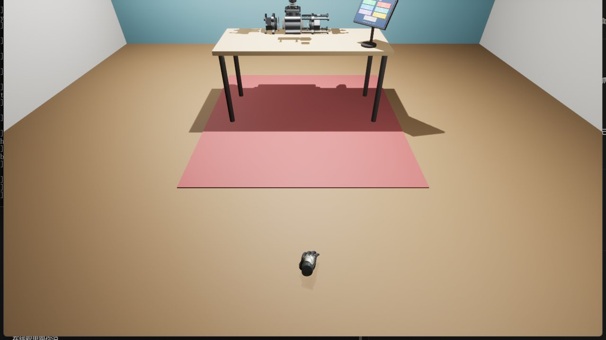 | 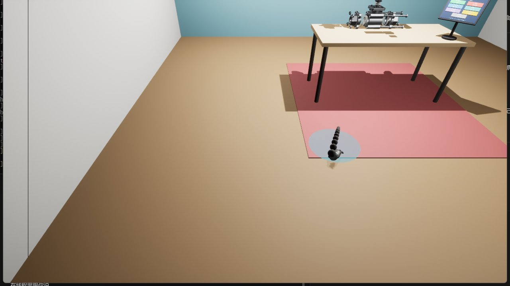 | 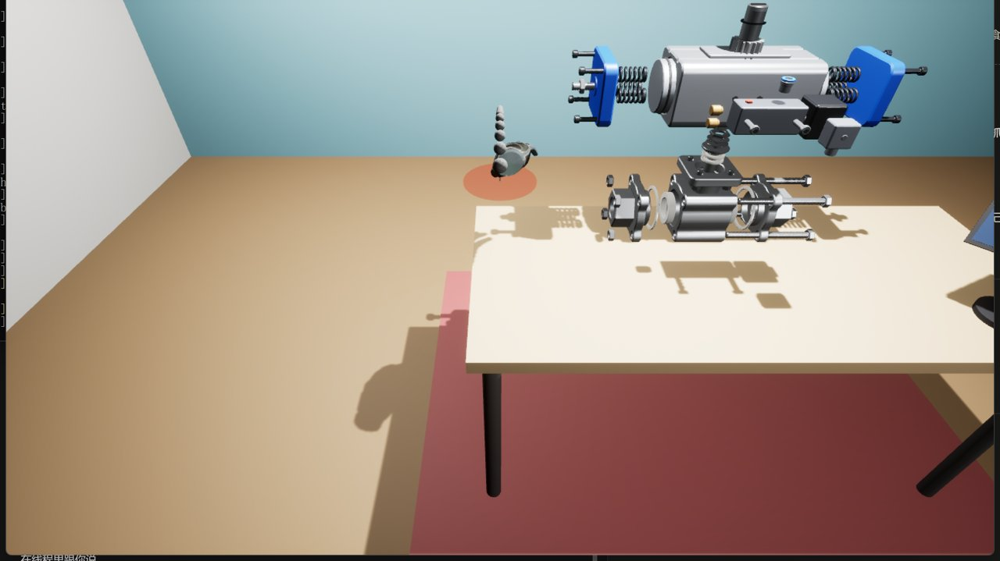 |

控制台输入 `toy.ShowGrabPoints 1` 可以在游戏里看到手和方块的抓点箭头（之后生成的方块生效）。`toy.PalmSnap 1` 切回旧的"手掌贴合"抓法（见「零件抓取」）。`toy.HandPreview 1 / 2 / 3` 在桌面模式下把左手侧着摆到镜头前（张开 / 握拳 / 来回握），用来检查手模型。

## 手的模型

| 张开 | 握拳 | 抓转子 |
| --- | --- | --- |
| 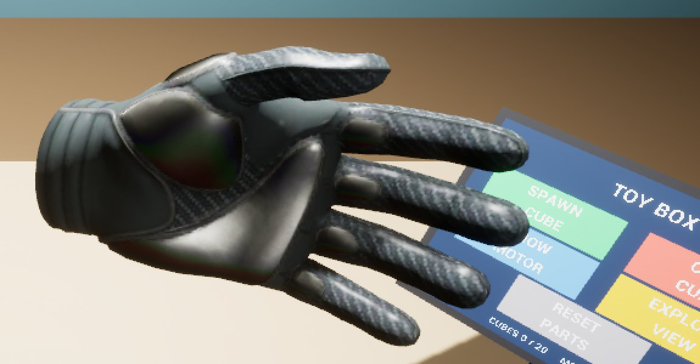 | 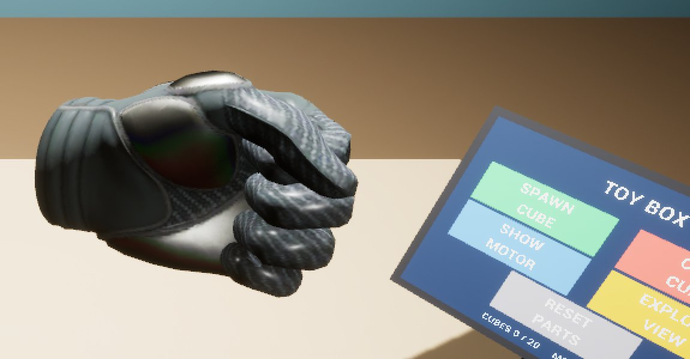 | 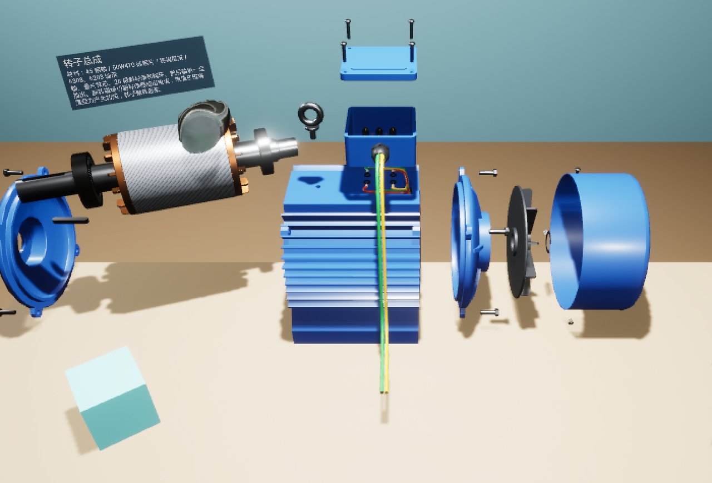 |

- **来源**：UE 5.8 自带的 VR 模板里的 MannyXR 手（引擎目录 `Templates/TemplateResources/Standard/XRMannequins`，模板创建工程时挂在 `/Game/XRMannequins`）。只拷了用得到的：左右手骨骼网格、骨架、Manny 材质和贴图、4 个右手动画（Idle 张开、Grasp 握、IndexCurl 食指弯、ThumbUp 竖拇指），共 31 个文件约 14MB，放在 `Content/XRMannequins`，路径和模板一致，引用不会断。Epic 的模板内容在 UE 项目里随便用。
- **怎么驱动手指**（`AToyHand::SetupHandMesh / ApplyFingerPose`）：不用动画蓝图。开局从动画里取出每根手指骨骼的"张开"和"握拳"两个局部姿势，之后每帧按手指分组在两者之间插值：扳机 → 拇指和食指一起合拢成"捏"（按满时食指 0.45、拇指 0.55，两个指尖刚好碰上）；握把 → 中指、无名指、小指。捏着东西时拇指食指保持捏合。
  - 模板的 Grasp 其实是"指"的手势（食指伸直），所以每根骨骼在 Grasp 和 IndexCurl 里挑弯得最多的那个当"握拳"；拇指没有现成的扣下动画，用 ThumbUp（竖起）的反方向转动 × 0.8。
  - 左手：模板只有右手动画。左手网格是右手的镜像，用两只手的参考姿势比出骨骼的镜像规则（日志：`左手骨骼镜像规则 0，手指参考姿势总误差 0.0052`），右手的姿势按这个规则镜像过去。
- **网格怎么摆**：从骨骼自动算，不靠手调角度——手腕→中指根 = 手指方向，握拳时中指尖移动的方向 = 掌心方向；手掌中心放在握把姿态手背一侧 3cm（和原来基础形状的手一样），所以 GripPoint 抓点、方块和零件的贴合都不用改。
- **指尖**：食指尖（戳屏 PokeTip）和拇指尖 = 末节骨骼再沿骨骼方向延伸 0.85 节。**捏合点锚定在手上的一个固定点**：开局按"扳机按满"的手势量一次两指尖的中点（右手在手坐标 (5.7, -5.4, 0.6)），之后不随手指弯曲移动，扣扳机的过程中判定点和范围小球不会跟着手指跑。

## 手部校准（VR）

**为什么手的角度会不对。** 手模型按"手指沿握把姿态 +X"摆（桌面模式、`toy.HandPreview` 都靠这个约定）。但 OpenXR 的握把姿态（grip）换算到 UE 后，+X 是握拳时四指围成的"管子"轴（沿着握把、从小指指向拇指），不是手指指的方向。结果 VR 里手多转了约 64°，手指往握把上端、拇指那边翘。掌心朝向、左右、侧偏都是对的。

**怎么修的**（`ToyHandCalib`、`AToyBoxPawn::ApplyHandCalib`）：手挂到握把姿态上之后，再给手 Actor 加一个相对变换，绕掌心中心转。HandMesh 的摆法不动，所以只影响 VR，桌面模式和 `toy.HandPreview` 一点不变。

- 默认 **Pitch -64°**（UE 5.7/5.8 VR 模板对同一只 MannyXR 手用的角度），Yaw 0、Roll 0、平移 0。合理范围 -55 ~ -85：-60 对齐手柄指向（aim），-70 对齐 Meta 的 grip_surface。Quest 3 的 Touch Plus 手柄据社区说握持角度和老手柄不一样（没有官方数据），剩下的误差只能戴上头显调。
- 参数以右手为准，左手自动镜像（Pitch 不变，Yaw / Roll / 左右平移取反）。
- 桌面自检（开局日志）：`ToyBox HandCalib 自检：右手 手腕→中指根 … → 握把系 (0.44, -0.00, -0.90)`，和 VR 模板的手指方向一致。
- 进 VR 后追踪生效时打一次 `ToyBox 姿态诊断：RightAim 相对 RightGrip …`、`RightPalm 相对 RightGrip …`。期望 Aim ≈ Pitch -60、Palm ≈ Pitch -70。如果 Palm 和 Grip 完全一样，说明运行时没给掌心姿态（退回了握把）；如果 Aim 不是 -60，Pitch 默认值跟着平移同样的差值。
- 传送抛物线改从右手的**瞄准姿态**（RightAim，手柄实际指的方向）发出；以前从握把姿态 +X 发出，比实际指向高约 60°。

**在头显里调（不用重新编译）：**

1. **长按左摇杆 1 秒**进入校准模式（手柄震一下），右手上方出现一块牌子显示当前数值；这时移动、转身、传送都暂停。
2. **角度页**：右摇杆上下 = Pitch，左右 = Yaw，左摇杆左右 = Roll（每秒 30°）。
3. 按 **A** 切到**位置页**：右摇杆上下 = 前后（X），左右 = 左右（Y），左摇杆上下 = 上下（Z）（每秒 2cm）。再按 A 切回角度页。
4. 按 **B** 恢复默认。每变 1° 或 0.5cm 右手柄轻震一下。
5. 调到手模型和真手（手柄）对上，**再长按左摇杆 1 秒退出**，自动存进 `Saved/Config/Windows/GameUserSettings.ini` 的 `[ToyBox.HandCalib]`，下次开局读回来；日志里打一行 `ToyBox HandCalib: Pitch=… Yaw=… Roll=… Off=(…)`。把这一行发回来，就写成代码默认值。

控制台也能直接改：`toy.HandPitch -64`、`toy.HandYaw`、`toy.HandRoll`、`toy.HandOffsetX/Y/Z`（厘米），`toy.HandCalibSave` 存盘。

**Virtual Desktop 的偏移**：VD 的 OpenXR 运行时（VDXR）可以在注册表 `HKLM\SOFTWARE\Virtual Desktop, Inc.\OpenXR` 里给 grip / aim / palm 加全局偏移（影响所有应用）。这台电脑上这个键不存在，也就是没设偏移（全是默认 0）；当前 OpenXR 运行时是 VDXR。

## 电机模型从哪来

```
ITBasics/三相电机爆炸图/build_motor.py ──Blender──▶ motor.glb ──Tools/import_model.py──▶ Content/Models/Motor/*.uasset
                                                    （零件 + extras 里的爆炸路线）            + parts.json（爆炸图清单）
```

- `导入电机模型.bat` 依次：找到或克隆 ITBasics（同级目录 `..\ITBasics`，或环境变量 `ITBASICS_DIR`）→ 用 Blender 跑 `build_motor.py` → 编译 → 用编辑器命令行跑 `Tools/import_model.py`（`MODEL_NAME=Motor`）。
- 导入结果提交在仓库里，所以平时直接用，不需要装 Blender。
- **为什么要 parts.json**：glb 里每个零件的爆炸路线写在节点的 extras 里，UE 导入时不会保留这些自定义数据，所以导入脚本自己读 glb，把它换算成 UE 坐标（厘米）另存一份。
- **爆炸动画**：和 ITBasics 的 Blender 动画、网页版是同一个公式。每个零件有几段位移，每段有一个"出场时刻" s，在总进度 T 的 `[0.6s, 0.6s+0.4]` 区间里缓动走完，所以接线盒盖先飞、转子后抽出；收回时 T 倒着走，顺序自然反过来。
- **抓取单元**：导入脚本还会按爆炸路线把 84 个网格分成 28 个抓取单元，写进 parts.json 的 `units`（见下面「零件抓取」）。只改了抓点规则时用 `MODEL_MANIFEST_ONLY=1` 只重写 parts.json，不重新导入资产。
- **大小**：运行时按装配状态的最长边缩放到 50cm（`AToyStudio::ModelLengthCm`）。注意 YE4-132M 实物本身就接近半米长，所以这其实接近 1:1，不是放大；想要更大改这个数就行。

## 阀门模型从哪来（气动球阀）

| 装配 | 爆炸 | 捏球体 |
| --- | --- | --- |
| 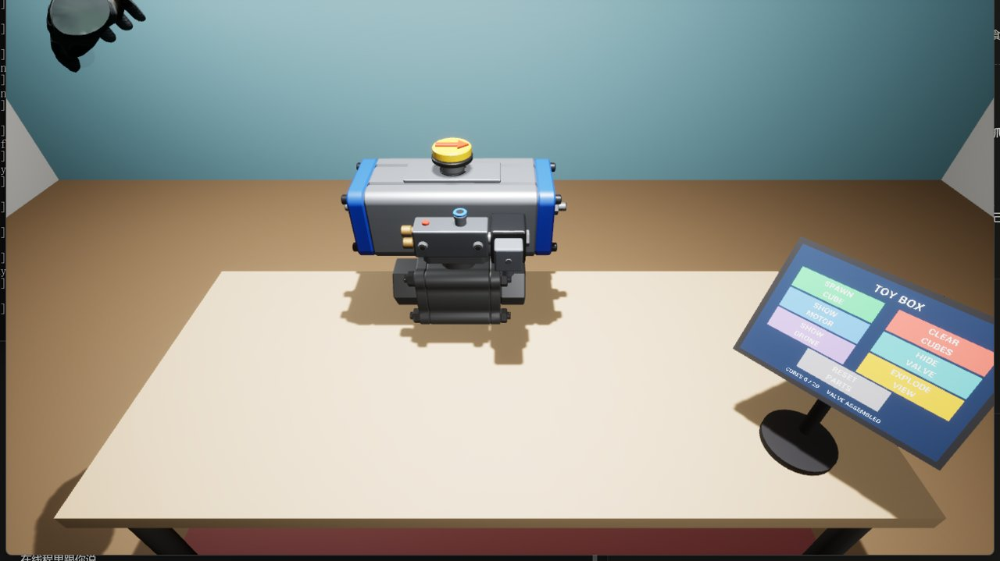 | 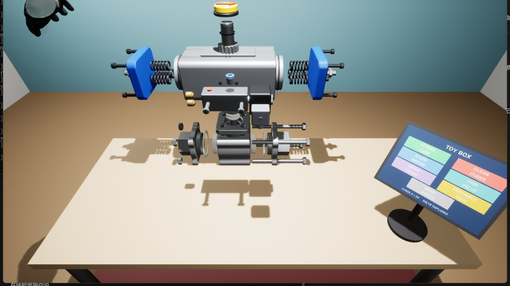 | 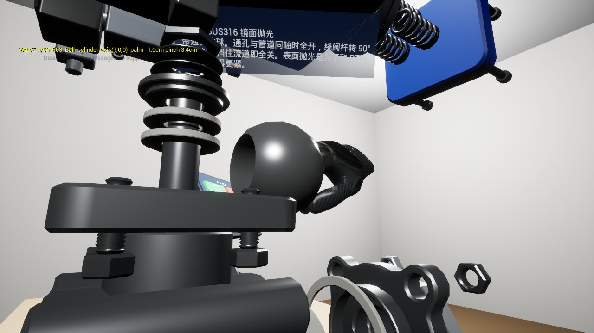 |

```
气动球阀爆炸图.html（打包好的单个 html，three.js + 应用代码都压缩在里面）
    ──Tools/export_ball_valve_glb.mjs（无头 Chrome，插钩子取出零件表，第二份 three.js 的 GLTFExporter 导出）──▶ ball_valve.glb
    ──Tools/import_model.py（MODEL_NAME=Valve）──▶ Content/Models/Valve/*.uasset + parts.json
```

- **模型**：三片式气动球阀 + 齿轮齿条单作用执行器（弹簧复位，断气即关），29 种零件 64 个实例：阀体、端盖、镜面球体、PTFE 阀座、双头螺柱、阀杆、填料、碟形弹簧、执行器缸体、齿轮轴、两只带齿条的活塞、6 根复位弹簧、电磁阀、消声器……原始尺寸约 19.7 × 11.7 × 18 cm，放大 2.54 倍到最长边 50cm。原来的蝶阀已经从玩具箱里删掉（源码还在 codex_localAI / ITBasics 里，没动）。
- **源码在哪**：只有打包好的单文件 html（`C:\work\codex_localAI\气动球阀爆炸图.html`，同一份也在 `work\orig\pbv.html`，旁边有格式化过的代码 `app.pretty.js` 方便看）。`导入阀门模型.bat` 按 `BALL_VALVE_HTML` → `..\ITBasics\气动阀门爆炸图\气动球阀爆炸图.html` → `C:\work\codex_localAI\气动球阀爆炸图.html` 的顺序找；导出要用一个装了 three、esbuild、puppeteer-core 的 `node_modules`（`VALVE_NODE_MODULES`，默认 `C:\work\codex_localAI\work\node_modules`）。导入结果提交在本仓库，平时不需要源码。
- **导出怎么做的**：html 里的 three.js 和应用代码都是压缩过的，拿不到导出器，也没法改源码。`export_ball_valve_glb.mjs` 在页面里插一行钩子，把应用闭包里的零件表、装配根节点、状态和"按状态摆零件"的函数挂到 `window` 上；再额外打包一份 three.js + `GLTFExporter`。无头 Chrome 打开页面后，把状态拨到"装配、阀门全关"，每个零件实例的网格按装配位置烘焙进顶点（毫米 → 米），用第二份 three 重建并导出；零件编号、中文名、材料、作用、爆炸路线写进节点 extras（和电机、无人机同一个约定）。节点名用英文（`P03_Ball`、`P17_Pinion`……，对照表在脚本里）。
  - ⚠️ 钩子靠的是这一版 html 压缩后的变量名（零件表 `xi`、根节点 `uo`、状态 `xt`、摆零件 `Bc`）。网页重新打包后变量名会变，脚本会直接报"找不到零件表的定义"，要照着 `app.pretty.js` 改一下钩子。
  - 材质按颜色 + 金属度 + 粗糙度合并成 21 种；金属度封顶 0.8、粗糙度至少 0.25（工作室没有反射探针，镜面球体否则会反射成黑块）。
- **爆炸距离**：网页版执行器整体往上飞 15cm、里面的零件再往上飞，放大 2.5 倍会冲出视野，所以 `explode_scale = 0.4`。
- **桌上的位置**：和电机共用一个位置，转 90°：管道 / 执行器缸体长轴沿桌子长边，爆炸时端盖、活塞、弹簧往左右飞，不朝玩家脸上飞；电磁阀那一面朝着玩家。
- **抓取单元**：通用规则（爆炸路线相同的合成一组；同种零件 2~8 个的一个一个分开；阀体是基座不能抓）→ 64 个单元，63 个能抓：捏 36、圆柱 20、方块 2、贴表面 5。手写覆盖（`Tools/grab_overrides/Valve.json`）3 条：齿轮轴写成竖直的杆、执行器端盖改成贴表面、位置指示器捏顶上。

## 无人机模型从哪来

| 装配 | 爆炸 | 抓电池 |
| --- | --- | --- |
| 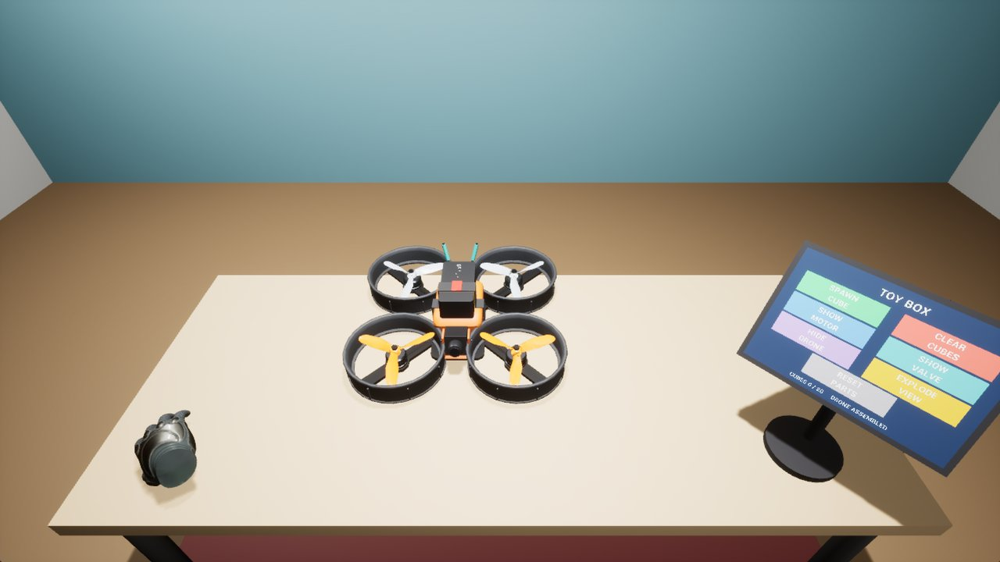 | 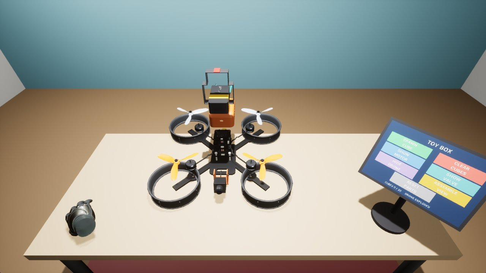 | 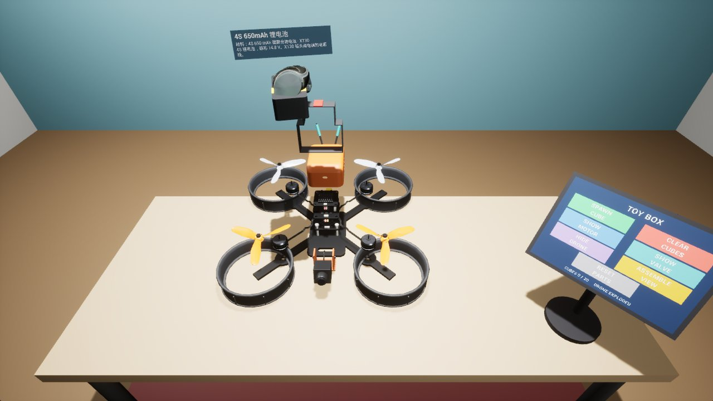 |

```
ITBasics/涵道无人机/build_drone.py ──Blender──▶ drone.glb ──Tools/import_model.py（MODEL_NAME=Drone）──▶ Content/Models/Drone/*.uasset + parts.json
```

- **模型**：原创的 3 寸涵道穿越机（cinewhoop），15 种零件 27 个实例（机架、立柱、4 个脚垫 / 涵道 / 电机 / 桨、电调、飞控、图传、机身罩、相机和支架、电池、绑带、天线）。实物约 19 × 19 × 6.4 cm（含涵道），放大 2.62 倍到 50cm 宽。`导入无人机模型.bat` 和电机的一样：拉 ITBasics → Blender 跑 `build_drone.py` → 编译 → 导入。
- **和电机 glb 的两点不同**，导入脚本都兼容了：
  - 零件节点放在各自的安装位置（节点带平移，网格顶点相对节点）。UE 导入 glTF 时会把节点变换烘进静态网格（实测涵道中心就在节点位置），所以只需要算包围盒时把节点平移加上。
  - extras 里零件号叫 `no`、没有材料。材料按零件号写在 `MODELS['Drone']['materials']` 里（信息牌第二行）。飞行动画用的桨叶模糊特效盘 `FX_PropBlur_*` 跳过不导。
- **抓取单元**：通用规则得出 26 个单元：机架 + 立柱是基座，4 个涵道、4 个电机、4 支桨、4 个脚垫各自单独抓，其余每个零件一个单元。抓法：脚垫 4 个"捏"，其余 21 个贴包围盒的面（涵道是绕竖轴的圆，不是绕模型 X 轴，所以不走"握外圆"）。
- **爆炸距离**：原来的距离按 19cm 的飞机定的，放大 2.6 倍后绑带会冲到 43cm 高，`explode_scale = 0.8`。
- **桌上的位置**：同一个位置，转 90° 让机头（相机）朝着玩家。
- ⚠️ 爆炸时 4 个脚垫往下移约 4cm，会插进桌面一点（装配状态下飞机就是踩在桌面上的）。

## 原理

### 先猜一下

> 抓起方块时，如果只把方块的**中心**挪到手心（不管旋转），会看到什么？
>
> A. 和现在一样，手掌贴着一个面
> B. 方块保持被抓前的歪斜角度，手掌可能插进方块里、或者只碰到一个角
> C. 方块会自动转正

<details><summary>答案</summary>

**B**。只对齐位置，旋转就是方块原来的样子，而手的朝向是任意的，所以手掌和方块表面一般不平行；方块中心离手心又只有 5cm，手掌模型就会穿进去。要"贴面"，就得同时对齐**位置和朝向**，这正是抓点要做的事。
</details>

### 抓点对齐（`AToyCube::ComputeHoldTransform`）

手和方块用同一个约定的坐标系来描述"接触点"：

- **手的 GripPoint**：在掌心表面，X 轴从掌心指向手背，Z 轴指向手指。
- **方块的 GrabPoint_0..5**：六个面中心各一个，X 轴 = 该面外法线（从方块指向外面），Z 轴 = 一个切线方向。

当手掌贴着某个面时，这两个坐标系应该**完全重合**。所以抓取 = 三步：

1. **选面**：每个面的外法线和手的 X 轴点积越大（越正对手掌）、离手越近，分越高。
2. **选摆法**：方块绕法线转 90° 看起来一样，所以 4 种摆法里挑 Z 轴最贴合手指方向的那种——方块被抓起时转动最少，不会突然甩一下。
3. **算变换**：要 `抓点世界变换 = 手抓点世界变换`。抓点在方块里的相对变换是 `G`，所以 `G × 方块 = 手抓点`，即 `方块相对手抓点 = G⁻¹`。把方块挂到 GripPoint 上，在 0.08 秒内从原位置插值到 `G⁻¹`。

这个思路和 UE 的 VR 模板、Meta/SteamVR 的 SDK 里 "snap grab + 抓点" 是同一类做法（**主流做法**）。它的前提：

- **物体形状规则**。方块六面对称，所以选面 + 4 种摆法就覆盖了所有握法。杯子、枪这类不对称物体一般只放一两个手工摆好的抓点，或者干脆用"保持抓起瞬间相对位置"的自由抓取。
- **手是硬的**。手指只是按握把值弯到固定角度，不会根据物体表面做碰撞贴合（那是 hand IK / 物理手的范畴）。

### 另外两种抓法，供比较

| 做法 | 体验 | 代价 |
| --- | --- | --- |
| **抓点吸附（本项目，主流）** | 手总是"标准地"握着物体，视觉稳定 | 物体会被吸到手里，离得远时有一点跳 |
| 自由抓取：记住抓起瞬间的相对变换 | 抓哪里就是哪里，零跳变 | 手模型经常穿进物体，看起来不像握住 |
| 物理手：手是刚体，用约束拉物体 | 能推、能捏、能碰撞 | 复杂很多，容易抖，调参难 |

### 零件抓取（`AToyPartUnit`、`IToyGrabbable`）

| 装配 | 爆炸后抓转子 | 拿回原位附近出现虚影 |
| --- | --- | --- |
| 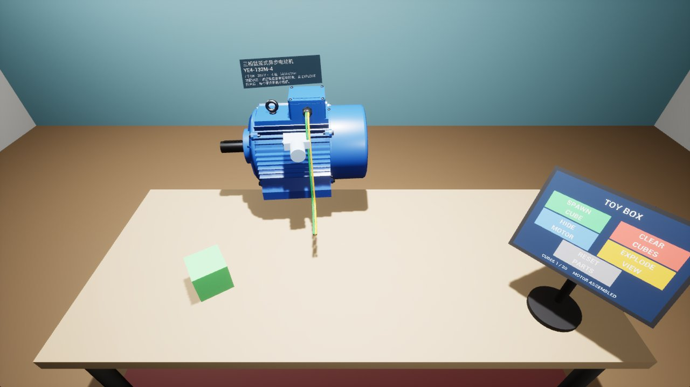 | 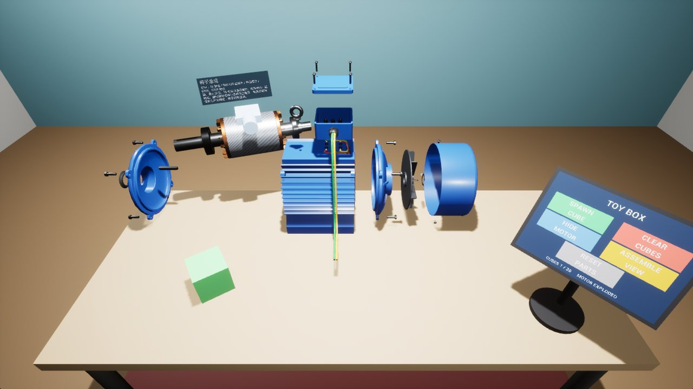 | 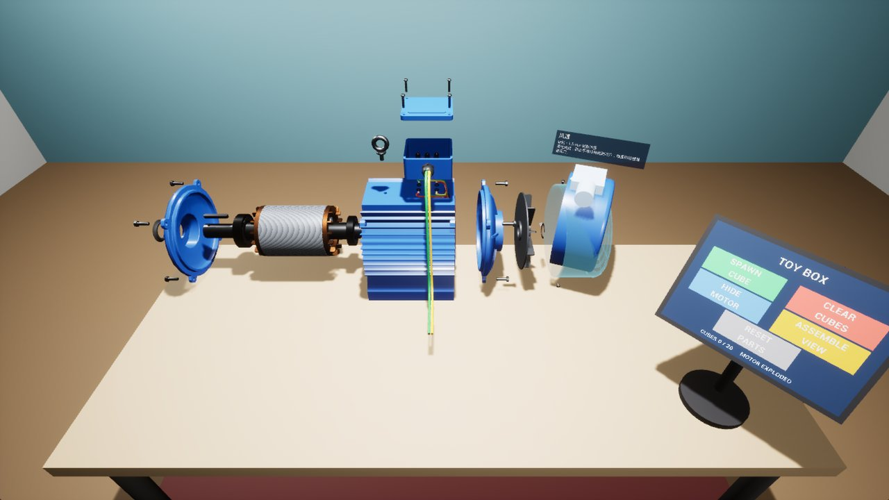 |

**1. 抓的是"单元"，不是网格。** 84 个网格里有 28 根导条、18 个线圈、十几颗螺钉，一个个抓没意义。爆炸路线完全相同的零件本来就一起动，按路线分组就是天然的单元：转子总成（轴 + 铁芯 + 鼠笼 + 两个轴承）、端盖、风扇、风罩、接线盒（含接线板、电源线）、盒盖……；只有螺钉这种"路线相同但各在各位置"的紧固件一颗一颗分开。定子 + 机座是基座，不能抓。每个单元是一个 `AToyPartUnit` Actor，挂在模型上，位置由爆炸进度决定。

**2. 装配 / 爆炸两种状态。** 完全装配时只开整机的检测盒（抓哪都 = 拿起整台电机，自由抓取：抓哪里就保持哪里）；完全爆炸后只开各单元的检测盒；动画进行中都不能抓。检测盒只做查询、不参与物理，所以方块会直接穿过电机。

**3. 现在的抓法：扳机捏取 + 自由捏取**（`AToyHand`、`AToyPartUnit::ComputeHoldTransform`、`AToyCube::ComputeHoldTransform`）。

- **只用扳机抓**：扳机过 0.6 捏起，低于 0.4 松开（迟滞，防止扳机在中间值抖动时反复抓放）；握把完全不参与抓取，只弯中指、无名指、小指。
- **判定点**：拇指指尖和食指指尖的中点（"捏合点"），半径 `GrabRadius` = 2cm 以内离得最近的那个（量的是到碰撞表面的距离）。
- **范围小球**：捏合点画一个半透明小球，半径 = 判定半径。平时淡白；有东西进范围时变绿（东西同时变亮）；捏住后缩到一半、更淡。只显示，不碰撞、不投影。日志里有 `ToyBox: 右手捏合范围内：…`，VR 里看不清时可以查。
- **捏起后怎么拿**：小件（`pinch`：螺钉、螺母、垫片……）把中心（或覆盖文件指定的捏点）吸到捏合点；其余零件、整机、方块都是**自由捏取**——保持捏起那一刻物体相对手的位置和角度，不再把手掌吸到表面上（Meta Interaction SDK 捏取就是这么做的）。
- **旧的手掌贴合还在**：parts.json 里 `cylinder` / `box` / `surface` 的数据照旧生成（下表），控制台 `toy.PalmSnap 1` 切回去就会用；默认不用。

| 捏球体 | 捏螺母 | 捏桨毂 |
| --- | --- | --- |
|  | 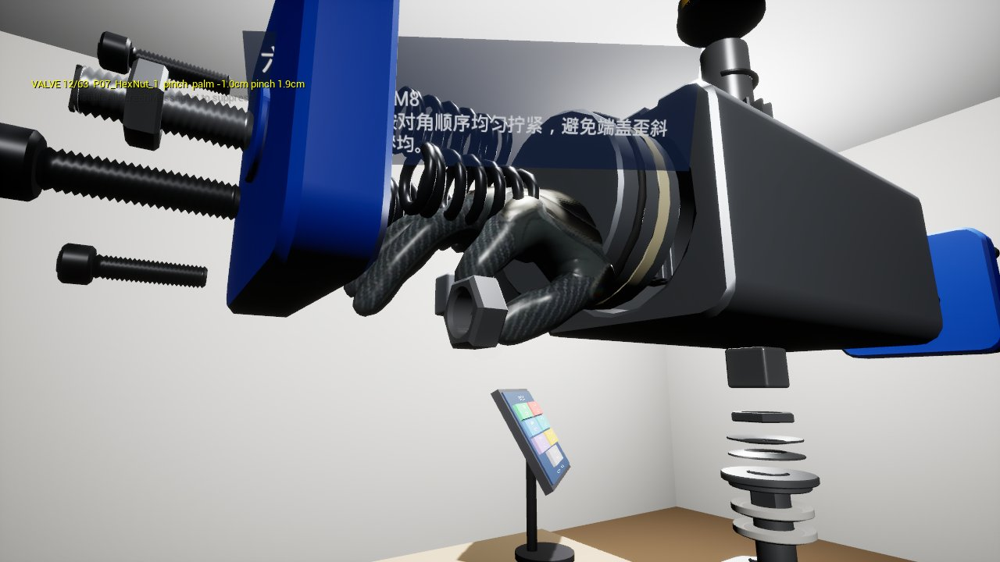 | 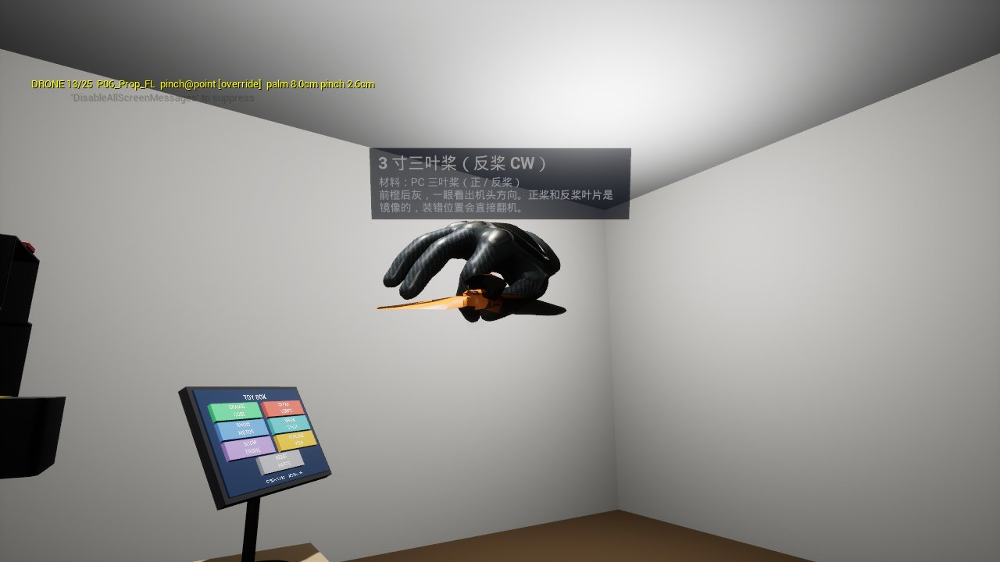 |

导入时给每个单元算的抓法（`Tools/import_model.py` 的 `grab_spec`），按下面的顺序挑第一个合适的。现在默认只用到 `pinch` 和覆盖文件里的 `point`，其余是 `toy.PalmSnap 1` 时的贴合方式：

| 顺序 | 类型 | 怎么判定 | 怎么贴合（`toy.PalmSnap 1`） |
| --- | --- | --- | --- |
| 1 | 手写覆盖 | `Tools/grab_overrides/<模型>.json` 里有这个单元（可用 `*` 通配） | 按文件里写的来 |
| 2 | `pinch` 捏 | 最长边 ≤ 7cm 的小件 | （默认也用）朝向保持抓起瞬间的样子，只把零件中心（或指定的 `point`）挪到拇指和食指之间 |
| 3 | `cylinder` 圆柱面 | 绕 X / Y / Z 任意一根轴的回转体，圆心不要求在原点：垂直于轴的两个方向一样宽（差 15% 内），绕轴 36 个角度格里至少 60% 的外轮廓半径和中位数差 8% 以内 | 手掌贴圆柱面；细长杆（长度 > 2.5 倍半径）只能握 |
| 4 | `box` 实心盒的面 | 从包围盒中心沿 X/Y/Z 打穿透射线，碰到的第一层和最后一层三角形围成"实心盒" | 和方块的 6 个抓点同一套规则 |
| 5 | `surface` 贴实物表面（兜底） | 空心件、成对件、环形件、中间有孔的 | 从指尖往掌心方向按三角形打这个单元自己的网格，手掌贴在命中点上 |

覆盖文件每条都要写 `why`：无人机电机、螺旋桨（捏桨毂）、电池绑带和天线（捏最高点）、电机吊环螺钉（捏吊环顶上）、球阀齿轮轴、执行器端盖、位置指示器（捏顶上）。`point` / `center` 可以写坐标，也可以写 `"top"`（最高的顶点）或 `"node"`（零件节点原点）。

| 模型 | 可抓单元 | 抓法统计 |
| --- | --- | --- |
| 电机 | 27 | 捏 19、圆柱 6、方块 1、贴表面 1（手写 1） |
| 球阀 | 63 | 捏 36、圆柱 20、方块 2、贴表面 5（手写 3） |
| 无人机 | 25 | 捏 10、圆柱 8、方块 3、贴表面 4（手写 10） |

**抓取体检 `toy.GrabAudit`。** 控制台输入 `toy.GrabAudit`（或 `Motor` / `Valve` / `Drone`，加 `quit` 跑完退出），会依次摆出模型、爆炸，用右手按桌面模式的方式（捏合点放在零件上离镜头最近的表面点、扣扳机）把每个单元捏一遍，捏住后手往上提、镜头给一个特写，截图到 `Saved/GrabAudit/<模型>/<序号>_<单元>.png`，并写 `Saved/GrabAudit/summary.csv`。三个模型 115 个单元约 4 分钟跑完。命令行批量跑：

```
UnrealEditor.exe VRToyBox.uproject -game -windowed -ResX=1280 -ResY=720 "-ExecCmds=toy.GrabAudit All quit"
```

| 以前的手掌贴合（`toy.PalmSnap 1`）：吊环 | 端盖 | 涵道 | 电池 | 机身罩 |
| --- | --- | --- | --- | --- |
| 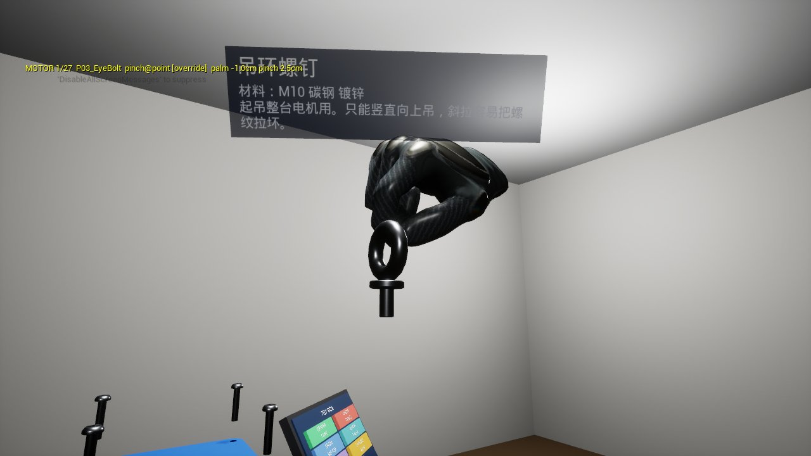 | 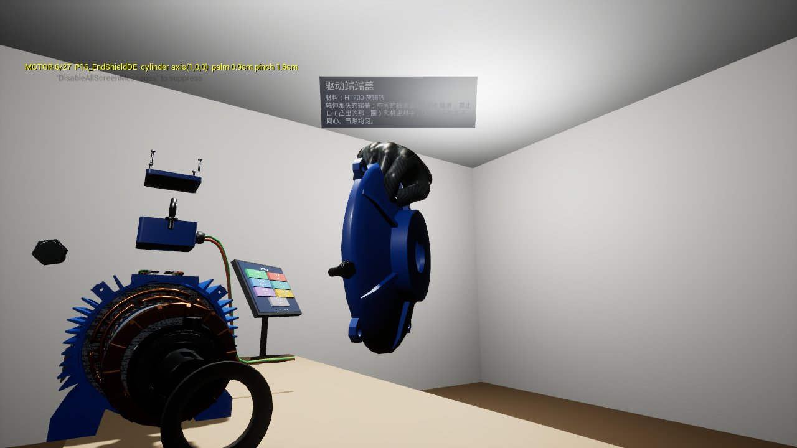 | 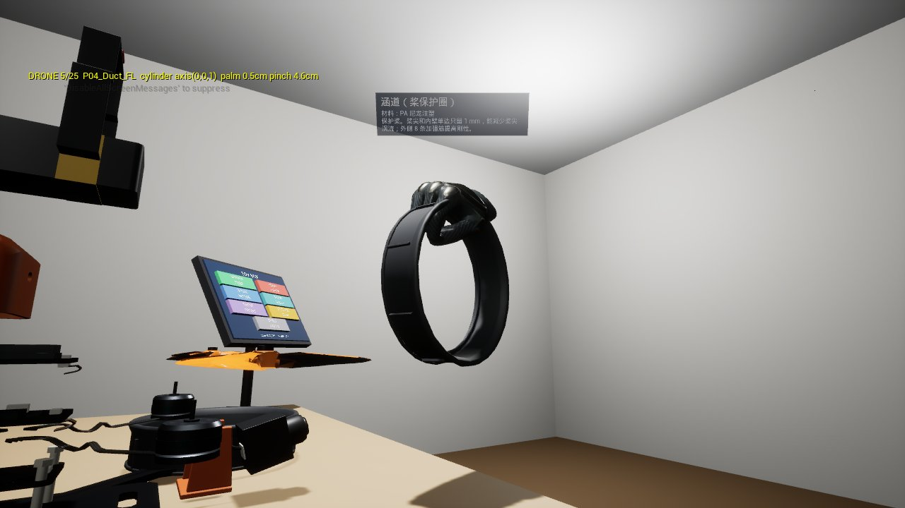 | 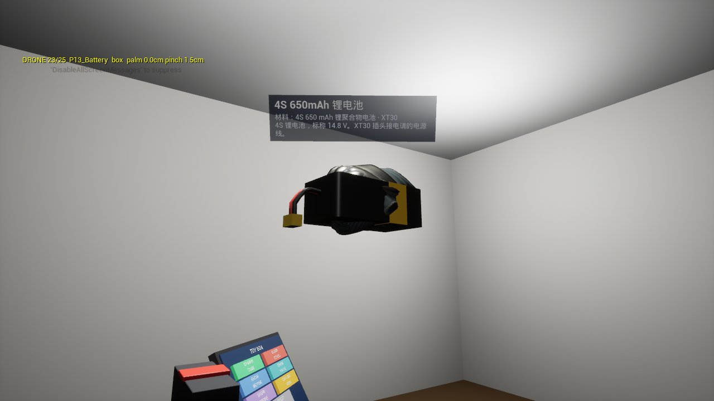 | 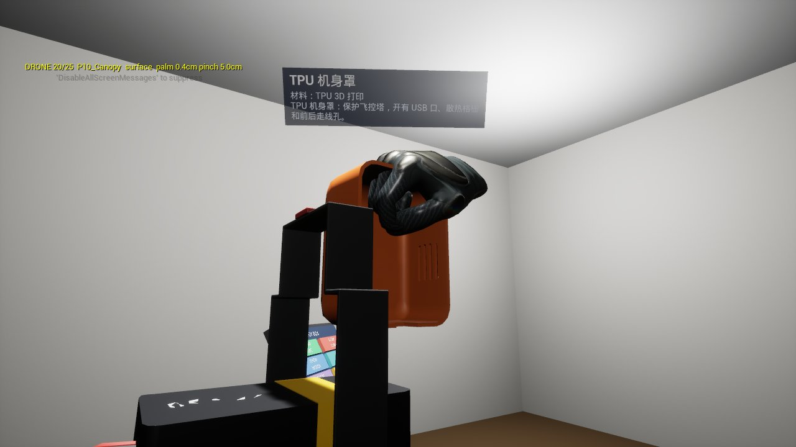 |

**4. 复位。** 松手后 0.4 秒飞回原位（目标每帧重新算，路上切换爆炸 / 装配也能飞到新位置）；拿着靠近原位 5cm 以内，原位显示半透明虚影，这时松手 0.12 秒吸进去。整机松手飞回桌上的支架。触屏 RESET PARTS = 所有手松开，全部飞回去。

**5. 信息牌。** 手边一块 `UWidgetComponent`，里面直接放 Slate 文字（不需要 UMG 蓝图资产）。UE 自带的 3D 文字（TextRender）没有中文字形，Slate 的默认字体有中文后备字形，所以用它。不受光照的 UI 在自动曝光下会很暗（颜色 1 ≈ 1 尼特，房间几十尼特），所以信息牌、虚影、高亮都乘了 12 倍亮度。

和其他做法比：物理手（Half-Life: Alyx、Boneworks）零件有重力会掉，看零件不方便；纯自由抓取零配置但手会穿进零件；维修培训类软件普遍是"悬浮 + 松手回位 + 虚影吸附"，这里就是借的这套，第二阶段的"按顺序拆装"可以直接复用虚影和吸附。

### 触屏怎么"点"

每个按钮前面有一个看不见的触发盒（`AToyTouchScreen::MakeButton`）。手每帧在食指指尖做一次小球重叠查询，**刚进入**触发盒的那一帧算一次点击，再加 0.35 秒冷却，防止手指抖一下触发两次。按钮按下时变白、往里缩 0.5cm，控制器震一下。

### 手柄输入

OpenXR 只会给"项目里用到的按键"向运行时申请绑定，所以 `Config/DefaultInput.ini` 里写了一组轴映射（Quest / Index / WMR / Vive 的握把、扳机、左摇杆 X/Y、右摇杆 X/Y），Pawn 每帧直接读这些键的值，同一动作在不同头显上取绝对值最大的。

### 移动和传送（`AToyBoxPawn`）

- **平滑移动**：左摇杆，方向 = 头显朝向的水平投影，1.5 m/s，死区 0.2（死区外重新映射到 0~1）。挪的是 VROrigin；挡墙和桌子用一个立在头正下方的胶囊体（半径 20cm、高 140cm、离地 15cm，跨得过地毯）扫掠，碰到就停在碰撞点前，剩下的位移沿墙面滑。
- **传送**（UE VR 模板的做法）：右摇杆往前推过 0.6，从右手沿手柄方向打抛物线（`PredictProjectilePath`，出射 6.5 m/s），抛物线用一串小球画，落点画一个圈；摇杆回到 0.3 以内时传送。落点必须是工作室的地板或地毯、法线朝上、那里站得下一个胶囊体（桌子底下、贴墙都不行），否则圈是红的、松开不传。传送时 0.15 秒黑屏淡出 → 把头挪到落点正上方 → 0.15 秒淡入。
- **快速转身**：右摇杆左右过 0.7 转 45°，瞄准传送时不转。

## 假设与可能失效的地方

证据分级：✅ 实测 / ⚠️ 未验证。2026-10-20 在 UE 5.8 + VS 2026（MSVC 14.50）上编译通过，并用 `-game -windowed`（不带头显）跑过桌面模式；用户在 Quest 3 上进过一次 VR（能抓东西，手的角度不对），扳机捏取、移动、传送还没在头显上测。

- ✅ **编译**：0 警告。注意 UE 5.8 里 `HeadMountedDisplayFunctionLibrary.h` 挪进了 XRBase 插件，所以 Build.cs 依赖 `XRBase`。
- ✅ **桌面模式**：点 SPAWN CUBE 生成方块、计数刷新，左键抓起拖动、松开落下，CLEAR ALL 清空。
- ✅ **画面亮度**：没有 `r.DefaultFeature.AutoExposure.ExtendDefaultLuminanceRange=True` 时整个画面严重过曝，已写进 DefaultEngine.ini。
- ✅ **出生点**：Entry 地图自带一个 PlayerStart，会让人出生在工作室外面（黑屏），所以 GameMode 总是让玩家出生在工作室原点。
- ✅ **手柄输入（VR，用户实测）**：旧式轴映射在 UE 5.8 + Quest 3 上生效，握把 / 扳机都能读到。⚠️ 新加的左摇杆、右摇杆 Y 是同一套机制，应该也行，还没在头显上测。
- ✅ **无人机（桌面模式）**：SHOW DRONE 摆出（机头朝玩家）、EXPLODE / ASSEMBLE、抓桨 / 电机 / 电池 / 相机 / 涵道都能抓、信息牌中文、松手飞回；`导入无人机模型.bat` 从头跑通。
- ✅ **球阀（桌面模式）**：SHOW VALVE 摆出球阀（执行器缸体沿桌子长边）、EXPLODE / ASSEMBLE、左键捏起执行器缸体并显示中文信息牌、松手飞回；`toy.GrabAudit Valve` 63 个单元全部捏到。
- ✅ **扳机捏取（桌面模式）**：左键 = 扳机，零件、整机、方块都能捏起；进入 / 离开捏合范围有日志（`右手捏合范围内：…`）。⚠️ 范围小球在桌面模式的镜头里被手背挡住，看不到颜色变化，要在 VR 里确认大小、颜色是否合适。
- ✅ **移动的小修**：平滑移动 / 传送检查忽略手里拿着的东西；一开始就卡在东西里时只允许往外走；落点无效时红圈贴到正下方的地上（找不到地就不显示）。
- ✅ **移动 / 传送（桌面模式）**：WASD 移动、撞墙停下；按住 T 瞄准：地上青色圈、桌上和贴墙处红色圈；松开传送，有黑屏淡入淡出（日志 `ToyBox: 传送到 …`）。⚠️ VR 里摇杆方向、抛物线从手柄的哪个方向打出去、晕不晕，要戴头显确认。
- ✅ **MannyXR 手（桌面模式）**：左右手都加载成功，张开 / 握拳 / 拇指扣下都对（`toy.HandPreview` 截图）；右手抓方块、转子，捏螺栓照常，判定和贴合没变。
- ⚠️ **手的朝向**：用户在 Quest 3 上反馈角度不太对，已加 VR 手部校准（默认 Pitch -64，见「手部校准」）。桌面自检数值和 VR 模板一致；VR 里对不对、Touch Plus 还差多少，要戴头显看，不对就进校准模式调。
- ⚠️ **手指和物体会互相穿插**：手指只是在两个固定姿势之间插值，不会贴着物体表面停下（那要做手指 IK / 物理手）；握 10cm 方块时手指会插进方块一点。
- ⚠️ **打包**：手的网格和动画在构造函数里用 ConstructorHelpers 硬引用，打包时会被带上；没实际打包验证过。
- ⚠️ **文字朝向**：屏幕上的英文如果是镜像的，把文字组件转 180°。用英文是因为 TextRender 的默认字体没有中文字形（✅ 已知限制）。
- ✅ **基础材质的 `Color` 参数**：5.8 里照常生效，各部件和随机色方块颜色都对。
- ⚠️ **VR 手感和帧率**：没法戴头显测，伸手够不够得着触屏、方块大小合不合适，都需要你戴上试。桌子近边离站立点 40cm，触屏在右前方约 80cm。
- ✅ **零件抓取（桌面模式，鼠标）**：装配时抓整机 → 信息牌显示中文 → 松手飞回支架；爆炸后抓转子、端盖、风罩、螺钉（捏）、接线盒，松手飞回；拿着风罩靠近原位出现虚影、松手吸回（日志 `ToyBox: P21_FanCover 松手，离原位 0.4 cm …，吸回`）；方块抓取照常。
- ✅ **捏合点判定（桌面模式）**：指尖在电机上时高亮，离开电机表面几厘米就不亮（以前 9cm 的手掌球会亮）；转子、螺钉、方块都能用指尖抓起；点电机旁边的桌面抓不到东西。
- ⚠️ **VR 里 2cm 会不会太严**：手柄追踪有毫米级抖动、看不到自己指尖的真实位置时，2cm 可能偏小，戴头显后觉得难抓就调大 `GrabRadius`。
- ✅ **中文信息牌**：Slate 默认字体在 `-game` 下能显示中文。⚠️ 打包成独立游戏后这个后备字体是否还在没验证；不在的话要导入一个中文字体资产。
- ⚠️ **VR 里的抓点手感**：桌面模式的手永远掌心朝下、手指沿视线，所以抓起时零件会转向镜头一点；VR 里手的朝向是真实的，贴合效果要戴头显看。螺钉捏起来会被手挡住，看不清（可以考虑捏小件时把零件放大或把牌子上加图）。
- ⚠️ **RESET PARTS 拿着零件时按**：桌面模式只有一只手（左键就是抓），没法边拿边按；VR 里另一只手戳 RESET 的情况没测。
- ✅ **抓取体检（扳机捏取）**：`toy.GrabAudit All` 三个模型 115 个单元全部捏到（0 个没捏到）。
- ⚠️ **自由捏取是"捏哪里就拿哪里"**：捏着大零件的边角拿起来，零件就挂在指尖外面；这是 Meta 那套的本意，但大零件（执行器缸体、转子）可能看起来像"粘"在手指上。觉得别扭可以 `toy.PalmSnap 1` 对比旧的贴合。
- ⚠️ **体检截图的取景**：镜头是按"手的右前方稍低处"自动摆的，球阀爆炸后零件挤在执行器周围，有些特写里镜头会被执行器挡住。
- ⚠️ **零件之间会互相穿过**（没有碰撞），拿着转子可以直接穿过机座；目前只是查看，所以没处理。
- 桌面模式下鼠标没指着东西时，手会悬在半空，只影响调试，没处理。
- 编辑器打开的是引擎自带的空地图 `/Engine/Maps/Entry`，所以**编辑器视口里是空的**，按 Play 才会生成工作室。想在编辑器里看到：建一个新关卡，把 `ToyStudio` 从放置面板拖进去。

## 代码地图

| 文件 | 内容 |
| --- | --- |
| `ToyBoxGameMode` | 没有工作室就生成一个，玩家站在它的原点 |
| `ToyStudio` | 房间、桌子、灯；生成/清空方块；摆出 / 换 / 收起电机、球阀或无人机 |
| `ToyTouchScreen` | 支架触屏和按钮 |
| `ToyCube` | 可抓方块和 6 个抓点，抓点对齐的数学 |
| `ToyExplodedModel` | 读 parts.json、生成抓取单元，原始 / 爆炸切换动画，整机抓取，虚影 / 高亮 / 复位 |
| `ToyPartUnit` | 一个抓取单元：小件捏到捏合点、其余自由捏取（旧的圆柱面 / 实心盒 / 贴实物表面贴合在 `toy.PalmSnap 1` 下），松手飞回原位，磁吸 |
| `ToyGrabAudit` | 调试命令 `toy.GrabAudit`：自动把每个单元抓一遍、截图、写 summary.csv |
| `Tools/grab_overrides/*.json` | 各模型手写的抓法覆盖，每条带 `why` |
| `ToyGrabbable` | 可抓物体的接口（方块、零件、整机都实现它） |
| `Tools/import_model.py` | glb → UE 资产 + parts.json（含抓取单元和抓点），电机、球阀、无人机共用，`MODELS` 里是各模型的配置 |
| `Tools/export_ball_valve_glb.mjs` | 把打包好的球阀 html 导出成 glb |
| `Tools/create_toy_materials.py` | 建虚影 / 高亮用的半透明材质 `M_ToyGhost` |
| `ToyHand` | MannyXR 手模型和手指弯曲（扳机捏 / 握把弯三指）、扳机捏取 / 放 / 扔、范围小球、戳按钮、信息牌 |
| `ToyBoxPawn` | 头显、控制器（握把 / 瞄准 / 掌心姿态）、输入、平滑移动、传送、转身、手部校准模式、桌面调试模式 |
| `ToyHandCalib` | VR 手部校准参数（控制台变量、存盘）和"手相对握把姿态"的变换 |
| `ToyShapeComponent` | "基础形状 + 颜色"，整个场景的积木 |
