# VR 玩具箱（VRToyBox）

UE 5.8 + OpenXR 的 C++ 小工程。第一个场景：

- 一间 6m × 6m 的小工作室，你站在一张桌子前面；
- 桌上一个支架触屏，屏幕上是一块中文 GUI（模型卡片、爆炸 / 复位、挪动方向键、摆件复位），用食指戳；
- 样板间里挑出来的 20 件摆件（花瓶、书、蜡烛、小盆栽……，`AToyProp`，见下文「样板间场景」）可以用拇指和食指捏起来（扣扳机）、换手、扔出去；捏起时保持捏住那一刻的位置和角度，捏合点有一个半透明小球表示范围。触屏 **摆件复位** 把它们全部放回原处。（以前的"生成方块 / 清空方块"已经去掉。）
- 左摇杆平滑移动，右摇杆左右快速转身，右摇杆往前推瞄准传送（抛物线 + 落点圈）。
- 触屏上能摆出五个爆炸图模型（一次一个，换模型时先收起原来的）：**三相电机**（ITBasics 里的 YE4-132M-4）、**气动球阀**（three.js 写的三片式球阀 + 齿轮齿条气动执行器）、**涵道无人机**（ITBasics 里的 3 寸涵道穿越机）、**迷你车床**（ITBasics 里照产品图建的 8 合 1 小车床）和**数字万用表**（外观参考 SATA DO5054 的原理爆炸图），前四个缩放到最长边约 0.5 米，万用表 0.4 米。点模型卡片摆出（再点一次或点 **收起模型** 收起），**爆炸拆开 / 组装回去** 让桌上的模型在爆炸图和原始装配之间切换，零件按真实拆装顺序先后飞出。
- **挪模型**：触屏右下角的方向键 **推远 / 拉近 / 左移 / 右移**，每按一下把桌上的模型整体挪 10cm（离站立点 55~95cm、左右 -40~+20cm，不会挪出桌面或撞上触屏），方向键中间显示现在离你多远。所有模型共用这个位置，换模型也不会弹回去。默认放在 70cm（以前是 90cm，站着伸手够不着）。
- **零件抓取查看**：装配状态下抓电机任意位置 = 拿起整台电机；爆炸后每个零件（转子总成、端盖、风扇、螺钉……共 27 个抓取单元）都能单独抓起来看，手边浮出中文信息牌（名字、材料、作用）。松手零件自己飞回原位，拿着靠近原位 5cm 会出现半透明虚影、松手吸回去；触屏 **零件复位** 一键全部复位。

房间、桌子、触屏、方块都是 C++ 用引擎自带的基础形状拼出来的（默认关卡 `L_Studio` 只是放了一个工作室的壳），每一处改动都能在 PR 里看 diff。二进制资产只有：电机、阀门、无人机、车床、万用表、AI 服务器、球形漂浮机器人、四缸发动机、五指灵巧手、干法刻蚀机模型（`Content/Models/Motor`、`Valve`、`Drone`、`Lathe`、`Multimeter`、`AIServer`、`OrbBot`、`Engine`、`DexHand`、`Etcher`）和虚影 / 高亮用的半透明材质（`Content/Materials/M_ToyGhost`），由脚本生成，见下面「电机模型从哪来」「阀门模型从哪来」「无人机模型从哪来」「车床模型从哪来」「万用表模型从哪来」「AI 服务器模型从哪来」「球形漂浮机器人模型从哪来」「四缸发动机模型从哪来」「五指灵巧手模型从哪来」「干法刻蚀机模型从哪来」；手模型（`Content/XRMannequins`），是从 UE 自带的 VR 模板拷来的，见「手的模型」。

## 演示

桌面模式自动录的（`toy.Demo`，见「零件抓取」最后）：装配 → 爆炸 → 右手捏起一个零件、信息牌浮出来 → 松手飞回 → 装配回去。

| 三相电机 | 气动球阀 | 涵道无人机 |
| --- | --- | --- |
| 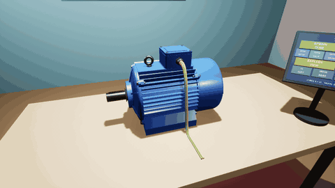 | 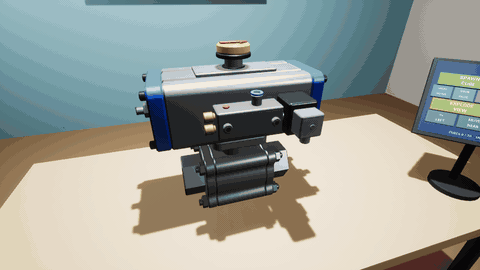 | 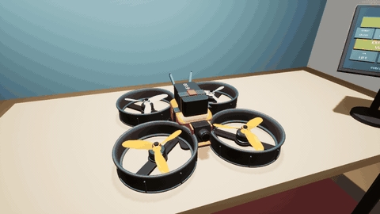 |
| **迷你车床** | **数字万用表** | **AI 服务器** |
| 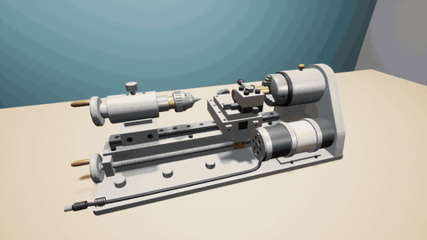 | 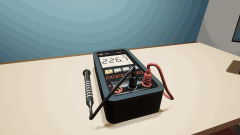 | 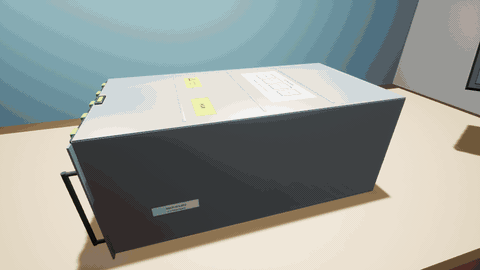 |

## 怎么跑（Windows）

需要：UE 5.8（Epic 启动器安装）、Visual Studio 2022 的「使用 C++ 的游戏开发」工作负载、git。

| 双击 | 做什么 |
| --- | --- |
| `一键启动.bat` | 检查 main 更新 → 编译 C++ → 打开编辑器 |
| `一键启动_VR直玩.bat` | 检查更新 → 编译 → 不开编辑器，直接进头显 |
| `检查更新.bat` | 只检查并拉取 main 的更新 |
| `导入电机模型.bat` | 电机模型改了才需要：重新生成并导入（见下文） |
| `导入阀门模型.bat` | 球阀模型改了才需要：从打包好的 html 导出 glb 并导入（见下文） |
| `导入无人机模型.bat` | 无人机模型改了才需要：ITBasics 里用 Blender 重新生成并导入（见下文） |
| `导入车床模型.bat` | 车床模型改了才需要：ITBasics 里用 Blender 重新生成并导入（见下文） |
| `导入万用表模型.bat` | 万用表模型改了才需要：ITBasics 里用 Blender 重新生成并导入（见下文） |
| `导入发动机模型.bat` | 四缸发动机模型改了才需要：ITBasics 里用 Blender 重新生成并导入（见下文） |
| `导入灵巧手模型.bat` | 五指灵巧手模型改了才需要：ITBasics 里用 Blender 重新生成并导入（见下文） |
| `生成样板间工作室.bat` | 装了 ArchViz 样板间素材才需要：生成并烘焙 `L_StudioArchViz`（见下文「样板间场景」；装了 Home Interior 会接在前门外一起烘焙），约 20 分钟 |
| `导入刻蚀机模型.bat` | 干法刻蚀机模型或网页里的原理内容改了才需要：ITBasics 里用 Blender 重新生成并导入，顺带拷讲解文字和标准答案（见下文） |

- 引擎不在 `C:\Program Files\Epic Games\UE_5.8` 的话，先设置环境变量 `UE_ROOT` 指向引擎根目录（脚本也会读 Epic 启动器写的注册表）。
- 更新脚本只在「当前在 main、没有未提交改动、本地没有 main 上没有的提交」时才 `git pull --ff-only`，其他情况只提示不动手，避免把你的改动搞乱。
- 编辑器里：Play 按钮旁的下拉菜单选 **VR Preview** 进头显；直接点 Play 是桌面调试模式。
- **默认关卡 `Content/Maps/L_Studio`**：编辑器一打开就是它，视口里直接看得到房间、桌子、灯和触屏（镜头停在房间后角看着桌子）。它**只是个壳**：里面只有一个 `ToyStudio`（原点）和一个 PlayerStart，房间、桌子、触屏都在 `AToyStudio` 的 C++ 构造函数里建，**改场景还是改 C++**，不用动关卡。会动的东西（方块、爆炸图模型、手）仍然在按 Play 之后生成。出生点由 GameMode 固定在工作室中央，PlayerStart 不起作用。在 Entry 之类的空地图里跑也行，GameMode 会自己生成一个工作室。
- 关卡坏了或想重建：`Tools/create_studio_level.py`（编辑器命令行跑，见文件开头）重新生成 L_Studio；`Tools/studio_viewport_shot.py`（编辑器里 `py <路径>` 跑）摆好视口镜头、存关卡、截下面这张图。

### 样板间场景（ArchViz Interior，只在本机）

工作室可以摆进 Epic 的 ArchViz Interior 样板间（北欧风客厅 + 餐厅）：餐桌换成我们的桌子和触屏，玩家面朝矮柜和挂画那面墙，餐厅窗户在左手边。

- **素材不进仓库**：这个仓库是公开的，Fab / Epic 素材的许可证不允许把源文件再分发。素材放在 `Content/ArchViz/`，已写进 `.gitignore`。
- **怎么装**：Epic 启动器 → Fab 库 → ArchViz Interior → ＋ → 勾「显示所有工程」→ 选 VRToyBox，版本选最高的 4.27 → 添加。**添加会把 `Config/DefaultEngine.ini`、`DefaultGame.ini` 换成样例的设置**，装完先 `git checkout -- Config`；素材会散在 `Content/` 根目录，要在编辑器里统一挪进 `Content/ArchViz/`（保持子目录）。然后双击 `生成样板间工作室.bat`。
- **生成脚本** `Tools/archviz/build_studio_archviz.py`：复制 `ArchVis_Lightmap` 成 `L_StudioArchViz`，删掉餐桌、6 把椅子、桌上摆件、两盏吊灯和过场动画，清掉关卡的 GameMode 覆盖，摆一个 `bBuildRoom = false` 的 `ToyStudio`（只留桌子、触屏、模型支架和主灯，自己的房间隐藏、没有碰撞），曝光补偿 +1.76 → -1.5，把 20 件小摆件换成能拿起来的 `AToyProp`（见下面），装了 Home Interior 的话把它接到前门外（见「第二个场景」），再用 CPU Lightmass（Production）把两套房子一起烘焙。GPU Lightmass 在 5.8 上对这张图一启动就崩，所以用 CPU。
- **一键启动**：本机有 `Content/ArchViz/Maps/L_StudioArchViz.umap` 就自动打开它；想回原来的方块房间，先 `set TOY_CLASSIC=1` 再启动。
- **传送**：套用样板间时，落点认 `ToyStudio.WalkArea` 和 `ExtraWalkAreas`（前门外的走廊、Home Interior）范围里、和站立点等高的朝上表面（地板、地毯），沙发座面、桌面不算。这些范围只比内墙往里缩 10cm（贴墙站不站得下由胶囊体检查管）；样板间右边那面墙前半段往外多出 90cm，生成脚本沿墙每 20cm 量一次，凸出去的那段单独加一个范围。吊扇、吊饰（骨骼网格，碰撞体往下到 1.4~1.8m）不挡传送抛物线。
- **走得到 / 传送得到的地图**：`toy.ReachMap [格子 cm] [名字] [胶囊体半径]` 在所有能传送的范围里按格子查每一格（是不是地板、能不能传送、从开局站立点用摇杆走路的胶囊体一格一格扫过去走不走得到、挡路的是什么），写 `Saved/ReachMap/<名字>.csv`；`python Tools/reach_map.py Saved/ReachMap/<名字>.csv` 画成俯视图并列出走不到的地方。2026-10-30 查过（半径 20）：除了下面两处，地板上身体站得下的地方都走得到也传送得到。半径减到 16 也只多出贴边一圈，没有新连通的地方，所以胶囊体不改。
  - 客厅沙发、茶几、单人沙发围起来的墙角（约 0.7㎡）：入口比 32cm 还窄，走不进去，能传送过去。家具没挪（挪了要重新烘焙）。
  - 样板间前墙和门厅墙之间不到 20cm 宽的夹缝：在墙里面，本来就不该去。
- **能拿起来的摆件**：生成脚本按 `PROPS` 表把 20 件小摆件换成 `AToyProp`（网格、材质、位置照搬，原来的静态 Actor 删掉，所以烘焙后不会留下它们的影子）。手靠近时金色高亮，捏起来手边信息牌显示名字和"材料：…"（声音按材料分），松手按手速扔出去；开局是睡着的（叠着的书不会自己弹开），被拿起、被撞到才醒。触屏 **摆件复位** 全部放回原处，按钮上方一行显示"摆件 20 件，N 件不在原位"；没有摆件的房间（L_Studio）显示"这个房间没有能拿起来的摆件"。

  | # | 名字 | 材料 | 质量 | 大小（cm） | 在哪（站在桌前看） | 碰撞 |
  |---|---|---|---|---|---|---|
  | 1 | 镂空几何摆件 | 钢 | 0.35kg | 12×12×10 | 左手边餐边柜，叠在两本书上 | 加的凸包 |
  | 2 | 白色小书 | 纸 | 0.4kg | 20×15×3 | 左手边餐边柜，几何摆件下面那本 | 加的盒子 |
  | 3 | 木头多面体 | 木 | 0.6kg | 31×31×16 | 左手边餐边柜，铁丝篮里 | 加的凸包 |
  | 4 | 白蜡烛 | 蜡 | 0.15kg | 14×5×5 | 左手边餐边柜右端 | 自带凸包 |
  | 5 | 黄铜花瓶 | 黄铜 | 0.8kg | 21×21×17 | 正前方矮柜 | 自带凸包 |
  | 6 | 粗肋草小盆栽 | 大理石花盆 | 1.2kg | 盆 15×15×10 | 身后茶几 | 盆自带凸包，植物和土挂在盆上 |
  | 7 | 朱顶红插花 | 陶瓷花瓶 | 0.5kg | 瓶 11×11×10 | 身后沙发旁边几 | 瓶自带凸包，花和土挂在瓶上 |
  | 8 | 白色大理石矮花瓶 | 大理石 | 0.7kg | 21×21×11 | 身后电视柜 | 自带凸包 |
  | 9 | 电视遥控器 | 塑料 | 0.12kg | 25×6×2 | 身后电视柜 | 自带凸包 |
  | 10 | 香薰蜡烛 | 黄铜杯、蜡 | 0.4kg | 12×12×11 | 身后梯架下层 | 自带凸包 |
  | 11 | 灰色硬皮书 | 纸 | 0.5kg | 25×19×4 | 正前方矮柜，压在另一本书上 | 加的盒子 |
  | 12 | 梯架上的小书 | 纸 | 0.3kg | 20×15×3 | 身后梯架中层，一摞书最上面那本 | 加的盒子 |
  | 13 | 矮书架上的大开本书 | 纸 | 0.7kg | 41×38×3 | 右手边前门旁的矮书架，一摞书最上面 | 加的盒子 |
  | 14 | 金属弹簧摆件 | 钢 | 0.3kg | 20×20×20 | 右手边矮书架，立在两本书上 | 自带凸包 |
  | 15 | 大理石苹果 | 大理石 | 1.5kg | 28×28×19 | 右手边墙上第二层搁板 | 自带凸包 |
  | 16 | 黄铜烛台 | 黄铜、蜡 | 0.3kg | 烛台 9×9×4 | 右手边墙上第一层搁板 | 自带凸包，蜡烛挂在烛台上 |
  | 17 | 茶几上的画册 | 纸 | 0.8kg | 37×31×4 | 身后茶几 | 加的盒子 |
  | 18 | 电视柜搁板上的书 | 纸 | 0.4kg | 26×18×2 | 身后电视柜上方的搁板，一摞书最上面 | 加的盒子 |
  | 19 | 电视柜上的杂志 | 纸 | 0.3kg | 37×25×1 | 身后电视柜 | 自带凸包 |
  | 20 | 小相框 | 木框、玻璃 | 0.5kg | 35×29×8 | 身后电视柜上方的搁板（128cm 高） | 加的盒子 |

  - **碰撞**：示例里大部分家具、墙只有三角面碰撞（只给射线用，物理模拟碰不到），摆件放上去会掉下去、扔过去会穿墙。脚本把这些网格（约 50 个：墙、天花板、地毯、餐边柜、边几、电视柜、梯架、铁丝篮……）改成"复杂碰撞当简单碰撞"；摆件网格没有简单碰撞的加一个（书是盒子，其余是顶点凸包，形状名 `ToyProp`，重跑时重算）。改的是本机 `Content/ArchViz` 里的网格，不进仓库。编辑器小工具在 `ToyArchVizTools`（命令行模式拿不到 StaticMeshEditorSubsystem）。
  - **盆栽 / 插花**：植物、花、土是挂（attach）在盆 / 瓶上的静态网格 Actor，开局时拆开焊接、关掉碰撞，只跟着走、一起高亮；捏的是盆 / 瓶。
  - **手感**：角阻尼 1（倒下的蜡烛很快停稳）；拿着时摆件不受碰撞，伸进架子里松手会以最多 40cm/s 慢慢挤出来，不会弹飞。拿起下面那件时，压在上面的摆件会被叫醒、掉下来（不会悬在半空）。
  - **没挑的**：边几下层隔板上的碗（提起来会穿过桌面）、茶几上挨着两个花瓶的碗（凸包互相重叠，一碰就被挤下桌）、梯架上的陀螺（侧躺着，一碰原地转半圈）、梯架中层的白瓷花瓶（在隔板最外沿，放下就翻下去）、前门衣帽架上挂着的 UE 手提袋（挂着的，一醒就掉）、沙发上的抱枕（靠在扶手 / 靠背上，一醒就滑到地上）、矮书架上的陶瓷多面体（棱着放，一醒就转 15°）、茶几上挨着的两个花瓶、并排立着的书。挂墙上的画、柜子里的东西都没动。
  - **自检**：`toy.PropTest [quit]`（桌面模式）：开局静止 → 全部叫醒 2 秒看会不会自己动 → 每件高亮截图、捏起、提 20cm、截图、松手看是否落回原来的台面 → 全部从 1 米高丢到身后空地看是否落地没穿 → 触屏摆件复位 → 记帧时间。截图和 `props_summary.csv` 在 `Saved/ArchVizCheck/`：

    ```
    UnrealEditor.exe VRToyBox.uproject /Game/ArchViz/Maps/L_StudioArchViz -game -windowed -ResX=1280 -ResY=720 "-ExecCmds=toy.PropTest quit"
    ```
- **性能**：样板间约 560 万三角面、没有 Nanite，光照贴图约 450 MB。5090 桌面模式约 2 ms/帧；以后要上 Quest 一体机得减面、降光照贴图分辨率。
  - **显示模型后掉帧（已修）**：太阳是固定（Stationary）平行光，可移动的网格每个都单独渲一张逐物体阴影 + 预阴影。发动机几十个零件就是几十张，绕到桌子后面看客厅时阴影投影铺满大半个屏幕。模拟双目 2688×3024 每眼（≈ Virtual Desktop Godlike）、站桌后看客厅：不显示模型 GPU 4.9ms；显示发动机 **8.4ms**（阴影投影 3.7ms，头显里 90 → 70~80 帧）。现在模型的零件都挂在 `UToyLightGroupComponent`（光照组根，`bLightAttachmentsAsGroup`）下面，整个模型只有一张：显示发动机 **5.9ms**、爆炸 6.2ms，画面一样。手里拿着的零件单独投影。
  - 复现：`toy.Stand <X> <Y>`（把玩家挪到工作室坐标，X 朝桌子）+ `toy.Look 180 -10`，例如
    `UnrealEditor.exe VRToyBox.uproject /Game/ArchViz/Maps/L_StudioArchViz -game -emulatestereo -windowed -ResX=3840 -ResY=2160 -ForceRes "-ExecCmds=r.ScreenPercentage 140,toy.After 4 toy.Stand 160 0,toy.After 4.5 toy.Look 180 -10,toy.After 14 startfpschart,toy.After 24 stopfpschart,toy.After 28 toy.Screen Engine,toy.After 40 startfpschart,toy.After 50 stopfpschart"`，结果在 `Saved/Profiling/FPSChartStats/`。

### 第二个场景（Home Interior，只在本机）：前门外接着另一套房子

从样板间的前门走出去，穿过一段 2 米的走廊，就进到另一套房子：Fab 上 Olga Chekunova 的 **Home Interior**（开放式厨房 + 餐桌 + 客厅，约 10×9m）。两套房子在同一个世界里，不换关卡、不黑场，站在样板间门口就能一直看到那边的客厅。

- **素材不进仓库**：放在 `Content/Home_Interior/`（已写进 `.gitignore`）。Fab → Home Interior →「添加到工程」选 VRToyBox，它自己就放在 `Content/Home_Interior/` 下面，Config 没被改。然后双击 `生成样板间工作室.bat`（会自动接上）。没装的话前门照旧关着。
- **怎么拼的**（`build_studio_archviz.py` 的 `ARCHVIZ_STEP=home`，在烘焙之前跑）：
  - `Home_Interior` 复制成子关卡 `L_StudioArchViz_Home`（`L_StudioArchViz` 里一直加载），整套房子平移到前门外：它的入户走廊尽头对着样板间前门，中间一段 2m 长、1.1m 宽、2.5m 高的走廊（引擎方块拼的，墙面 / 地板用 Home 的材质，顶上一盏静态灯）。不用转方向：Home 的窗户朝 +X、背对样板间；样板间的窗户朝 -X / -Y，两边从窗户都看不到对方的外墙。
  - 门洞：样板间前墙是一整块实心墙板（门只是贴在上面的门框和门板），Home 的入户走廊尽头原来是一面白墙。两边都复制一份网格（`SM_Wall_Front_ToyDoor`、`SM_Scene_ToyDoor`，在本机素材目录里），用 Geometry Script 减掉一个 82×203cm 的门洞；样板间的门板、把手和盖住前墙的阻挡体积删掉，Home 那头装上同一套门框。门一直开着。
  - 一套天：Home 的太阳、天光、天空球、大气雾、窗外的背景板（会从样板间餐厅窗户斜着看到）和平面反射都删掉，Home 窗外看到的是样板间的城市。Home 原来靠天光从窗户照进来，改成每扇窗里侧两块静态面光源（和样板间窗户补光一个做法）。
  - 曝光统一：Home 原来是自动曝光、屋里暗（一直顶在 EV100 上限，等效 EV 0.65），样板间是固定 EV 5.5、补偿 -1.5（等效 EV 7）。Home 的灯全部改成静态，亮度乘 2^(7 - 0.65 - 1.5) ≈ 29（多减的 1.5 档是和原来的 Home 截图对比调的，`HOME_BRIGHTNESS_STOPS`）；Home 的后期体积只罩住 Home（从走廊中间开始），曝光和样板间一样固定，色温、泛光还是 Home 自己的。所以触屏、信息牌、摆件高亮两边一样亮。
  - 摆件：`HOME_PROPS` 的 21 件换成 `AToyProp`（标签 `Home01_…`），墙和家具改三角面碰撞。工作室只有样板间那一个，`ExtraWalkAreas` 加上走廊和 Home，传送、摇杆走路都能过去；触屏 **摆件复位** 管两边一共 41 件。
- **烘焙**：两个关卡一起烘焙（CPU Lightmass Production，用样板间的 Lightmass 设置；体积光照贴图内存上限 30 → 80MB，房子大了一倍多也不降精度）。
- **以前的版本**（穿门换关卡、`L_HomeStudio`）不再生成，bat 会删掉旧的 `L_HomeStudio`。`AToyDoorway` 类和 `toy.Door` 还留着，现在的地图里没有用到。
- **能拿起来的东西**（`HOME_PROPS`，21 件，Home Interior 的网格都自带凸包；标签 `Home01…21`）：

  | # | 名字 | 材料 | 在哪 |
  |---|---|---|---|
  | 1 | 餐桌上的水壶 | 陶瓷 | 餐桌 |
  | 2 | 红酒瓶 | 玻璃 | 餐桌 |
  | 3 / 4 | 红酒杯 ×2 | 玻璃 | 餐桌 |
  | 5 | 餐桌上的马克杯 | 陶瓷 | 餐桌 |
  | 6 | 樱桃果盘 | 陶瓷 | 餐桌（11 颗樱桃挂在盘子上一起走） |
  | 7 | 餐刀 | 不锈钢 | 餐桌 |
  | 8 / 9 | 岛台上的马克杯 ×2 | 陶瓷 | 厨房岛台 |
  | 10 | 香草小盆栽 | 陶瓷花盆 | 厨房台面（香草挂在盆上） |
  | 11 | 置物架上的花瓶 | 陶瓷 | 入口旁的置物架 |
  | 12 | 收纳小盒 | 木 | 入口旁的玻璃柜 |
  | 13 | 茶几上的蜡烛 | 玻璃杯、蜡 | 茶几 |
  | 14 / 15 | 斗柜上的花瓶、细花瓶 | 陶瓷 | 镜子旁的斗柜 |
  | 16 | 置物架下层的收纳盒 | 木 | 入口旁的置物架下层 |
  | 17 | 置物架上的浅盘 | 陶瓷 | 入口旁的置物架 |
  | 18 | 茶几上的两本书 | 纸 | 茶几（上面那本挂在下面那本上一起走） |
  | 19 | 小碟和咖啡杯 | 陶瓷 | 沙发旁的小桌（杯子挂在碟子上） |
  | 20 / 21 | 另外两盆香草 | 陶瓷花盆 | 厨房台面（香草挂在盆上） |

  接到样板间以后去掉了 3 件（两套房子 40 件一起跑 PropTest 时不稳，原来单独一张图时也是擦线过的）：玻璃水杯（一醒歪 3°）、灶台上的汤锅（一醒在灶架上滑 1~2cm）、置物架上的细高花瓶（松手有时落到上一层隔板）；补了 4 件底面平、平放的（18~21）。叠着的书、碟子上的杯子以前分开做摆件一醒就歪，现在上面那件挂在下面那件上，一起是一个摆件。摆件的网格如果被墙 / 家具那一步改成了三角面碰撞，生成脚本会改回凸包（不然物理模拟不动）。
  餐巾去掉了碰撞（几毫米厚的三角面会把压在上面的杯子顶歪）。没挑的：碗（凹的）、单颗樱桃、竖着排的书、挤在一起的蜡烛和盆栽、叠着的盘子、挂在钩子上的手套和锅铲、两米高的吊柜和搁板；试过又拿掉的：沙发 / 椅子上的靠垫和坐墩（软面上放不稳，一醒就滑）、盘子上的餐叉（一醒歪 3°）、小圆桌上的红色马克杯（桌面是玻璃，没有碰撞，放回去会掉到地上）、盘子里的果冻（丢到地上那一步没落下来）、茶几上叠着的书和碟子上的咖啡杯（一醒就歪几度）、玻璃柜里的花瓶和窗边架子上的储物盒（会滑 / 放回去落到别的隔层）。
- **自检**：`L_StudioArchViz` 上的 `toy.PropTest quit` 一次测两边 41 件（Home 的 21 件按标签排在 `Prop01…20` 前面）。

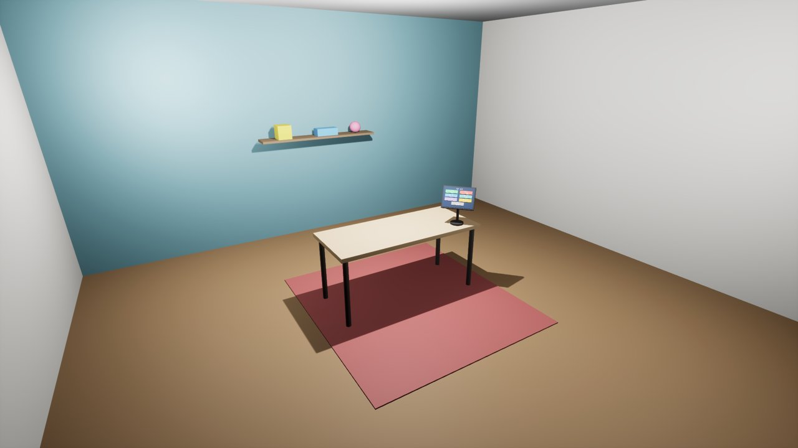

### 操作

| | VR | 桌面调试模式（没戴头显） |
| --- | --- | --- |
| 点触屏按钮 | 食指戳：指尖离屏幕 3cm 内按钮变亮、出现光标点，戳到 0.6cm 算按下（不按扳机时食指是伸直的） | 鼠标指着按钮会变亮，左键点 |
| 捏起方块 / 零件 / 整机 | 捏合点的小球碰到东西（小球变绿、东西变亮）时**扣扳机** | 鼠标指着按住左键（左键 = 扳机） |
| 松手 | 松开扳机（零件自动飞回原位；方块挥手松开会扔出去） | 松开左键 |
| 握把 | 只弯中指、无名指、小指，**不参与抓取** | — |
| 平滑移动 | 左摇杆（方向跟着头的朝向，1.5 m/s，挡墙和桌子） | WASD |
| 转身 | 右摇杆左右，45° 一档 | 按住右键拖动 |
| 传送 | 右摇杆往前推：右手出抛物线和落点圈（青色 = 能去，红色 = 不能），摇杆回中就传过去 | 按住 T 沿鼠标方向瞄准，松开 T 传送 |
| 零件复位 | 松手自动飞回；或戳触屏 **零件复位** | 松开左键 |
| 远近 | 走过去 | 滚轮 |

| 移动后（S 后退） | 传送：落点在地上（青色） | 传送：落点在墙上（红色，不传） |
| --- | --- | --- |
|  |  |  |

控制台输入 `toy.Screen <按钮>` 等于戳触屏上那个按钮，可以连着写：`toy.Screen Lathe MoveNear MoveNear Explode`（按钮名：Props（摆件复位）/ Motor / Valve / Drone / Lathe / Meter / Server / Robot / Engine / Hand / Hide / Explode / Reset / MoveNear / MoveFar / MoveLeft / MoveRight / Menu），命令行里用 `-ExecCmds=` 也行。`toy.ShowGrabPoints 1` 可以在游戏里看到手和方块的抓点箭头（之后生成的方块生效）。`toy.PalmSnap 1` 切回旧的"手掌贴合"抓法（见「零件抓取」）。`toy.HandPreview 1 / 2 / 3` 在桌面模式下把左手侧着摆到镜头前（张开 / 握拳 / 来回握），用来检查手模型。

## 手的模型

**玩家的手现在是三指抓取器**（2026-10-27 起，参考 Red Matter 2 的抓取器，外形原创）：一只戴手套的手握着它，扳机控制三根手指开合。MannyXR 手当手套用，五指灵巧手不再当玩家的手，设置页的 `HAND MODEL` 也去掉了。为什么用工具代替手：用户觉得真手的手指总有"不像我的手"的违和；工具只有一个开合自由度，扳机按多少就合多少，和"扳机捏取"一一对应。2026-10-26 先做过一版两片平行夹爪（基础形状拼的），用户看了截图想要 Red Matter 2 那样的三指爪，就换成了这一版。

- **模型**（`Tools/claw/build_claw_tool.py`，Blender 脚本 → `claw_tool.glb` + `rig.json`，双击 `导入抓取器模型.bat` 导入到 `Content/Models/ClawTool`）：深蓝防滑握柄、白色圆形头（背面朝玩家：深蓝面板 + 橙色发光环）、绕过手背的护手环（内侧一条发光线）、前端三根手指（120° 均布，每根三节，关节有橙色灯，指尖内侧黑色橡胶垫）。尺寸都按手 Actor 坐标写（厘米：+X 朝前、+Y 手背、+Z 拇指一侧），握柄轴是 +X 往上翘 64°（控制器握把的方向，见 ToyHandCalib）。云端可以用 pip 装的 bpy 跑这个脚本，加 `--render` 出预览图。
- **手指怎么动**（`UToyClawToolRig`）：网格按"张开"姿势导入，`rig.json` 给每根手指的根关节点、往外张的方向、关节轴、三节长度，以及张开 / 合拢两组相对角度（张开 55° / -15° / -30°，合拢 22° / -38° / -28°）。第 j 节方向 = cos(φj)·X + sin(φj)·radial，合拢程度在两组角度之间线性插值。全部张开时指尖撑开约 14cm，合拢时三个指尖在中心碰上；捏合点（抓取判定、范围小球、戳触屏的点）就是合拢时三个指尖的中点，在手坐标 (11.9, 0, 5.0)。
- **夹住时停在表面**（`AToyHand::FindClawContact`）：抓起的吸附滑完后，每根手指的指尖内侧当成半径 0.45cm 的小球，沿"张开 → 合拢"的路径分 16 段扫零件网格（复杂 + 简单碰撞），第一次碰到的地方就是这根手指的合拢程度；三根手指各算各的。日志：`右手抓取器夹住 … 三根手指合拢到 0.62 / 0.70 / 0.58`。`toy.FingerContact 0` 关掉后三根手指直接合到底。
- **手套手**：MannyXR 手照旧摆在握把姿态上，固定成握拳（四指 1、拇指 0.35，拇指搭在头顶的按钮附近），材质用抓取器机身的白色 `M_ClawWhite`（引擎基础形状材质带噪点纹理，试过一次，手腕截面像一团灰斑）。
- **左手**：整个抓取器沿 Y 镜像（缩放 -1），护手环就到了左手的手背一侧。
- **对比用**：控制台 `toy.HandModel 0 / 1` 还能临时换回 MannyXR / 灵巧手（代码和资产暂时留着），`2` 或 `-1` = 抓取器。触屏上的灵巧手展品（`HAND-20`）不受影响。抓取器模型没导入时自动退回 MannyXR 手。
- 抓取器相对握把的位置是按控制器握把方向估的，VR 里位置不对就用手部校准（长按左摇杆）的偏移调。

下面是以前 MannyXR 手的说明，留作参考。

| 张开 | 握拳 | 抓转子 |
| --- | --- | --- |
|  |  |  |

- **来源**：UE 5.8 自带的 VR 模板里的 MannyXR 手（引擎目录 `Templates/TemplateResources/Standard/XRMannequins`，模板创建工程时挂在 `/Game/XRMannequins`）。只拷了用得到的：左右手骨骼网格、骨架、Manny 材质和贴图、4 个右手动画（Idle 张开、Grasp 握、IndexCurl 食指弯、ThumbUp 竖拇指），共 31 个文件约 14MB，放在 `Content/XRMannequins`，路径和模板一致，引用不会断。Epic 的模板内容在 UE 项目里随便用。
- **怎么驱动手指**（`AToyHand::SetupHandMesh / ApplyFingerPose`）：不用动画蓝图。开局从动画里取出每根手指骨骼的"张开"和"握拳"两个局部姿势，之后每帧按手指分组在两者之间插值：扳机 → 拇指和食指一起合拢成"捏"（按满时食指 0.45、拇指 0.55，两个指尖刚好碰上）；握把 → 中指、无名指、小指。捏着东西时拇指食指保持不动。
- **指尖贴住零件表面**（`AToyHand::ComputeContactCurls`）：捏住后，拇指和食指不再固定弯到"捏合"，而是各自只弯到碰到零件表面为止。做法：抓起的吸附动作滑完后算一次，把指尖从张开到捏合的弯曲路径切成 16 小段，指尖当成半径 0.6cm 的小球（`FingerTipRadius`）沿路径扫零件网格（复杂碰撞 + 简单碰撞），第一次碰到的位置就是这根手指的弯曲度；一路没碰到就照旧弯到捏合。零件挂在手上不再动，所以只算一次。日志：`右手捏住 … 食指弯到 0.31 / 0.45，拇指 …`。控制台 `toy.FingerContact 0` 改回旧的固定弯曲，方便对比。
  - 模板的 Grasp 其实是"指"的手势（食指伸直），所以每根骨骼在 Grasp 和 IndexCurl 里挑弯得最多的那个当"握拳"；拇指没有现成的扣下动画，用 ThumbUp（竖起）的反方向转动 × 0.8。
  - 左手：模板只有右手动画。左手网格是右手的镜像，用两只手的参考姿势比出骨骼的镜像规则（日志：`左手骨骼镜像规则 0，手指参考姿势总误差 0.0052`），右手的姿势按这个规则镜像过去。
- **网格怎么摆**：从骨骼自动算，不靠手调角度——手腕→中指根 = 手指方向，握拳时中指尖移动的方向 = 掌心方向；手掌中心放在握把姿态手背一侧 3cm（和原来基础形状的手一样），所以 GripPoint 抓点、方块和零件的贴合都不用改。
- **指尖**：食指尖（戳屏 PokeTip）和拇指尖 = 末节骨骼再沿骨骼方向延伸 0.85 节。**捏合点锚定在手上的一个固定点**：开局按"扳机按满"的手势量一次两指尖的中点（右手在手坐标 (5.7, -5.4, 0.6)），之后不随手指弯曲移动，扣扳机的过程中判定点和范围小球不会跟着手指跑。

### 灵巧手当玩家的手

左右手都用「五指灵巧手模型」那套部件网格（`Content/Models/DexHand`，不用重新导入），左手是右手沿 X 镜像。代码在 `UToyDexHandRig`（ToyDexHandRig.h/.cpp），`AToyHand::SetupDexHand` 负责摆放。

- **手指怎么动**：网格本身只有"放松"一个姿势，动起来靠关节表 `Content/Models/DexHand/rig.json`（ITBasics `export_ue.py` 顺带生成，`导入灵巧手模型.bat` 会拷过来）：每根手指 J1→J4 四个关节在放松姿势下的转轴（过哪点、朝哪个方向），加上 `rest / open / fist / pinch` 几个手势的关节角（`params.json` 里求解好的，pinch = 拇指和食指指腹刚好碰上）。关节 k 比放松多转 Δ，部件跟着它所在的最深一级关节走（M1 电机在掌上不动；轭架、M2 跟 J1；近节、M3 跟 J2；中节、M4 跟 J3；远节、指尖跟 J4）。导出时用这张表在虚幻坐标里重算握拳 / 捏合 / 张开的指尖位置，和 Blender 直接摆出来的对比，误差 0.0001cm。
- **输入**：和 MannyXR 一样。扳机 → 食指、拇指从放松往 pinch 手势转（按满两个指腹碰上）；握把 → 中指、无名指、小指往握拳转（只按扳机时这三指也跟着弯到握拳的 30%）。关节角线性插值，像电机在转。
- **捏合手势的形状**：pinch 是 ITBasics 求解器避开穿模解出来的"OK 手势"，两个指腹在食指根前面碰上（右手手坐标约 (1.2, -1.5, 1.6)，MannyXR 是 (5.7, -5.4, 0.6)），比 MannyXR 更贴近手掌，所以捏住的小零件会离手心近一些、有时被拇指挡住。试过让接触点往外移：这只手的拇指短，最多再往前 1.5cm，而且拇指要平压在掌心上，样子更差，所以保留原手势。
- **摆法（对齐现在的 VR 校准）**：完全沿用 MannyXR 的约定——手腕点 → 中指 J1 = 手指方向（手坐标 +X），手心（模型 +Y）朝 -Y（左手 +Y），手掌中心（手腕和中指根的中点、掌厚中线）放在 (0, ±3, 0)。VR 里照旧由 `ToyHandCalib`（默认 Pitch -64°，长按左摇杆可调）绕掌心转到握把姿态上，所以抓点、校准参数、桌面模式都不用改。
- **指尖**：捏合点锚定在 pinch 手势下拇指指腹和食指指腹的中点；戳屏的 PokeTip 是食指指尖套最前端，跟着手指实时动。
- **尺寸**：真实尺寸（`toy.DexHandScale 1`，手腕到中指尖约 18cm，掌宽约 8cm），可以在控制台实时改。法兰和腕部模块也显示（像机械臂末端）。
- **指尖贴表面**（`toy.FingerContact`）对灵巧手也生效：捏住后拇指、食指沿各自从放松到 pinch 的关节路径扫过去，碰到零件表面就停。扫的小球球心用指尖套中心（rig.json 的 `tips.core`，离指腹约 0.7cm），半径 `FingerTipRadius` 0.6cm，球面正好是指腹。

## 手部校准（VR）

**为什么手的角度会不对。** 手模型按"手指沿握把姿态 +X"摆（桌面模式、`toy.HandPreview` 都靠这个约定）。但 OpenXR 的握把姿态（grip）换算到 UE 后，+X 是握拳时四指围成的"管子"轴（沿着握把、从小指指向拇指），不是手指指的方向。结果 VR 里手多转了约 64°，手指往握把上端、拇指那边翘。掌心朝向、左右、侧偏都是对的。

**怎么修的**（`ToyHandCalib`、`AToyBoxPawn::ApplyHandCalib`）：手挂到握把姿态上之后，再给手 Actor 加一个相对变换，绕掌心中心转。HandMesh 的摆法不动，所以只影响 VR，桌面模式和 `toy.HandPreview` 一点不变。

- 默认 **Pitch -64°**（UE 5.7/5.8 VR 模板对同一只 MannyXR 手用的角度），Yaw 0、Roll 0、平移 0。合理范围 -55 ~ -85：-60 对齐手柄指向（aim），-70 对齐 Meta 的 grip_surface。Quest 3 的 Touch Plus 手柄据社区说握持角度和老手柄不一样（没有官方数据），剩下的误差只能戴上头显调。
- 参数以右手为准，左手自动镜像（Pitch 不变，Yaw / Roll / 左右平移取反）。
- 桌面自检（开局日志）：`ToyBox HandCalib 自检：右手 手腕→中指根 … → 握把系 (0.44, -0.00, -0.90)`，和 VR 模板的手指方向一致。
- 进 VR 后追踪生效时打一次 `ToyBox 姿态诊断：RightAim 相对 RightGrip …`、`RightPalm 相对 RightGrip …`。期望 Aim ≈ Pitch -60、Palm ≈ Pitch -70。如果 Palm 和 Grip 完全一样，说明运行时没给掌心姿态（退回了握把）；如果 Aim 不是 -60，Pitch 默认值跟着平移同样的差值。
- 传送抛物线改从右手的**瞄准姿态**（RightAim，手柄实际指的方向）发出；以前从握把姿态 +X 发出，比实际指向高约 60°。

**在头显里调（不用重新编译）：**

1. **长按左摇杆 1 秒**进入校准模式（手柄震一下），右手上方出现一块牌子显示当前数值；这时移动、转身、传送都暂停。
2. **角度页**：右摇杆上下 = Pitch，左右 = Yaw，左摇杆左右 = Roll（每秒 30°）。
3. 按 **A** 切到**位置页**：右摇杆上下 = 前后（X），左右 = 左右（Y），左摇杆上下 = 上下（Z）（每秒 2cm）。再按 A 切回角度页。
4. 按 **B** 恢复默认。每变 1° 或 0.5cm 右手柄轻震一下。
5. 调到手模型和真手（手柄）对上，**再长按左摇杆 1 秒退出**，自动存进 `Saved/Config/Windows/GameUserSettings.ini` 的 `[ToyBox.HandCalib]`，下次开局读回来；日志里打一行 `ToyBox HandCalib: Pitch=… Yaw=… Roll=… Off=(…)`。把这一行发回来，就写成代码默认值。

控制台也能直接改：`toy.HandPitch -64`、`toy.HandYaw`、`toy.HandRoll`、`toy.HandOffsetX/Y/Z`（厘米），`toy.HandCalibSave` 存盘。

**Virtual Desktop 的偏移**：VD 的 OpenXR 运行时（VDXR）可以在注册表 `HKLM\SOFTWARE\Virtual Desktop, Inc.\OpenXR` 里给 grip / aim / palm 加全局偏移（影响所有应用）。这台电脑上这个键不存在，也就是没设偏移（全是默认 0）；当前 OpenXR 运行时是 VDXR。

## 电机模型从哪来

```
ITBasics/三相电机爆炸图/build_motor.py ──Blender──▶ motor.glb ──Tools/import_model.py──▶ Content/Models/Motor/*.uasset
                                                    （零件 + extras 里的爆炸路线）            + parts.json（爆炸图清单）
```

- `导入电机模型.bat` 依次：找到或克隆 ITBasics（同级目录 `..\ITBasics`，或环境变量 `ITBASICS_DIR`）→ 用 Blender 跑 `build_motor.py` → 编译 → 用编辑器命令行跑 `Tools/import_model.py`（`MODEL_NAME=Motor`）。
- 导入结果提交在仓库里，所以平时直接用，不需要装 Blender。
- **为什么要 parts.json**：glb 里每个零件的爆炸路线写在节点的 extras 里，UE 导入时不会保留这些自定义数据，所以导入脚本自己读 glb，把它换算成 UE 坐标（厘米）另存一份。
- **爆炸动画**：和 ITBasics 的 Blender 动画、网页版是同一个公式。每个零件有几段位移，每段有一个"出场时刻" s，在总进度 T 的 `[0.6s, 0.6s+0.4]` 区间里缓动走完，所以接线盒盖先飞、转子后抽出；收回时 T 倒着走，顺序自然反过来。
- **抓取单元**：导入脚本还会按爆炸路线把 84 个网格分成 28 个抓取单元，写进 parts.json 的 `units`（见下面「零件抓取」）。只改了抓点规则时用 `MODEL_MANIFEST_ONLY=1` 只重写 parts.json，不重新导入资产。
- **大小**：运行时按装配状态的最长边缩放到 50cm（`AToyStudio::ModelLengthCm`）。注意 YE4-132M 实物本身就接近半米长，所以这其实接近 1:1，不是放大；想要更大改这个数就行。

## 阀门模型从哪来（气动球阀）

| 装配 | 爆炸 | 捏球体 |
| --- | --- | --- |
|  |  |  |

```
气动球阀爆炸图.html（打包好的单个 html，three.js + 应用代码都压缩在里面）
    ──Tools/export_ball_valve_glb.mjs（无头 Chrome，插钩子取出零件表，第二份 three.js 的 GLTFExporter 导出）──▶ ball_valve.glb
    ──Tools/import_model.py（MODEL_NAME=Valve）──▶ Content/Models/Valve/*.uasset + parts.json
```

- **模型**：三片式气动球阀 + 齿轮齿条单作用执行器（弹簧复位，断气即关），29 种零件 64 个实例：阀体、端盖、镜面球体、PTFE 阀座、双头螺柱、阀杆、填料、碟形弹簧、执行器缸体、齿轮轴、两只带齿条的活塞、6 根复位弹簧、电磁阀、消声器……原始尺寸约 19.7 × 11.7 × 18 cm，放大 2.54 倍到最长边 50cm。原来的蝶阀已经从玩具箱里删掉（源码还在 codex_localAI / ITBasics 里，没动）。
- **源码在哪**：只有打包好的单文件 html（`C:\work\codex_localAI\气动球阀爆炸图.html`，同一份也在 `work\orig\pbv.html`，旁边有格式化过的代码 `app.pretty.js` 方便看）。`导入阀门模型.bat` 按 `BALL_VALVE_HTML` → `..\ITBasics\气动阀门爆炸图\气动球阀爆炸图.html` → `C:\work\codex_localAI\气动球阀爆炸图.html` 的顺序找；导出要用一个装了 three、esbuild、puppeteer-core 的 `node_modules`（`VALVE_NODE_MODULES`，默认 `C:\work\codex_localAI\work\node_modules`）。导入结果提交在本仓库，平时不需要源码。
- **导出怎么做的**：html 里的 three.js 和应用代码都是压缩过的，拿不到导出器，也没法改源码。`export_ball_valve_glb.mjs` 在页面里插一行钩子，把应用闭包里的零件表、装配根节点、状态和"按状态摆零件"的函数挂到 `window` 上；再额外打包一份 three.js + `GLTFExporter`。无头 Chrome 打开页面后，把状态拨到"装配、阀门全关"，每个零件实例的网格按装配位置烘焙进顶点（毫米 → 米），用第二份 three 重建并导出；零件编号、中文名、材料、作用、爆炸路线写进节点 extras（和电机、无人机同一个约定）。节点名用英文（`P03_Ball`、`P17_Pinion`……，对照表在脚本里）。
  - ⚠️ 钩子靠的是这一版 html 压缩后的变量名（零件表 `xi`、根节点 `uo`、状态 `xt`、摆零件 `Bc`）。网页重新打包后变量名会变，脚本会直接报"找不到零件表的定义"，要照着 `app.pretty.js` 改一下钩子。
  - 材质按颜色 + 金属度 + 粗糙度合并成 21 种；金属度封顶 0.8、粗糙度至少 0.25（工作室没有反射探针，镜面球体否则会反射成黑块）。
- **爆炸距离**：网页版执行器整体往上飞 15cm、里面的零件再往上飞，放大 2.5 倍会冲出视野，所以 `explode_scale = 0.4`。
- **桌上的位置**：和电机共用一个位置，转 90°：管道 / 执行器缸体长轴沿桌子长边，爆炸时端盖、活塞、弹簧往左右飞，不朝玩家脸上飞；电磁阀那一面朝着玩家。
- **抓取单元**：通用规则（爆炸路线相同的合成一组；同种零件 2~8 个的一个一个分开；阀体是基座不能抓）→ 64 个单元，63 个能抓：捏 36、圆柱 20、方块 2、贴表面 5。手写覆盖（`Tools/grab_overrides/Valve.json`）3 条：齿轮轴写成竖直的杆、执行器端盖改成贴表面、位置指示器捏顶上。

## 无人机模型从哪来

| 装配 | 爆炸 | 抓电池 |
| --- | --- | --- |
|  |  |  |

```
ITBasics/涵道无人机/build_drone.py ──Blender──▶ drone.glb ──Tools/import_model.py（MODEL_NAME=Drone）──▶ Content/Models/Drone/*.uasset + parts.json
```

- **模型**：原创的 3 寸涵道穿越机（cinewhoop），15 种零件 27 个实例（机架、立柱、4 个脚垫 / 涵道 / 电机 / 桨、电调、飞控、图传、机身罩、相机和支架、电池、绑带、天线）。实物约 19 × 19 × 6.4 cm（含涵道），放大 2.62 倍到 50cm 宽。`导入无人机模型.bat` 和电机的一样：拉 ITBasics → Blender 跑 `build_drone.py` → 编译 → 导入。
- **和电机 glb 的两点不同**，导入脚本都兼容了：
  - 零件节点放在各自的安装位置（节点带平移，网格顶点相对节点）。UE 导入 glTF 时会把节点变换烘进静态网格（实测涵道中心就在节点位置），所以只需要算包围盒时把节点平移加上。
  - extras 里零件号叫 `no`、没有材料。材料按零件号写在 `MODELS['Drone']['materials']` 里（信息牌第二行）。飞行动画用的桨叶模糊特效盘 `FX_PropBlur_*` 跳过不导。
- **抓取单元**：通用规则得出 26 个单元：机架 + 立柱是基座，4 个涵道、4 个电机、4 支桨、4 个脚垫各自单独抓，其余每个零件一个单元。抓法：脚垫 4 个"捏"，其余 21 个贴包围盒的面（涵道是绕竖轴的圆，不是绕模型 X 轴，所以不走"握外圆"）。
- **爆炸距离**：原来的距离按 19cm 的飞机定的，放大 2.6 倍后绑带会冲到 43cm 高，`explode_scale = 0.8`。
- **桌上的位置**：同一个位置，转 90° 让机头（相机）朝着玩家。
- ⚠️ 爆炸时 4 个脚垫往下移约 4cm，会插进桌面一点（装配状态下飞机就是踩在桌面上的）。

## 车床模型从哪来

| 装配 | 爆炸 |
| --- | --- |
| 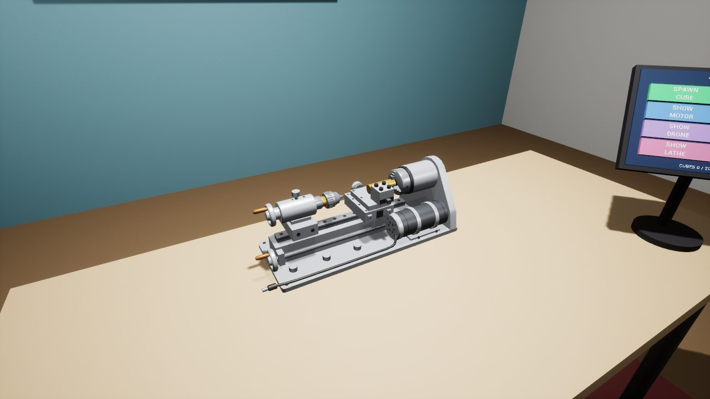 | 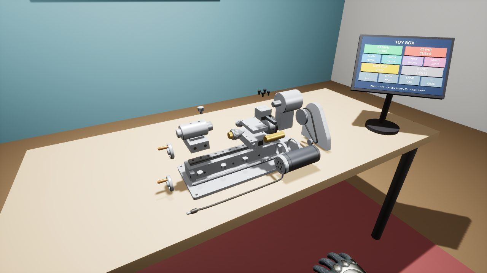 |
| **拿起电机转子（电枢 + 换向器）** | **拿起卡盘里的平面螺纹盘** |
| 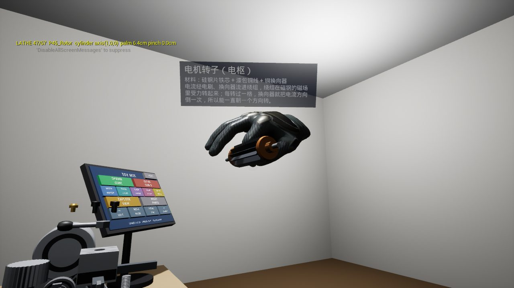 | 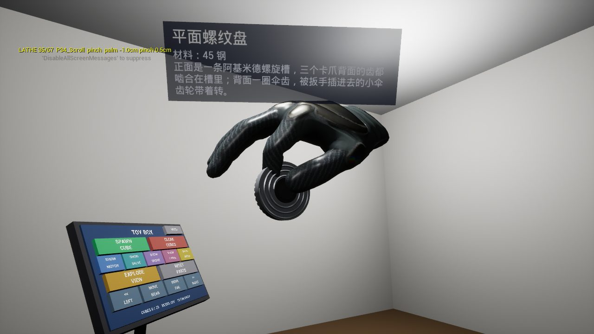 |

```
ITBasics/迷你车床爆炸图/build_lathe.py ──Blender──▶ lathe.glb ──Tools/import_model.py（MODEL_NAME=Lathe）──▶ Content/Models/Lathe/*.uasset + parts.json
```

- **模型**：一台常见的 8 合 1 迷你桌面金属车床，照 4 张产品图（正面、两个斜前方、俯斜视）用 Blender 脚本建的（没有图纸，尺寸按比例估，估算依据见 ITBasics 的 `迷你车床爆炸图/README.md`）。53 种零件 84 个实例。外面看得到的：铝底板 + 4 个脚垫、床身 + 直线导轨、丝杠 + 纵向进给手轮、主轴箱（横放的铝主轴套 + 立板）+ 油杯、Φ50 三爪卡盘 + 3 个卡爪、黄铜工件、大拖板、十字滑台 + 横向手轮 + 刻度环（在刀架后面）、四方刀架 + 手柄螺母 + 4 颗压紧螺钉 + 外圆车刀 + 切断刀、尾座 + 手轮 + 钻夹头 + 锁紧螺钉、皮带罩 + 3 颗螺钉、皮带、两个皮带轮、电机座、24 V 直流电机 + 电源线、3 个底板锁紧螺丝、卡盘扳手，三个手轮的铜手柄单独成件。拆开才看得到的：主轴、前后两个轴承、主轴锁紧螺母、平面螺纹盘（正面螺旋棱、背面伞齿）、卡爪背面的齿、两个导轨滑块、黄铜丝杠螺母、横向丝杠、刀架中心螺柱、尾座套筒和丝杆；电机拆到外壳、端盖、端盖螺钉、转子（12 槽铁芯 + 绕组 + 换向器）、两块磁钢（N 红 S 蓝，方便讲原理）、两个电刷；导轨固定螺钉 9 颗、床身固定螺钉 6 颗。丝杠类零件是真正的螺旋螺纹。实物约 38.8 × 14 × 13.7 cm（含把手和 DC 插头），放大 1.29 倍到 50cm 长。`导入车床模型.bat` 和无人机的一样：拉 ITBasics → Blender 跑 `build_lathe.py` → 编译 → 导入。
- **拆机顺序**：卡盘扳手、刀架手柄螺母、刀架螺钉 → 纵向手轮和手柄 → 刀架、两把车刀 → 横向手轮、刻度环 → 十字滑台、横向丝杠、中心螺柱 → 工件 → 大拖板、丝杠螺母、滑块 → 卡爪张开、卡盘取下、螺纹盘抽出 → 尾座（钻夹头、锁紧螺钉、套筒、手轮、丝杆、本体、滑块）→ 皮带罩螺钉 → 皮带罩 → 皮带 → 主轴锁紧螺母 → 皮带轮 → 电机抽出再拆开（端盖螺钉 → 端盖连电刷 → 转子 → 磁钢）→ 丝杠、锁紧螺丝、油杯 → 主轴箱抬起 → 主轴抬起、轴承从两头退出 → 导轨螺钉、床身螺钉。底板、床身、导轨、电机座是基座。同一个组件里的零件爆炸路线故意错开一点，不然会被合成一个抓取单元。
- **材质**：金属度都压在 0.55 以下。工作室没有反射探针，金属反射的是黑的环境，第一次导入时用金属度 0.8，铝件在这里全是黑的（实测），改成"亮灰 + 低金属度"。
- **爆炸距离**：原尺寸下最高的刀架螺钉往上 9.5cm，放大后在桌面上方约 28cm，没有冲出视野，`explode_scale` 保持 1。
- **桌上的位置**：同一个位置，Yaw 90：床身沿桌子长边，正面（电机、手轮把手、刻度手轮）朝着玩家，主轴箱在右手边，皮带罩往右飞。
- **抓取单元**：通用规则得出 68 个单元，底板与床身是基座，67 个能抓。电机外壳和电源线合成一个单元，9 颗导轨螺钉合成一个单元（同种零件超过 8 个按一组），其余每个零件单独抓（`MODELS['Lathe']` 里给基座和电机外壳写了名字和说明）。抓法：捏 50、圆柱 5、方块 5、贴表面 7。手写覆盖（`Tools/grab_overrides/Lathe.json`）5 条：三个手轮捏轮缘最高处（不捏轮毂中心）、电机外壳握外圆（电源线把包围盒拉长到 37cm）、丝杠写成沿 X 的细圆柱。

## 万用表模型从哪来

| 装配 | 爆炸（中间主板和元件、左边屏幕叠层、右边面壳和按键） |
| --- | --- |
| 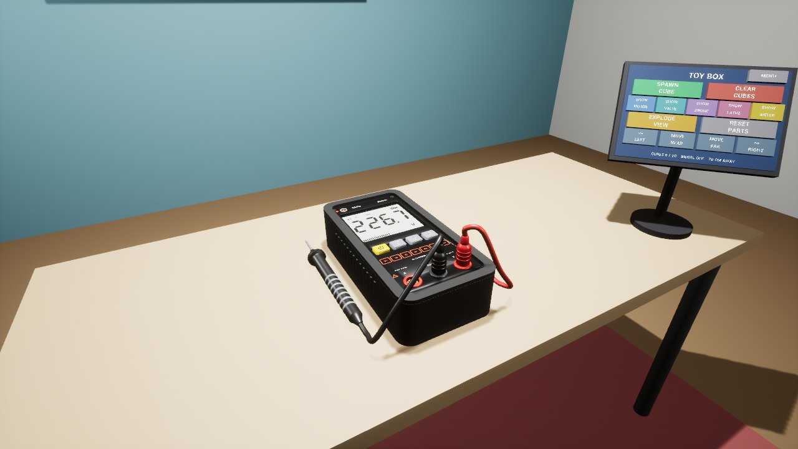 | 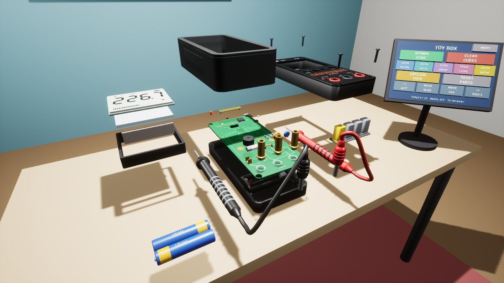 |
| **拿起 PTC 热敏电阻（错档防烧）** | **拿起主控芯片** |
| 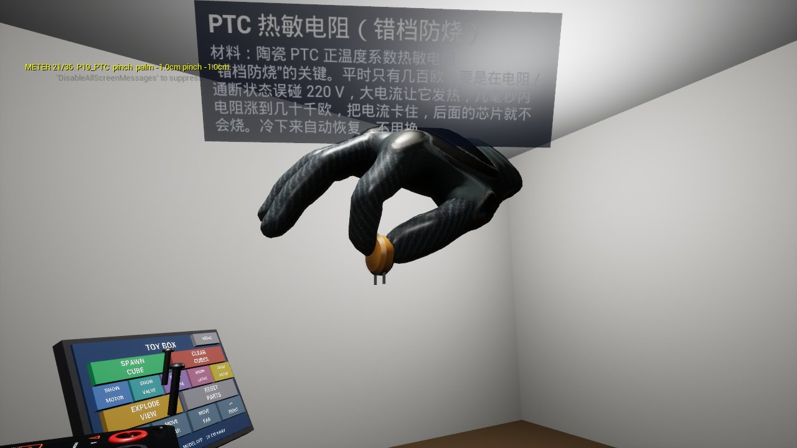 | 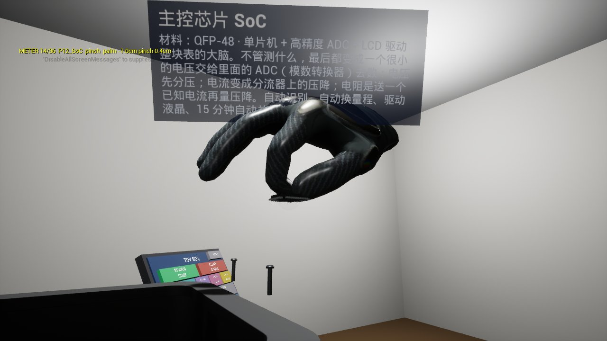 |

```
ITBasics/万用表爆炸图/build_multimeter.py ──Blender──▶ multimeter.glb ──Tools/import_model.py（MODEL_NAME=Multimeter）──▶ Content/Models/Multimeter/*.uasset + parts.json
```

- **模型**：口袋式自动量程数字万用表，外观照 SATA 世达 DO5054 智能款的产品图（白底大屏读数 226.7 V、黄色电源键 + SEL / HOLD / NCV 三个灰键、橙色功能图标框、A / COM / V 三个插孔、红黑表笔）。内部按这类表的常见结构补的，是"原理爆炸图"：每个零件的信息牌讲它在电路里干什么。32 种零件 38 个实例：底壳 + 电池弹片、橡胶护套、面壳（面板印刷是真几何体）+ 4 颗螺丝、硅胶导电按键、LCD + 2 根斑马条 + 背光导光板 + LCD 支架、主板（浅绿走线按信号走向画）、主控 SoC、自动量程模拟开关、EEPROM、晶振、基准电压源、电源 MOS + 稳压、4 个精密分压电阻、PTC、压敏电阻、4A 陶瓷保险丝、锰铜分流器、蜂鸣器、V / COM / A 三个插孔、2 颗背光 LED、NCV 感应线圈、NCV 指示灯、2 节 AAA 电池、红黑表笔（含线和插头）。尺寸估算和原理速记见 ITBasics 的 `万用表爆炸图/README.md`。
- **展示尺寸 40cm**（其他模型 50cm）：`MODELS['Multimeter']` 里写 `length_cm=40`，导入时写进 `parts.json` 的 `model.length_cm`，`AToyExplodedModel::LoadManifest` 读到就用它代替工作室的 `ModelLengthCm`。实物（含表笔）约 15 × 12.5 × 6.8 cm，放大 2.67 倍。
- **拆机顺序**：拔表笔 → 剥护套 → 拧面壳螺丝 → 掀面壳 → 拿按键 → 拆屏幕叠层（液晶屏 → 斑马条 → 导光板 → 支架）→ 拔保险丝 → 抬主板，元件一个接一个浮到各自焊盘正上方 → 取电池。底壳和电池弹片是基座。
- **爆炸后的摆法**：表面朝上平放，人从前上方往下看，单纯往上摞会挡住主板，所以分三列：中间主板和元件，左边屏幕叠层（电池在它前面），右边面壳（正面朝上）和螺丝、按键在面壳前下方；护套往上往后，表笔往前挪。爆炸后最高的护套在桌面上方约 40cm。
- **桌上的位置**：同一个位置，Yaw 90：屏幕那头朝远处、插孔和表笔插头朝着玩家，红表笔在右手边。
- **抓取单元**：主板上的元件路线本来都一样（会被合成一个单元），Blender 脚本给每个元件的出场时刻错开 0.008，所以每个元件都能单独抓、单独看信息牌。通用规则得出 37 个单元，底壳与电池弹片是基座，36 个能抓：捏 22、圆柱 4、方块 3、贴表面 7。手写覆盖（`Tools/grab_overrides/Multimeter.json`）2 条：红黑表笔写成握笔杆（线和插头把包围盒撑大了）。

## AI 服务器模型从哪来

| 装配（Blender 预览图） | 爆炸（左边 GPU 托盘、中间机箱、右边主板托盘） |
| --- | --- |
| 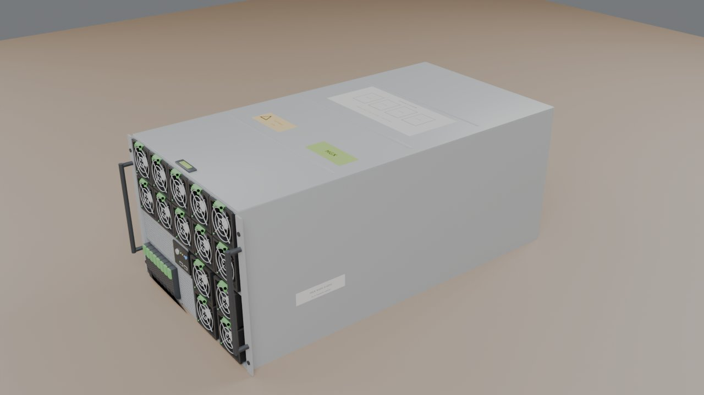 |  |

```
ITBasics/AI服务器爆炸图/build_ai_server.py ──Blender──▶ ai_server.glb ──Tools/import_model.py（MODEL_NAME=AIServer）──▶ Content/Models/AIServer/*.uasset + parts.json
```

- **模型**：8U 风冷 AI 训练服务器（8 卡 HGX H100 平台，按 DGX / HGX 的公开图片原创简化）。Blender 里先按细零件建（180 个：芯片、HBM、供电、散热器……），导出前按"一块 GPU"这一级合并成 **32 个部件**：机箱（含前控制面板，基座）、顶盖、GPU 区风扇墙（10 个风扇）、CPU 区风扇（4 个）、NVMe 硬盘组（8 块 + 背板）、电源组（6 个 + 配电板）、GPU 托盘（HGX 基板 + 4 颗 NVSwitch）、**8 块 GPU 模组**（每块含 SXM5 载板、GPU 芯片、6 颗 HBM3、供电）、8 个 GPU 散热器、主板托盘（主板 + PCIe 交换芯片、PCH、BMC 等小芯片 + OCP 网卡 + M.2）、2 颗 CPU（连散热器）、4 排 DDR5（每排 8 根）、2 组 400G 网卡（每组 4 张）。细零件的几何还在（GPU 上的芯片和 HBM 都看得到），只是不再单独拆。信息牌讲每个部件在整台机器里干什么，原理速记见 ITBasics 的 `AI服务器爆炸图/README.md`。
- **展示尺寸 55cm**：`MODELS['AIServer']` 里 `length_cm=55`，实物约 91 cm（含把手），缩放约 0.61 倍。没用 1:1 是因为拆开以后放不下：装配状态 91 × 48 × 36 cm 桌子还放得下，但爆炸后左右要摊开 2 米多、GPU 会升到桌面上方 80 多厘米。CPU 和内存条是同一个缩放的实物尺寸（CPU 封装 77.5 × 56.5 mm，内存条 133.35 × 31.25 mm），内存条本来就比 CPU 长 1.7 倍。
- **拆机顺序**：掀顶盖（往上再往后，停在电源组上方，不挡 GPU）→ 拔前面的风扇墙、CPU 风扇、硬盘组 → 电源组从后面拔出再抬高 → GPU 托盘先抬高再往前抽出，8 块 GPU 再往上提、排成"两层看台"：每层 4 块左右一字排开，靠玩家那层低、后面那层高（桌上约高 15cm），每块的散热器浮在自己的 GPU 上方约 5cm，站着从缝里能看到 8 颗芯片和 HBM → 主板托盘从后面整个抽出再往远处让，CPU、内存、网卡往上浮。机箱是基座。
- **桌上的位置**：`ServerMount` Yaw 180，前面板朝左手边、后面朝右手边。爆炸后 GPU 托盘在左边、比机箱高（后面那层散热器的顶在桌面上方约 59cm），主板托盘在右边贴着桌面，抽出后再往远处让，避开右手边的触屏。
- **抓取单元**：32 个（机箱是基座），31 个能抓，一个部件一个单元，没有手写覆盖。以前（180 个零件、111 个能抓）拆得太碎，8 块 GPU 的散热器挨得只有约 1cm，看上去像两大块，GPU 本体藏在散热器底下，所以改成按部件合并。第一次合并后体检截图里 8 块 GPU 还是叠成两堆：基板上 4 块一排的方向正好顺着玩家视线，光往上提、拉开间距没用，所以改成横过来的两层。之后又按用户要求把散热器和 GPU 分开，好看到芯片。想回到细零件版，把 ITBasics 脚本里 `merge_units()` 那一行注释掉再导入。
- **体量**：32 个静态网格、约 32 万三角面（几何没减，只是合并），`Content/Models/AIServer` 11MB（以前 180 个网格 24MB）。

## 球形漂浮机器人模型从哪来

| 装配（Blender 预览图） | 爆炸 |
| --- | --- |
|  | 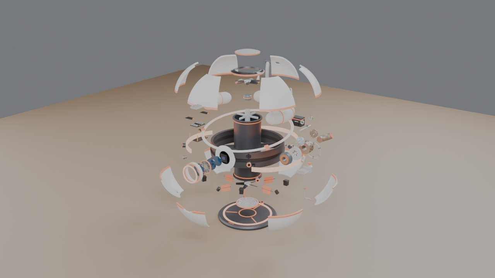 |

```
ITBasics/球形漂浮机器人爆炸图/build_orb_bot.py ──Blender──▶ orb_bot.glb ──Tools/import_model.py（MODEL_NAME=OrbBot）──▶ Content/Models/OrbBot/*.uasset + parts.json
```

双击 `导入漂浮机器人模型.bat`（只有模型改了才需要跑）。

- **模型**：科幻原创的球形浮游机器人 ORB-1（白 + 橙），悬在自带的停机加注坪上方。设定是"真实骨架 + 科幻外皮"：航空煤油 → 微型燃气涡轮发电机 → 球心竖直涵道里的共轴反转风扇往下吹气；6 片导流舵片管俯仰 / 横滚，赤道 4 个小喷口管偏航。58 种零件 96 个实例：12 片装甲瓣、顶 / 底格栅、激光雷达环、浮游光环、3 段灯带；3 段环形燃料舱 + 加注管 / 口盖 / 液位传感器、滤清器、燃油泵、电磁截止阀、调压阀、7 根油管；涡轮发电机拆成发电机定子 / 转子、进气口、压气机叶轮、燃烧室、喷油嘴组、点火器、涡轮转子、排气管、主轴、2 个轴承、支架；缓冲电池、电子舱（支架、电源板、2 块电调、散热片、飞控、IMU、线束）；上 / 下风扇和电机、电机支架、6 片舵片 + 6 个舵机、4 个偏航喷口；主眼（3 片镜片、光圈、图像传感器、遮光罩、眼圈光环）、2 个立体相机、2 个测高雷达、2 根天线。信息牌都标了【真实原理】或【科幻设定】，原理速记见 ITBasics 的 `球形漂浮机器人爆炸图/README.md`。
- **展示尺寸 50cm**：`MODELS['OrbBot']` 里 `length_cm=50`，按含停机坪的总高（56cm）缩放，球体约 32cm、离坪面约 15cm。
- **拆机顺序**：光环上浮 → 口盖、天线、相机、喷口、灯带往外拔 → 顶 / 底格栅、雷达环 → 12 片装甲瓣像花一样打开 → 主眼镜片沿视线朝玩家排开（约 20cm）→ 下半球油路往外 → 电池往后、涡轮发电机往右手边拉出再沿轴线拆成一串、电子舱往左手边拉出再一层层叠开 → 舵机、舵片、风扇、电机沿涵道上下抽出 → 燃料舱最后往上提（它和赤道承力带同高，只能往上走）。停机坪 + 赤道承力带 + 涵道 + 主眼镜筒是基座。
- **桌上的位置**：`OrbMount` Yaw 90，主眼朝着玩家，涡轮在右手边、电子舱在左手边。第一次体检时往上炸得太高（顶部零件出画面）、涡轮组贴着右手边的触屏，已把往上的距离压低约 25%、涡轮组改成往右后方拉出，复查后离触屏约 20cm；最顶上一两个小件仍贴着体检截图的上沿。
- **抓取单元**：93 个（停机坪 + 赤道承力带 + 涵道 + 主眼镜筒是基座），92 个能抓：捏 61、贴表面 19、圆柱 7、方块 5。`toy.GrabAudit Robot` 全部捏到，导入方向检查 3 项 OK。没有手写覆盖。
- **体量**：96 个静态网格、约 21 万三角面，`Content/Models/OrbBot` 13MB。⚠️ 还没在头显里看过：7 个模型按钮缩到 4.1cm 后的字能不能看清、下半球朝下处在阴影里显得偏灰（材质是白的，工作室没有反射捕获）。

## 四缸发动机模型从哪来

| 装配（Blender 预览图） | 爆炸 |
| --- | --- |
| 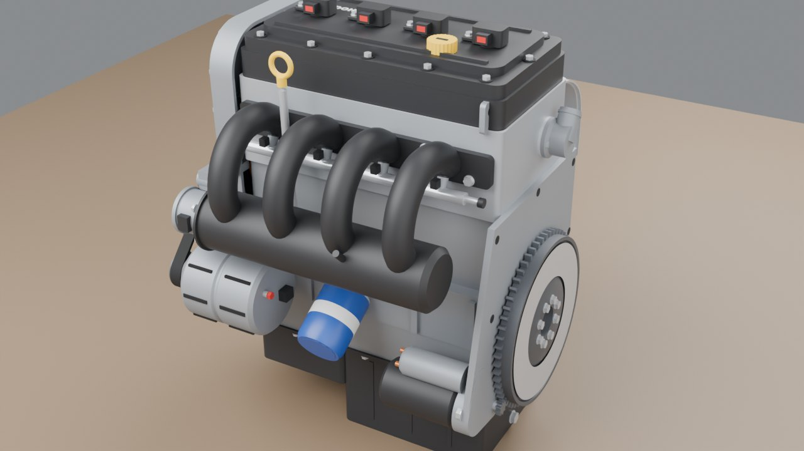 | 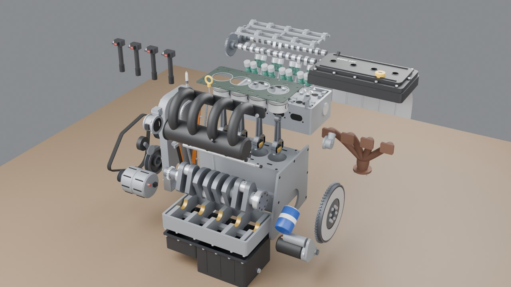 |

```
ITBasics/四缸发动机爆炸图/build_engine.py ──Blender──▶ engine.glb ──Tools/import_model.py（MODEL_NAME=Engine）──▶ Content/Models/Engine/*.uasset + parts.json
```

双击 `导入发动机模型.bat`（只有模型改了才需要跑）。

- **模型**：通用的 2.0L 自然吸气直列四缸汽油机（DOHC 16 气门、正时链条、进气道喷射，缸径 86 × 行程 86），不对应具体车型。先和用户确认了零件树和接口参数表，再一个系统一个系统建：49 个部件 = 缸体（基座）+ 48 个能抓的单元。粒度按"拿在手里能讲清楚作用的东西"分：曲轴、4 个活塞、4 根连杆、飞轮、皮带轮、缸盖、两根凸轮轴、凸轮轴承盖架、4 组气门（每组 4 个气门连弹簧和挺柱）、缸垫、正时链条 / 导轨 / 罩盖、气门室盖、4 个点火线圈、4 个火花塞、进气歧管、节气门、油轨、排气歧管、隔热罩、油底壳、主轴承梁、机油泵、机滤、机油尺、水泵、节温器、发电机、起动机、多楔带、张紧轮。原理速记和接口尺寸见 ITBasics 的 `四缸发动机爆炸图/README.md`。
- **展示尺寸 60cm**：`MODELS['Engine']` 里 `length_cm=60`。装配后最长的一边是高度（油底壳底到点火线圈顶约 67cm），缩放 0.89 倍，活塞直径约 7.7cm。
- **拆机顺序**：多楔带 → 张紧轮、发电机、水泵、皮带轮 → 起动机、机滤、机油尺（只拔出一半）→ 点火线圈、火花塞 → 节气门、进气歧管、油轨 → 隔热罩、排气歧管 → 正时罩盖、导轨、链条 → 气门室盖 → 承盖架、凸轮轴 → 飞轮 → 缸盖（连气门）→ 缸垫 → 油底壳 → 活塞、连杆从缸孔往上推出 → 机油泵 → 主轴承梁 → 曲轴。
- **桌上的位置**：`EngineMount` Yaw 90，进气侧朝着玩家，正时端在左手边、飞轮在右手边，比其他模型往远处挪了 6cm。拆开后附件和正时件往左（最远的皮带在桌面左侧约 -68cm）、飞轮和排气往右（离触屏约 13cm）、缸盖和凸轮轴往后，下半截（油底壳、主轴承梁、曲轴）像抽屉一样往玩家这边拉出，油底壳正好停在桌子前沿。最高的凸轮轴承盖架在桌面上方约 81cm。
- **导出时左右镜像**：Blender 脚本最后把整台发动机沿 X 镜像，这样进气侧朝玩家时正时端才在左手边（不镜像就得让排气侧朝玩家）。镜像后相当于曲轴从前面看逆时针转，静态模型看不出来；气门室盖上的字提前反写了。
- **抓取单元**：49 个（缸体是基座），48 个能抓：贴表面 26、圆柱 14、方块 7、捏 1。`toy.GrabAudit Engine` 48 个全部捏到，导入方向检查 4 项 OK（进气歧管在 +Y、排气歧管在 -Y、正时罩在 -X、飞轮在 +X）。没有手写覆盖。
- **摆放复查**（按网格包围盒 + 爆炸位移算）：没有零件低于桌面；离触屏最近的起动机还隔约 11cm；油底壳前沿正好停在桌子前沿；缸盖、排气凸轮轴、承盖架往后越过桌子后沿最多 5cm，但它们悬在离地 117~157cm，不碍事。拆开后发电机正好在左边方块的生成点上，方块会落在发电机上。
- **体量**：49 个静态网格、约 17 万三角面，`Content/Models/Engine` 7.9MB。⚠️ 还没在头显里看过：第 2 页的 ENGINE 卡片要先点「下页」才看得到。

## 五指灵巧手模型从哪来

| 装配（Blender 预览图） | 爆炸 |
| --- | --- |
| 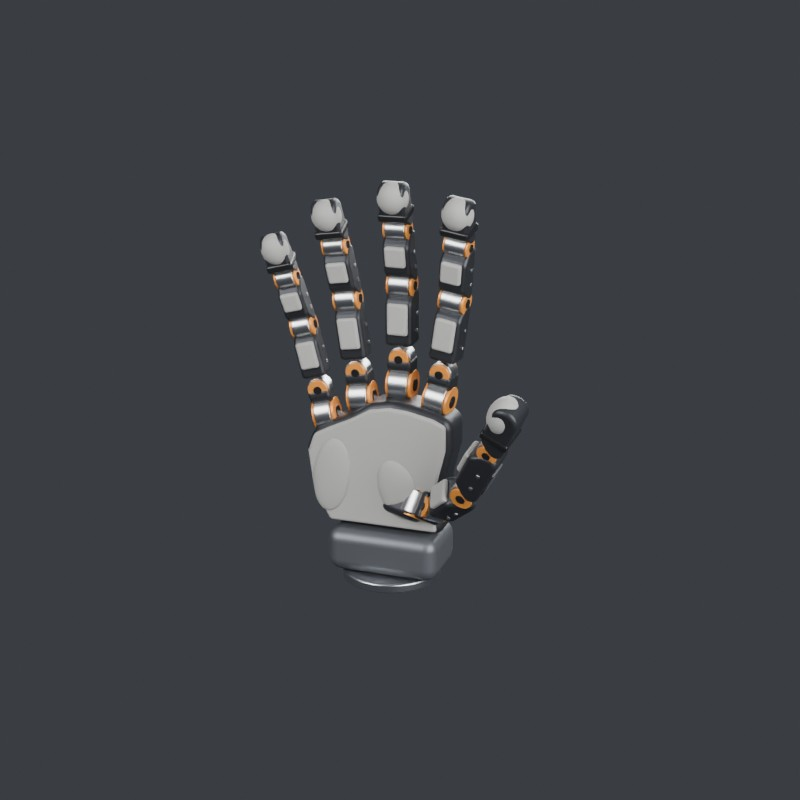 | 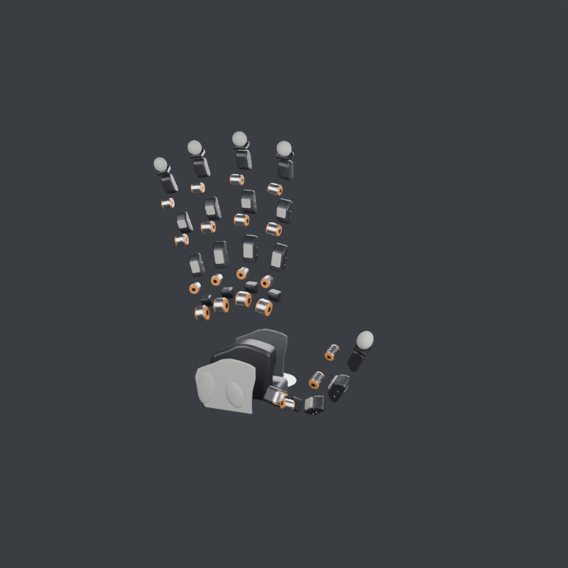 |

```
ITBasics/五指灵巧手/build_hand.py ──export_ue.py（Blender）──▶ hand_ue.glb ──Tools/import_model.py（MODEL_NAME=DexHand）──▶ Content/Models/DexHand/*.uasset + parts.json
```

双击 `导入灵巧手模型.bat`（只有模型改了才需要跑）。触屏第 2 页的卡片 `HAND-20`，控制台 `toy.Screen Hand`。

- **模型**：ITBasics 里的 20 自由度直驱右手（5 指 × 4 关节，关节布局参考 Wuji Hand 2 公开 URDF，外形原创），原来是给网页查看器做的，180 个网格零件、按关节分层挂在一起。`export_ue.py` 复用 `build_hand.py` 建模，再按这个工程的约定重新导出，不改原来的网页版。
- **合并成 50 个部件**：按零件树的叶子合并：每个电机模组（定子壳 + 两个输出环 + 两个端盖）、每节指骨（骨架 + 硅胶指节垫 + 指背盖板 + 螺钉）、指尖（力传感器 + 指尖套）各一个部件。每根手指 9 个（J1~J4 电机、指根轭架、近 / 中 / 远节指骨、指尖）× 5 + 背盖、掌心硅胶、腕部模块、法兰 + 掌骨架（基座）。螺钉、端盖单独抓太小（放大后也就几毫米）。
- **手势**：放松（`params.json` 的 `poses.rest`）。0 位的拇指是横着伸出去的，不像手。
- **爆炸**：网页版的偏移是挂在关节父子层级上的（手指根部往外、关节之间拉开、电机往手心弹），导出时沿父链把每一级偏移换成世界坐标，变成几步平移，按层级错开出场：法兰 → 腕部 → 背盖 → 掌心硅胶 → 五根手指依次拔出 → 关节拉开 → 电机弹出 → 指尖。偏移量比网页版大约 2 倍（VR 里要伸手进去捏）；法兰和腕部改成往手背方向退，不往下走（往下会钻进桌面）。虚幻这边只支持平移，所以拆开后每个部件还保持装配时的朝向。
- **展示尺寸 50cm**：实物装配后约 14 × 9 × 21cm（宽 × 厚 × 高），放大约 2.4 倍，最小的 J4 电机直径约 2.6cm。
- **桌上的位置**：`DexHandMount` Yaw 90，法兰朝下立在桌上，手心朝着玩家，拇指在右手边。按包围盒 + 爆炸位移算：拆开后最高的中指指尖在离地约 158cm（桌面上方 83cm），法兰往后退到 x≈108（桌子后沿 110），拇指往玩家这边最近到 x≈45，左右在 -34 ~ 30cm 之间，离右边的触屏（y=60）还有约 30cm。
- **导入方向检查**：拇指指尖在 +X、掌心硅胶在 +Y、背盖在 -Y、中指指尖在 +Z。
- **导入结果（2026-10-23）**：50 个静态网格（Nanite 全关），共约 17.2 万个三角形，`Content/Models/DexHand` 58 个文件约 6.0MB。抓取单元 50 个（法兰 + 掌骨架是基座），49 个能抓：捏 40、方块 8、圆柱 1。导入方向检查 4 项 OK，没有缺节点的警告。
- ✅ **抓取体检（桌面模式）**：`toy.GrabAudit Hand` 49 个单元全部捏到。装配截图里手立在桌上、手心朝玩家、拇指在右手边，没有东西钻到桌面下面。爆炸截图里拇指那串零件在镜头里叠在触屏前面（按上面算的离触屏还有约 30cm，没在 3D 里量过），中指那一列最上面的零件被画面上沿切掉。
- ⚠️ **还没在头显里看过**：爆炸后最高的指尖在桌面上方约 83cm，站着够不够得着待确认。

## 干法刻蚀机模型从哪来

| 装配（Blender 预览图） | 爆炸 |
| --- | --- |
| 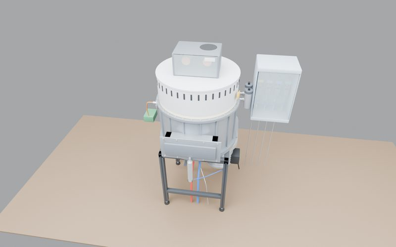 | 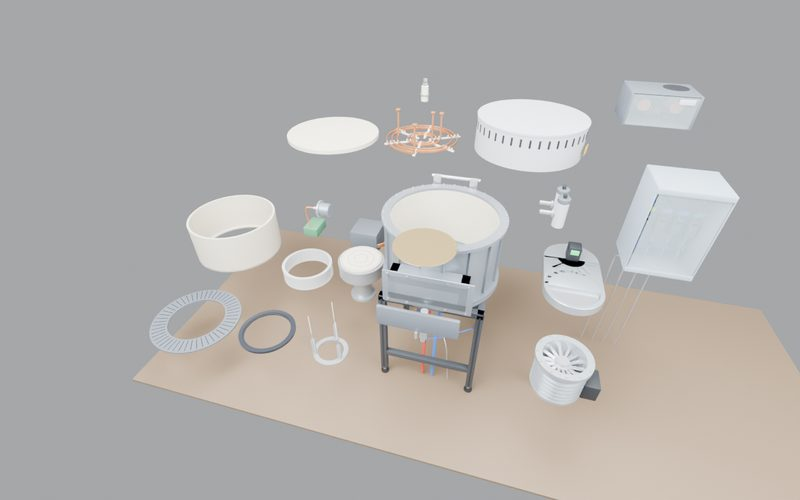 |

```
ITBasics/干法刻蚀机/build_etcher.py ──export_ue.py（Blender）──▶ etcher_ue.glb ──Tools/import_model.py（MODEL_NAME=Etcher）──▶ Content/Models/Etcher/*.uasset + parts.json
ITBasics/干法刻蚀机/web/etch_core.js ──tools/export_core.mjs（Node）──▶ etcher_content.json + etcher_golden.json ──导入 bat 拷过来──▶ Content/Etcher/
```

双击 `导入刻蚀机模型.bat`（只有模型或网页的原理内容改了才需要跑）。触屏第 2 页的卡片 `ETCHER`，控制台 `toy.Screen Etcher`。

刻蚀机分两个模式做：玩具室桌上的**演示模式**（小模型，把网页里的原理讲解都搬进来）和单开一个场景的**仿真 fab 模式**（1:1 机台 + 机台触屏，玩家当工艺工程师）。这一版是两个模式共用的底子：桌面模型 + 共用核心。

- **模型**：ITBasics 网页版里的 ICP 工艺腔 PM1（原创，不对应具体机型）。`export_ue.py` 复用 `build_etcher.py` 建模，只要 PM1：去掉射频电源柜（1.6m 高的大柜子，放进来整机变宽，别的零件都跟着缩小）、EFEM、传输腔，两台机械手留给 fab 模式；剪掉连到电源柜的两根射频电缆和气体盒到喷嘴的进气管；加一片能抓的 300mm 晶圆（厚度加到 3mm，缩小后才看得见）。不改原来的网页版。
- **20 个部件**：腔体 + 机架（基座）、射频屏蔽罩、源匹配器、平面线圈、中心进气喷嘴、陶瓷介质窗、气体盒、观察窗 + 光谱仪、真空计、闸阀门、内衬、约束环、晶圆、边缘环、绝缘环、静电卡盘、升降针、偏压匹配器、摆阀、分子泵。粒度按"开腔保养时拿在手里能讲清楚作用的东西"分；中文名和作用说明取自网页的零件页（`etcher_content.json`），材料是手写的。
- **爆炸**：按开腔保养的顺序：先把顶上的源组件（屏蔽罩 → 源匹配器 → 线圈 → 喷嘴 → 介质窗）提起来退到腔体后面；晶圆升起来飘到闸阀上方、离玩家最近；腔里的内衬、约束环、边缘环、绝缘环、静电卡盘从腔口提出来摆到左边，升降针从腔底抽出来放在左前方；气体盒、真空计、摆阀、分子泵往右拉开，光谱仪往左，闸阀门往玩家这边，偏压匹配器往左后方。`export_ue.py --check` 查过：拆开 100% 时部件之间没有穿插（拆的半路有几件会从机架的细杆中间穿过去）。
- **展示尺寸 60cm**：实物（不含电源柜）约 145 × 97 × 165cm（宽 × 深 × 高），缩到约 0.36 倍，晶圆直径约 11cm，最小的喷嘴约 2 × 3 × 5cm（捏）。
- **桌上的位置**：`EtcherMount` Yaw 90，闸阀朝着玩家，气体盒、分子泵在右手边，光谱仪在左手边。装配后占 x 52~88、y -36~16，最高离地 135cm（桌面上方 60cm）。拆开后 x 41~109、y -84~36，最高离地 140cm：内衬和约束环在最左边，比桌子左沿（y=-80）多出约 4cm（悬在半空，不碰桌子）；气体盒离右边的触屏（y=60）约 24cm。
- **导入方向检查**：闸阀门在 +Y、气体盒和分子泵在 +X、光谱仪在 -X。
- **共用核心（网页和 VR 算出来的数一样）**：网页是唯一的源头。ITBasics 把网页里的工艺模型和所有讲解文字抽成 `web/etch_core.js`，`export_core.mjs` 导出两份 json：
  - `Content/Etcher/etcher_content.json`：15 步的"现在在干什么 / 为什么"、32 个零件说明、5 个预置配方、8 个配方参数、结果提示和判定文字、粒子名。以后触屏和信息牌读它，网页改了文字 VR 跟着变。
  - `Content/Etcher/etcher_golden.json`：5 个预置配方 + 60 个随机配方（固定种子），网页版模型按 0.05 秒一步、不加噪声算出的结果。
  - `ToyEtchCore`（C++）逐行照 `etch_core.js` 翻译，控制台 `toy.EtchSelfTest` 逐组对答案：稳态量（速率、离子能量、选择比……）相对误差 ≤ 1e-6，刻蚀过程（深度、钻蚀、栅氧、光刻胶、光谱）≤ 1e-4，终点时间允许差一步（0.05 秒），5 项判定必须一样。云端用 g++ 单独编译对过一遍：65/65 一致（加 `-ffast-math` 也一致）。
  - 改公式的顺序：先改 `etch_core.js` → 跑 `export_core.mjs` → 照着改 `ToyEtchCore.cpp` → 跑导入 bat 拷 json → `toy.EtchSelfTest` 全过。
- **还没做的**：触屏上的原理讲解页、腔里的等离子体 / 粒子动画、配方实验（下一阶段，演示模式）；新场景、1:1 机台和机台触屏（仿真 fab 模式）。
- **导入结果（2026-10-25）**：20 个静态网格（Nanite 全关），共约 7.9 万个三角形，`Content/Models/Etcher` 55 个文件约 5.4MB。抓取单元 20 个（腔体 + 机架是基座），19 个能抓：圆柱 10、贴表面 5、方块 3、捏 1。导入方向检查 4 项 OK，没有缺节点的警告，没有手写覆盖。
- ✅ **工艺模型对答案**：`toy.EtchSelfTest` 65/65 组和网页版一致；讲解文字读到 15 步、32 个零件、5 个预置配方、8 个配方参数。
- ✅ **抓取体检（桌面模式）**：`toy.GrabAudit Etcher` 19 个单元全部捏到。装配截图里工艺腔立在桌上、闸阀门正对镜头、气体盒在右后方、光谱仪在左边；拆开后没有零件钻到桌面下面，分子泵、摆阀、气体盒停在触屏左边，没撞进触屏。腔体上半截和最左边的内衬、约束环超出了体检截图的画面（取景问题）。
- ⚠️ **还没在头显里看过**：拆开后最左边的内衬在离站立点约 84cm 的左侧，站着够不够得着待确认；第 2 页的 ETCHER 卡片要先点「下页」才看得到。

## 原理

### 先猜一下

> 抓起方块时，如果只把方块的**中心**挪到手心（不管旋转），会看到什么？
>
> A. 和现在一样，手掌贴着一个面
> B. 方块保持被抓前的歪斜角度，手掌可能插进方块里、或者只碰到一个角
> C. 方块会自动转正

<details><summary>答案</summary>

**B**。只对齐位置，旋转就是方块原来的样子，而手的朝向是任意的，所以手掌和方块表面一般不平行；方块中心离手心又只有 5cm，手掌模型就会穿进去。要"贴面"，就得同时对齐**位置和朝向**，这正是抓点要做的事。
</details>

### 抓点对齐（`AToyCube::ComputeHoldTransform`）

手和方块用同一个约定的坐标系来描述"接触点"：

- **手的 GripPoint**：在掌心表面，X 轴从掌心指向手背，Z 轴指向手指。
- **方块的 GrabPoint_0..5**：六个面中心各一个，X 轴 = 该面外法线（从方块指向外面），Z 轴 = 一个切线方向。

当手掌贴着某个面时，这两个坐标系应该**完全重合**。所以抓取 = 三步：

1. **选面**：每个面的外法线和手的 X 轴点积越大（越正对手掌）、离手越近，分越高。
2. **选摆法**：方块绕法线转 90° 看起来一样，所以 4 种摆法里挑 Z 轴最贴合手指方向的那种——方块被抓起时转动最少，不会突然甩一下。
3. **算变换**：要 `抓点世界变换 = 手抓点世界变换`。抓点在方块里的相对变换是 `G`，所以 `G × 方块 = 手抓点`，即 `方块相对手抓点 = G⁻¹`。把方块挂到 GripPoint 上，在 0.08 秒内从原位置插值到 `G⁻¹`。

这个思路和 UE 的 VR 模板、Meta/SteamVR 的 SDK 里 "snap grab + 抓点" 是同一类做法（**主流做法**）。它的前提：

- **物体形状规则**。方块六面对称，所以选面 + 4 种摆法就覆盖了所有握法。杯子、枪这类不对称物体一般只放一两个手工摆好的抓点，或者干脆用"保持抓起瞬间相对位置"的自由抓取。
- **手是硬的**。手指只是按握把值弯到固定角度，不会根据物体表面做碰撞贴合（那是 hand IK / 物理手的范畴）。

### 另外两种抓法，供比较

| 做法 | 体验 | 代价 |
| --- | --- | --- |
| **抓点吸附（本项目，主流）** | 手总是"标准地"握着物体，视觉稳定 | 物体会被吸到手里，离得远时有一点跳 |
| 自由抓取：记住抓起瞬间的相对变换 | 抓哪里就是哪里，零跳变 | 手模型经常穿进物体，看起来不像握住 |
| 物理手：手是刚体，用约束拉物体 | 能推、能捏、能碰撞 | 复杂很多，容易抖，调参难 |

### 零件抓取（`AToyPartUnit`、`IToyGrabbable`）

| 装配 | 爆炸后抓转子 | 拿回原位附近出现虚影 |
| --- | --- | --- |
|  |  |  |

**1. 抓的是"单元"，不是网格。** 84 个网格里有 28 根导条、18 个线圈、十几颗螺钉，一个个抓没意义。爆炸路线完全相同的零件本来就一起动，按路线分组就是天然的单元：转子总成（轴 + 铁芯 + 鼠笼 + 两个轴承）、端盖、风扇、风罩、接线盒（含接线板、电源线）、盒盖……；只有螺钉这种"路线相同但各在各位置"的紧固件一颗一颗分开。定子 + 机座是基座，不能抓。每个单元是一个 `AToyPartUnit` Actor，挂在模型上，位置由爆炸进度决定。

**2. 装配 / 爆炸两种状态。** 完全装配时只开整机的检测盒（抓哪都 = 拿起整台电机，自由抓取：抓哪里就保持哪里）；完全爆炸后只开各单元的检测盒；动画进行中都不能抓。检测盒只做查询、不参与物理，所以方块会直接穿过电机。

**3. 现在的抓法：扳机捏取 + 自由捏取**（`AToyHand`、`AToyPartUnit::ComputeHoldTransform`、`AToyCube::ComputeHoldTransform`）。

- **只用扳机抓**：扳机过 0.6 捏起，低于 0.4 松开（迟滞，防止扳机在中间值抖动时反复抓放）；握把完全不参与抓取，只弯中指、无名指、小指。
- **判定点**：拇指指尖和食指指尖的中点（"捏合点"），半径 `GrabRadius` = 2cm 以内离得最近的那个（量的是到碰撞表面的距离）。
- **范围小球**：捏合点画一个半透明小球，半径 = 判定半径。平时淡白；有东西进范围时变绿（东西同时变亮）；捏住后缩到一半、更淡。只显示，不碰撞、不投影。日志里有 `ToyBox: 右手捏合范围内：…`，VR 里看不清时可以查。
- **捏起后怎么拿**：小件（`pinch`：螺钉、螺母、垫片……）把中心（或覆盖文件指定的捏点）吸到捏合点；其余零件、整机、方块都是**自由捏取**——保持捏起那一刻物体相对手的位置和角度，不再把手掌吸到表面上（Meta Interaction SDK 捏取就是这么做的）。
- **旧的手掌贴合还在**：parts.json 里 `cylinder` / `box` / `surface` 的数据照旧生成（下表），控制台 `toy.PalmSnap 1` 切回去就会用；默认不用。

| 捏球体 | 捏螺母 | 捏桨毂 |
| --- | --- | --- |
|  |  |  |

导入时给每个单元算的抓法（`Tools/import_model.py` 的 `grab_spec`），按下面的顺序挑第一个合适的。现在默认只用到 `pinch` 和覆盖文件里的 `point`，其余是 `toy.PalmSnap 1` 时的贴合方式：

| 顺序 | 类型 | 怎么判定 | 怎么贴合（`toy.PalmSnap 1`） |
| --- | --- | --- | --- |
| 1 | 手写覆盖 | `Tools/grab_overrides/<模型>.json` 里有这个单元（可用 `*` 通配） | 按文件里写的来 |
| 2 | `pinch` 捏 | 最长边 ≤ 7cm 的小件 | （默认也用）朝向保持抓起瞬间的样子，只把零件中心（或指定的 `point`）挪到拇指和食指之间 |
| 3 | `cylinder` 圆柱面 | 绕 X / Y / Z 任意一根轴的回转体，圆心不要求在原点：垂直于轴的两个方向一样宽（差 15% 内），绕轴 36 个角度格里至少 60% 的外轮廓半径和中位数差 8% 以内 | 手掌贴圆柱面；细长杆（长度 > 2.5 倍半径）只能握 |
| 4 | `box` 实心盒的面 | 从包围盒中心沿 X/Y/Z 打穿透射线，碰到的第一层和最后一层三角形围成"实心盒" | 和方块的 6 个抓点同一套规则 |
| 5 | `surface` 贴实物表面（兜底） | 空心件、成对件、环形件、中间有孔的 | 从指尖往掌心方向按三角形打这个单元自己的网格，手掌贴在命中点上 |

覆盖文件每条都要写 `why`：无人机电机、螺旋桨（捏桨毂）、电池绑带和天线（捏最高点）、电机吊环螺钉（捏吊环顶上）、球阀齿轮轴、执行器端盖、位置指示器（捏顶上）、车床的三个手轮（捏轮缘）、电机、丝杠，万用表的两支表笔（握笔杆）。`point` / `center` 可以写坐标，也可以写 `"top"`（最高的顶点）或 `"node"`（零件节点原点）。

| 模型 | 可抓单元 | 抓法统计 |
| --- | --- | --- |
| 电机 | 27 | 捏 19、圆柱 6、方块 1、贴表面 1（手写 1） |
| 球阀 | 63 | 捏 36、圆柱 20、方块 2、贴表面 5（手写 3） |
| 无人机 | 25 | 捏 10、圆柱 8、方块 3、贴表面 4（手写 10） |
| 车床 | 67 | 捏 50、圆柱 5、方块 5、贴表面 7（手写 5） |
| 万用表 | 36 | 捏 22、圆柱 4、方块 3、贴表面 7（手写 2） |

**抓取体检 `toy.GrabAudit`。** 控制台输入 `toy.GrabAudit`（或 `Motor` / `Valve` / `Drone` / `Lathe` / `Multimeter` / `Server` / `Robot` / `Engine` / `Hand` / `Etcher`，加 `quit` 跑完退出），会依次摆出模型（先拍一张装配全景 `00_assembled.png`）、爆炸（再拍一张 `00_exploded.png`），用右手按桌面模式的方式（捏合点放在零件上离镜头最近的表面点、扣扳机）把每个单元捏一遍，捏住后手往上提、镜头给一个特写，截图到 `Saved/GrabAudit/<模型>/<序号>_<单元>.png`，并写 `Saved/GrabAudit/summary.csv`。五个模型 180 个单元约 6 分钟跑完（只跑车床或万用表约 1 分钟）。命令行批量跑：

```
UnrealEditor.exe VRToyBox.uproject -game -windowed -ResX=1280 -ResY=720 "-ExecCmds=toy.GrabAudit All quit"
```

**录演示动图 `toy.Demo`。** 控制台输入 `toy.Demo`（或 `Motor` / `Valve` / `Drone` / `Lathe` / `Multimeter` / `Server` / `Robot` / `Engine` / `Hand`，加 `quit` 录完退出），每个模型先爆炸一次再装回去、量出两种状态的包围盒，然后逐帧截图到 `Saved/Demo/<模型>/f_0000.png …`：装配停 1 秒 → 爆炸 → 右手从镜头右下方伸过去捏起第二大的零件（最大的一般是机壳）、往上提 → 松手 → 装配回去，镜头按包围盒自动拉远拉近、绕模型慢慢转 24°。要带 `-benchmark -fps=15`（固定步长，截图慢也不掉帧）。README 上面那 6 张 GIF 就是这样录的（10 帧/秒、480 宽、96 色，每张约 3MB）：

```
UnrealEditor.exe VRToyBox.uproject -game -windowed -ResX=960 -ResY=540 -benchmark -fps=15 -nosound "-ExecCmds=r.MotionBlurQuality 0,toy.Demo quit"
ffmpeg -framerate 15 -i Saved/Demo/MOTOR/f_%04d.png -vf "fps=10,scale=480:-1:flags=lanczos,split[a][b];[a]palettegen=max_colors=96[p];[b][p]paletteuse=dither=bayer:bayer_scale=5:diff_mode=rectangle" docs/gifs/motor.gif
```

ffmpeg 要用带 `palettegen` 滤镜的版本（2014 年以后的都行；pip 装的 `ffmpeg` 包里那个 2013 年的版本没有）。

| 以前的手掌贴合（`toy.PalmSnap 1`）：吊环 | 端盖 | 涵道 | 电池 | 机身罩 |
| --- | --- | --- | --- | --- |
|  |  |  |  |  |

**4. 复位。** 松手后 0.4 秒飞回原位（目标每帧重新算，路上切换爆炸 / 装配也能飞到新位置）；拿着靠近原位 5cm 以内，原位显示半透明虚影，这时松手 0.12 秒吸进去。整机松手飞回桌上的支架。触屏 **零件复位** = 所有手松开，全部飞回去。

**5. 信息牌。** 手边一块 `UWidgetComponent`，里面直接放 Slate 文字（不需要 UMG 蓝图资产）。UE 自带的 3D 文字（TextRender）没有中文字形，Slate 的默认字体有中文后备字形，所以用它。不受光照的 UI 在自动曝光下会很暗（颜色 1 ≈ 1 尼特，房间几十尼特），所以信息牌、虚影、高亮都乘了 12 倍亮度。

和其他做法比：物理手（Half-Life: Alyx、Boneworks）零件有重力会掉，看零件不方便；纯自由抓取零配置但手会穿进零件；维修培训类软件普遍是"悬浮 + 松手回位 + 虚影吸附"，这里就是借的这套，第二阶段的"按顺序拆装"可以直接复用虚影和吸附。

### 触屏怎么"点"

屏幕是一块真正的 GUI：`UWidgetComponent` 里直接放 C++ 写的 Slate 界面（和手边的信息牌一样，不需要 UMG 蓝图资产，能显示中文）。界面 1280 × 880 像素铺满 32 × 22cm 的屏幕（每厘米 40 像素；Quest 3 在 50cm 外每厘米大约 29 个像素，再高也看不出区别）。

- **顶栏**：标题、提示（模型没导入时这里提示要跑哪个 `scripts/import_*.bat`）、右上角 **菜单**。
- **左边**：4 × 2 的模型卡片（每张约 4.8 × 5.5cm，色块 + 中文名 + 状态），桌上那个模型的卡片有金色描边，最后一格 **收起模型**。超过 7 个模型时卡片自动分页，出现 **上页 / 下页**。下面两个大按钮 **生成方块 / 清空方块**（10 × 3.5cm）。
- **右边**：当前模型的名字和状态，**爆炸拆开 / 组装回去**、**零件复位**，下面是挪模型的方向键（每格约 2.8 × 2.5cm，中间显示离你多远）。没有模型时 **零件复位** 和 **收起模型** 变灰。

界面上的按钮只是贴图里的像素，没有碰撞体，所以手指被当成一只"鼠标"（`AToyTouchScreen::TouchFinger`）：

1. 屏幕前方有一个看不见的感应区（表面后 1.5cm 到前 3.5cm）。手每帧在食指指尖做小球重叠查询，指尖在感应区里就交给触屏。
2. 指尖投影到屏幕平面，换算成界面像素（`UWidgetComponent::GetLocalHitLocation`，和画面用的是同一套换算），再量指尖离屏幕表面多远。
3. **3cm 以内悬停**：手指对着的按钮变亮，屏幕上出现一个光标圆点（越靠近越小）。
4. **从前面戳到 0.6cm 以内算按下**：执行按钮、按钮缩一下变白、控制器震一下。上一帧必须还在 0.6cm 外面，所以手从侧面或屏幕后面滑进来不会误触。
5. **退回 1.5cm 以外才算松开**，松开前不会按第二次（按下 / 松开用两个阈值，手指在临界处抖动不会连点）。两次点击之间还有 0.3 秒冷却。

桌面模式下鼠标射线打到屏幕表面的薄片（`ClickPlane`），打中的点同样换算成像素：指着按钮变亮，左键点击。界面上的字和颜色每帧从 `AToyStudio` 读，不需要手动刷新。主菜单面板（START / SETTINGS / QUIT）还是原来的 3D 按钮。

### 手柄输入

OpenXR 只会给"项目里用到的按键"向运行时申请绑定，所以 `Config/DefaultInput.ini` 里写了一组轴映射（Quest / Index / WMR / Vive 的握把、扳机、左摇杆 X/Y、右摇杆 X/Y），Pawn 每帧直接读这些键的值，同一动作在不同头显上取绝对值最大的。

### 移动和传送（`AToyBoxPawn`）

- **平滑移动**：左摇杆，方向 = 头显朝向的水平投影，1.5 m/s，死区 0.2（死区外重新映射到 0~1）。挪的是 VROrigin；挡墙和桌子用一个立在头正下方的胶囊体（半径 20cm、高 140cm、离地 15cm，跨得过地毯）扫掠，碰到就停在碰撞点前，剩下的位移沿墙面滑。
- **传送**（UE VR 模板的做法）：右摇杆往前推过 0.6，从右手沿手柄方向打抛物线（`PredictProjectilePath`，出射 6.5 m/s），抛物线画成一根发光细管（`UProceduralMeshComponent`，沿弧长等距 48 节、每节 8 个顶点，外面再套一层很淡的粗管当光晕；手边细、淡，往落点越来越亮，有一串淡淡的亮纹往前流；离眼睛远了按距离加粗，保持 2~3 个像素宽，MSAA 下不闪），管子挂在右手柄下面跟着低延迟更新走；落点画一个两边虚的亮环 + 淡底，轻轻地"呼吸"。三角形开局建一次，之后每帧只换顶点位置和颜色；材质 `M_ToyArc`（`Tools/create_toy_materials.py`，颜色 = Color × 顶点色），亮度跟触屏一样乘 `UiBrightnessScale`。`toy.AimPreview <Yaw> <Pitch>`（桌面模式）一直从右手瞄准，截图用；摇杆回到 0.3 以内时传送。落点必须是工作室的地板或地毯、法线朝上、那里站得下一个胶囊体（桌子底下、贴墙都不行），否则圈是红的、松开不传。传送时 0.15 秒黑屏淡出 → 把头挪到落点正上方 → 0.15 秒淡入。
- **快速转身**：右摇杆左右过 0.7 转 45°，瞄准传送时不转。

## 假设与可能失效的地方

证据分级：✅ 实测 / ⚠️ 未验证。2026-10-20 在 UE 5.8 + VS 2026（MSVC 14.50）上编译通过，并用 `-game -windowed`（不带头显）跑过桌面模式；用户在 Quest 3 上进过一次 VR（能抓东西，手的角度不对），扳机捏取、移动、传送还没在头显上测。

- ✅ **编译**：0 警告。注意 UE 5.8 里 `HeadMountedDisplayFunctionLibrary.h` 挪进了 XRBase 插件，所以 Build.cs 依赖 `XRBase`。
- ✅ **桌面模式**：点 SPAWN CUBE 生成方块、计数刷新，左键抓起拖动、松开落下，CLEAR ALL 清空。
- ✅ **画面亮度**：没有 `r.DefaultFeature.AutoExposure.ExtendDefaultLuminanceRange=True` 时整个画面严重过曝，已写进 DefaultEngine.ini。
- ✅ **模型摆在桌上（2026-10-22 修）**：`L_Studio` 是在加 `ModelAnchor` 之前存的，关卡里的工作室把电机 / 阀门 / 无人机的支架存成直接挂在 Root 上（原点 = 地板），构造函数里的 `SetupAttachment` 盖不过关卡里存的值，所以 `-game` 打开 L_Studio 时这三个模型摆在桌子前面的地上（车床、万用表、服务器是后加的，没受影响）。`AToyStudio::BeginPlay` 现在把六个支架统一挂回 `ModelAnchor`；`toy.Demo` 录的六张动图里六个模型都在桌上。⚠️ 还没在头显里看过。
- ✅ **出生点**：Entry 地图自带一个 PlayerStart，会让人出生在工作室外面（黑屏），所以 GameMode 总是让玩家出生在工作室原点。
- ✅ **手柄输入（VR，用户实测）**：旧式轴映射在 UE 5.8 + Quest 3 上生效，握把 / 扳机都能读到。⚠️ 新加的左摇杆、右摇杆 Y 是同一套机制，应该也行，还没在头显上测。
- ✅ **无人机（桌面模式）**：SHOW DRONE 摆出（机头朝玩家）、EXPLODE / ASSEMBLE、抓桨 / 电机 / 电池 / 相机 / 涵道都能抓、信息牌中文、松手飞回；`导入无人机模型.bat` 从头跑通。
- ✅ **车床（桌面模式）**：`toy.GrabAudit Lathe` 摆出车床（正面朝玩家）、爆炸、67 个单元全部捏到，信息牌中文。⚠️ 新触屏布局（四个模型一排、挪模型一排）和挪动按钮只在桌面模式用 `toy.Screen` 测过（挪到 55cm、左右撞到边界停住、换模型保持位置，体检 144 个单元全部捏到），还没在头显里戳过；尺寸是按产品图估的，和实物可能差 10% 左右。
- ✅ **万用表（桌面模式）**：`toy.GrabAudit Multimeter` 摆出万用表（插孔朝玩家）、爆炸、36 个单元全部捏到，信息牌中文。⚠️ 外形尺寸按产品图估，内部结构是按同类表补的示意。
- ✅ **AI 服务器（桌面模式，2026-10-22 改成 32 个部件后复查）**：`toy.GrabAudit Server` 摆出服务器、爆炸，31 个能抓的单元全部抓到（贴表面 19、方块 10、捏 2），导入方向检查 3 项 OK。8 块 GPU 拆开后是前低后高两排、每排 4 块，每块的散热器浮在自己的 GPU 上方，截图里看得到绿色载板、芯片和 HBM；所有部件都在桌面范围内，离触屏最近的是主板托盘（约 20cm）。体检截图（`docs/screenshots/ai_server_audit_exploded.jpg`）的镜头偏低，后排散热器被画面上沿切掉一截，不影响。⚠️ 还没在头显里看过：站着看后排散热器的高度（桌面上方约 59cm）合不合适；README 顶上的 GIF 还是 180 个零件的旧版（这台电脑的 ffmpeg 没有 palettegen，没重录）。
- ✅ **球阀（桌面模式）**：SHOW VALVE 摆出球阀（执行器缸体沿桌子长边）、EXPLODE / ASSEMBLE、左键捏起执行器缸体并显示中文信息牌、松手飞回；`toy.GrabAudit Valve` 63 个单元全部捏到。
- ✅ **扳机捏取（桌面模式）**：左键 = 扳机，零件、整机、方块都能捏起；进入 / 离开捏合范围有日志（`右手捏合范围内：…`）。⚠️ 范围小球在桌面模式的镜头里被手背挡住，看不到颜色变化，要在 VR 里确认大小、颜色是否合适。
- ✅ **移动的小修**：平滑移动 / 传送检查忽略手里拿着的东西；一开始就卡在东西里时只允许往外走；落点无效时红圈贴到正下方的地上（找不到地就不显示）。
- ✅ **移动 / 传送（桌面模式）**：WASD 移动、撞墙停下；按住 T 瞄准：地上青色圈、桌上和贴墙处红色圈；松开传送，有黑屏淡入淡出（日志 `ToyBox: 传送到 …`）。⚠️ VR 里摇杆方向、抛物线从手柄的哪个方向打出去、晕不晕，要戴头显确认。
- ✅ **MannyXR 手（桌面模式）**：左右手都加载成功，张开 / 握拳 / 拇指扣下都对（`toy.HandPreview` 截图）；右手抓方块、转子，捏螺栓照常，判定和贴合没变。
- ⚠️ **手的朝向**：用户在 Quest 3 上反馈角度不太对，已加 VR 手部校准（默认 Pitch -64，见「手部校准」）。桌面自检数值和 VR 模板一致；VR 里对不对、Touch Plus 还差多少，要戴头显看，不对就进校准模式调。
- ⚠️ **手指和物体会互相穿插**：手指只是在两个固定姿势之间插值，不会贴着物体表面停下（那要做手指 IK / 物理手）；握 10cm 方块时手指会插进方块一点。
- ⚠️ **打包**：手的网格和动画在构造函数里用 ConstructorHelpers 硬引用，打包时会被带上；没实际打包验证过。
- ⚠️ **文字朝向**：屏幕上的英文如果是镜像的，把文字组件转 180°。用英文是因为 TextRender 的默认字体没有中文字形（✅ 已知限制）。
- ✅ **基础材质的 `Color` 参数**：5.8 里照常生效，各部件和随机色方块颜色都对。
- ⚠️ **GUI 触屏**：界面亮度（`Brightness` 8 倍）、字号和颜色是按信息牌的经验估的，要看截图再调；悬停 3cm / 按下 0.6cm / 松开 1.5cm 这几个距离还没在头显里戳过，指尖位置有几毫米误差，戳不准时先调这几个数。
- ⚠️ **VR 手感和帧率**：没法戴头显测，伸手够不够得着触屏、方块大小合不合适，都需要你戴上试。桌子近边离站立点 40cm，模型默认在 70cm（可以用触屏挪到 55cm），触屏在右前方约 80cm。
- ✅ **零件抓取（桌面模式，鼠标）**：装配时抓整机 → 信息牌显示中文 → 松手飞回支架；爆炸后抓转子、端盖、风罩、螺钉（捏）、接线盒，松手飞回；拿着风罩靠近原位出现虚影、松手吸回（日志 `ToyBox: P21_FanCover 松手，离原位 0.4 cm …，吸回`）；方块抓取照常。
- ✅ **捏合点判定（桌面模式）**：指尖在电机上时高亮，离开电机表面几厘米就不亮（以前 9cm 的手掌球会亮）；转子、螺钉、方块都能用指尖抓起；点电机旁边的桌面抓不到东西。
- ⚠️ **VR 里 2cm 会不会太严**：手柄追踪有毫米级抖动、看不到自己指尖的真实位置时，2cm 可能偏小，戴头显后觉得难抓就调大 `GrabRadius`。
- ✅ **中文信息牌**：Slate 默认字体在 `-game` 下能显示中文。⚠️ 打包成独立游戏后这个后备字体是否还在没验证；不在的话要导入一个中文字体资产。
- ⚠️ **VR 里的抓点手感**：桌面模式的手永远掌心朝下、手指沿视线，所以抓起时零件会转向镜头一点；VR 里手的朝向是真实的，贴合效果要戴头显看。螺钉捏起来会被手挡住，看不清（可以考虑捏小件时把零件放大或把牌子上加图）。
- ⚠️ **RESET PARTS 拿着零件时按**：桌面模式只有一只手（左键就是抓），没法边拿边按；VR 里另一只手戳 RESET 的情况没测。
- ✅ **抓取体检（扳机捏取）**：`toy.GrabAudit All` 四个模型 144 个单元全部捏到（0 个没捏到）。
- ⚠️ **自由捏取是"捏哪里就拿哪里"**：捏着大零件的边角拿起来，零件就挂在指尖外面；这是 Meta 那套的本意，但大零件（执行器缸体、转子）可能看起来像"粘"在手指上。觉得别扭可以 `toy.PalmSnap 1` 对比旧的贴合。
- ⚠️ **体检截图的取景**：镜头是按"手的右前方稍低处"自动摆的，球阀爆炸后零件挤在执行器周围，有些特写里镜头会被执行器挡住。
- ⚠️ **零件之间会互相穿过**（没有碰撞），拿着转子可以直接穿过机座；目前只是查看，所以没处理。
- 桌面模式下鼠标没指着东西时，手会悬在半空，只影响调试，没处理。
- ⚠️ **小零件的影子**：点光源阴影默认会把"屏幕上看起来很小"的物体剔掉（`r.Shadow.RadiusThreshold` = 0.01），螺钉、卡爪这种 1~2cm 的零件头一动影子就一会有一会没有，`DefaultEngine.ini` 里调到 0.001。另外主灯就在桌子正上方，模型的影子大多落在模型自己正下方，看起来像"没有影子"，零件拿起来离桌面远了才看得到。还没在头显里确认闪不闪了。
- ✅ **不用 Nanite**：glTF 导入时 UE 默认给每个网格开 Nanite。这个工程是前向渲染 + SM5，Nanite 不支持，编辑器会弹"使用 Nanite 资产需要 SM6"、网格退回备用网格显示。所以导入后统一关掉（模型每个零件只有几千个面，用不着 Nanite），不开 SM6。
- ⚠️ **编辑器问"检测到源内容文件变更，要导入吗"**：是新模型的 `Content/Models/<模型>/parts.json`。编辑器盯着 Content 文件夹，把 json 当成可以导入的数据表。点**不导入**，那是 C++ 直接读的零件清单。
- ✅ **编辑器视口**：默认打开 `L_Studio`，房间、桌子、灯、触屏（子 Actor）都看得见；关卡里的 `ToyStudio` 被 GameMode 直接拿来用（不会再生成第二个）。`-game` 跑 L_Studio 和跑 Entry 空地图都测过（`toy.GrabAudit` 全部捏到）。截图是用编辑器世界里同一个镜头位置的场景捕获拍的（截图时编辑器是最小化的），不是带 UI 的视口截屏。

## 声音和震动（第一期）

所有声音都是 `Tools/audio/make_sounds.py` 合成的（只用 numpy，不用录音素材），43 个 wav 在 `Tools/audio/out/`，导入后在 `Content/Audio`。改了音效跑根目录的 `导入音效.bat`（重新合成 + 导入）。

- **统一入口** `UToyFeedback::Play(事件, 位置, 手, 材料, 大小, 速度)`：同一帧放声音、给手加震动。每种声音 3 个变体，轮着放（不和上一次一样），音高 ±3%、音量 ±2 dB；同一来源同一事件 60ms 内只响一次；最多同时 12 个声音。
- **材料**：按零件 parts.json 的"材料"文字里最先出现的关键词分 6 类：重金属（钢 / 铁 / 铜）、轻金属（铝）、硬塑料（塑料 / 尼龙 / PC / ABS / PCB / 碳纤维，也是默认）、橡胶、脆性（玻璃 / 陶瓷 / 硅片 / 晶圆）、抓取器自己。单独的"硅"不算（硅钢片是金属）。
- **只留硬塑料、不要电机声**（用户 2026-10-27 戴头显试过，嫌声音种类太多）：所有零件的敲击声统一用硬塑料（`toy.MaterialSfx 1` 换回按材料分），扣扳机的伺服电机声默认关掉（`toy.ServoSfx 1` 打开）。震动不变，仍按材料分软硬。其余几种材料和电机的音效文件还在，只是默认不用。
- **大小**：以 10cm 方块为准，体积每大 8 倍音低 3 个半音，震动的余震也拖得更长。
- **震动混合器**（`AToyBoxPawn`）：每只手每帧把所有震动层（渐入 / 保持 / 渐出，可以延后开始）加起来，再加上这一帧的持续驱动，截到 1，只用振幅。比一帧还短的"嗒"至少出一帧。
- **第一期的事件**：
  - 捏合点碰到能抓的东西：很轻的"嗒"。
  - 扳机带着手指动：合拢量每走 0.08 一下齿轮感震动（伺服电机声默认关，`toy.ServoSfx 1` 打开：越快越响越高）。
  - 每根手指碰到零件表面：各自一声材料敲击（三根自然错开）；三根都到位：锁定"咔嗒" + 材料声，一下干脆的震动加余震。
  - 拿着零件靠近原位、虚影出现：轻轻一声"叮"，之后像倒车雷达一样越近震得越密（刚抓起时零件就在原位旁边，要先拿开再靠近才响）。
  - 松手：放气声，扔得越快越响、震得越重；零件飞回原位的风声跟着距离；落位"咔哒"（吸回去的还会在松手的那只手上震两下，相隔 40ms）。
  - 触屏：悬停到新按钮"嗒"（手指滑过一排按钮，每跨一个按钮边缘一下），按下"咔"，松开轻一点；主菜单按钮按下 / 松开同样，菜单打开 / 收起各一声。
- **设置页**：SOUND、HAPTICS 各三档 OFF / LOW / HIGH（关 / 弱 / 强，默认强），存在 GameUserSettings.ini 的 `[ToyBox.Settings]`。
- **调试**：`toy.FeedbackLog 1` 每个事件打一行日志（事件、手、材料、体积、放了哪个声音）。`toy.HapticTest 1~4` 在右手上放测试震动，右手边信息牌显示正在放哪一步：1 = 振幅阶梯 0.05→0.5，2 = 时长阶梯 5→50ms，3 = 点击 vs 包络，4 = 齿轮。桌面模式没有震动，只看得到步骤。

## 代码地图

| 文件 | 内容 |
| --- | --- |
| `ToyBoxGameMode` | 没有工作室就生成一个，玩家站在它的原点 |
| `ToyStudio` | 房间、桌子、灯；生成/清空方块；摆出 / 换 / 收起电机、球阀、无人机、车床或万用表 |
| `ToyTouchScreen` | 支架触屏：WidgetComponent 里的 Slate 界面（布局在 `BuildItems`，画面在 `BuildGui`），手指 / 鼠标的悬停、按下、松开判定 |
| `ToyCube` | 可抓方块和 6 个抓点，抓点对齐的数学 |
| `ToyExplodedModel` | 读 parts.json、生成抓取单元，原始 / 爆炸切换动画，整机抓取，虚影 / 高亮 / 复位 |
| `ToyPartUnit` | 一个抓取单元：小件捏到捏合点、其余自由捏取（旧的圆柱面 / 实心盒 / 贴实物表面贴合在 `toy.PalmSnap 1` 下），松手飞回原位，磁吸 |
| `ToyDoorway` | 两个场景之间的门口：头走进门前的盒子 → 黑场 → 换关卡，`?Arrive=<门名>` 让 GameMode 把人放到那边同名的门口；`toy.Door`（现在样板间和 Home Interior 是直接连通的，地图里没有用到） |
| `ToyLightGroupComponent` | 模型的光照组根（`ModelRoot`）：不画东西，整个模型共用一张固定太阳光的逐物体阴影，不是每个零件一张 |
| `ToyGrabAudit` | 调试命令 `toy.GrabAudit`：自动把每个单元抓一遍、截图、写 summary.csv |
| `ToyDemoRecorder` | 调试命令 `toy.Demo`：录 README 演示动图的逐帧截图（装配 → 爆炸 → 捏起一个零件 → 装配回去） |
| `Tools/grab_overrides/*.json` | 各模型手写的抓法覆盖，每条带 `why` |
| `ToyGrabbable` | 可抓物体的接口（方块、零件、整机都实现它） |
| `Tools/import_model.py` | glb → UE 资产 + parts.json（含抓取单元和抓点），电机、球阀、无人机、车床、万用表共用，`MODELS` 里是各模型的配置 |
| `Tools/export_ball_valve_glb.mjs` | 把打包好的球阀 html 导出成 glb |
| `Tools/create_toy_materials.py` | 建虚影 / 高亮用的半透明材质 `M_ToyGhost` |
| `Tools/disable_nanite.py` | 关掉 `/Game/Models` 下所有网格的 Nanite（`import_model.py` 导入后自动调用） |
| `ToyDexHandRig` | 五指灵巧手当玩家的手：读关节表、生成部件网格、按弯曲程度算关节链和指尖 |
| `ToyEtchCore` | 干法刻蚀机的工艺模型（C++ 版，逐行照 ITBasics `etch_core.js` 翻译，不碰 UE 类型） |
| `ToyEtchSelfTest` | 调试命令 `toy.EtchSelfTest`：拿网页版的标准答案（`Content/Etcher/etcher_golden.json`）逐组对 C++ 版工艺模型 |
| `ToyHand` | 手模型（灵巧手 / MannyXR）和手指弯曲（扳机捏 / 握把弯三指）、扳机捏取 / 放 / 扔、范围小球、戳按钮、信息牌 |
| `ToyBoxPawn` | 头显、控制器（握把 / 瞄准 / 掌心姿态）、输入、平滑移动、传送、转身、手部校准模式、桌面调试模式 |
| `ToyHandCalib` | VR 手部校准参数（控制台变量、存盘）和"手相对握把姿态"的变换 |
| `ToyShapeComponent` | "基础形状 + 颜色"，整个场景的积木 |
| `ToyFeedback` | 声音 + 震动的统一入口：事件表、材料分类、变体轮换、3D 衰减、同时发声上限、`toy.FeedbackLog` |
| `Tools/audio/` | `make_sounds.py` 合成全部音效（`out/*.wav`），`import_sounds.py` 导入成 `/Game/Audio` |
