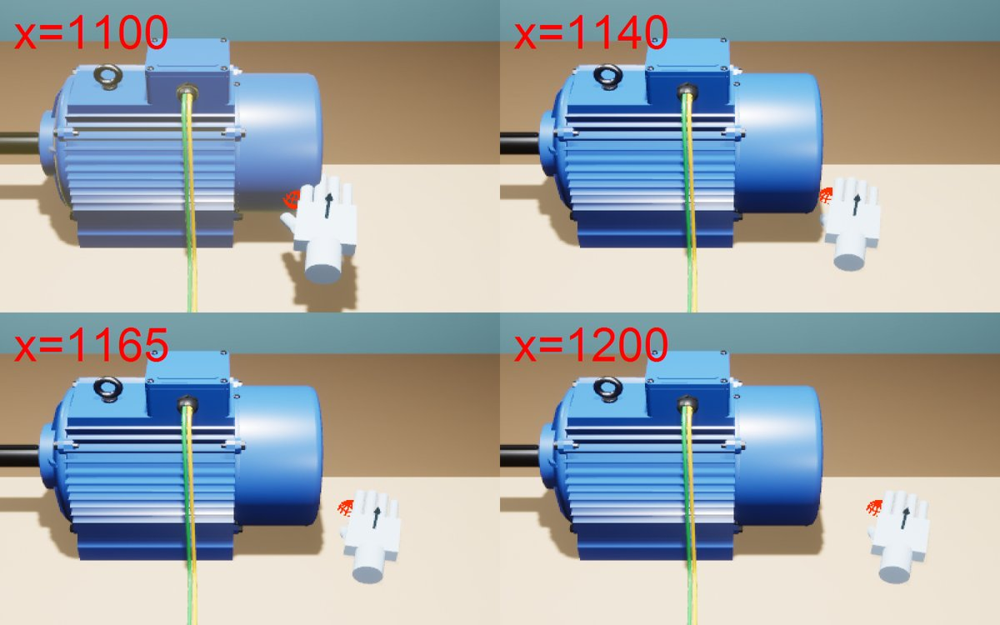

# VR 玩具箱（VRToyBox）

UE 5.8 + OpenXR 的 C++ 小工程。第一个场景：

- 一间 6m × 6m 的小工作室，你站在一张桌子前面；
- 桌上一个支架触屏，用食指戳 **SPAWN CUBE**，桌上就掉下一个随机颜色的 10cm 方块；**CLEAR ALL** 清空；
- 方块可以用手抓起来、换手、扔出去；抓的时候手掌会"贴"到方块的一个面上（抓点对齐），手指弯成握住的样子。
- 触屏下排两个按钮控制桌上的**三相电机**（ITBasics 里的 YE4-132M-4 爆炸图模型，缩放到约 0.5 米长）：**SHOW/HIDE MOTOR** 摆出 / 收起，**EXPLODE/ASSEMBLE** 在爆炸图和原始装配之间切换，零件按真实拆装顺序先后飞出。
- **零件抓取查看**：装配状态下抓电机任意位置 = 拿起整台电机；爆炸后每个零件（转子总成、端盖、风扇、螺钉……共 27 个抓取单元）都能单独抓起来看，手边浮出中文信息牌（名字、材料、作用）。松手零件自己飞回原位，拿着靠近原位 5cm 会出现半透明虚影、松手吸回去；触屏 **RESET PARTS** 一键全部复位。

房间、桌子、触屏、方块都是 C++ 用引擎自带的基础形状拼出来的，每一处改动都能在 PR 里看 diff。二进制资产只有：电机模型（`Content/Models/Motor`）和虚影 / 高亮用的半透明材质（`Content/Materials/M_ToyGhost`），由脚本生成，见下面「电机模型从哪来」；手模型（`Content/XRMannequins`），是从 UE 自带的 VR 模板拷来的，见「手的模型」。

## 怎么跑（Windows）

需要：UE 5.8（Epic 启动器安装）、Visual Studio 2022 的「使用 C++ 的游戏开发」工作负载、git。

| 双击 | 做什么 |
| --- | --- |
| `一键启动.bat` | 检查 main 更新 → 编译 C++ → 打开编辑器 |
| `一键启动_VR直玩.bat` | 检查更新 → 编译 → 不开编辑器，直接进头显 |
| `检查更新.bat` | 只检查并拉取 main 的更新 |
| `导入电机模型.bat` | 电机模型改了才需要：重新生成并导入（见下文） |

- 引擎不在 `C:\Program Files\Epic Games\UE_5.8` 的话，先设置环境变量 `UE_ROOT` 指向引擎根目录（脚本也会读 Epic 启动器写的注册表）。
- 更新脚本只在「当前在 main、没有未提交改动、本地没有 main 上没有的提交」时才 `git pull --ff-only`，其他情况只提示不动手，避免把你的改动搞乱。
- 编辑器里：Play 按钮旁的下拉菜单选 **VR Preview** 进头显；直接点 Play 是桌面调试模式。

### 操作

| | VR | 桌面调试模式（没戴头显） |
| --- | --- | --- |
| 点触屏按钮 | 食指戳 | 鼠标左键点 |
| 抓方块 | 手靠近（方块变亮）按住握把 | 鼠标指着方块按住左键 |
| 抓电机 / 零件 | 同上（零件变亮 = 会抓到它） | 同上，鼠标点中哪个零件就抓哪个 |
| 零件复位 | 松手自动飞回；或戳 RESET PARTS | 松开左键 |
| 扔 | 挥手时松开握把 | 拖动鼠标时松开左键 |
| 弯食指 | 扳机 | — |
| 转身 | 右摇杆左右，45° 一档 | 按住右键拖动 |
| 远近 | 走过去 | 滚轮 |

控制台输入 `toy.ShowGrabPoints 1` 可以在游戏里看到手和方块的抓点箭头（之后生成的方块生效）。`toy.HandPreview 1 / 2 / 3` 在桌面模式下把左手侧着摆到镜头前（张开 / 握拳 / 来回握），用来检查手模型。

## 手的模型

| 张开 | 握拳 | 抓转子 |
| --- | --- | --- |
|  |  |  |

- **来源**：UE 5.8 自带的 VR 模板里的 MannyXR 手（引擎目录 `Templates/TemplateResources/Standard/XRMannequins`，模板创建工程时挂在 `/Game/XRMannequins`）。只拷了用得到的：左右手骨骼网格、骨架、Manny 材质和贴图、4 个右手动画（Idle 张开、Grasp 握、IndexCurl 食指弯、ThumbUp 竖拇指），共 31 个文件约 14MB，放在 `Content/XRMannequins`，路径和模板一致，引用不会断。Epic 的模板内容在 UE 项目里随便用。
- **怎么驱动手指**（`AToyHand::SetupHandMesh / ApplyFingerPose`）：不用动画蓝图。开局从动画里取出每根手指骨骼的"张开"和"握拳"两个局部姿势，之后每帧按手指分组在两者之间插值：握把 → 中指、无名指、小指、拇指；扳机 → 食指；拿着东西时按抓法给最小弯曲（握 0.6、捏 = 食指 0.45 拇指 0.55 其余收起、托整机 0.25）。
  - 模板的 Grasp 其实是"指"的手势（食指伸直），所以每根骨骼在 Grasp 和 IndexCurl 里挑弯得最多的那个当"握拳"；拇指没有现成的扣下动画，用 ThumbUp（竖起）的反方向转动 × 0.8。
  - 左手：模板只有右手动画。左手网格是右手的镜像，用两只手的参考姿势比出骨骼的镜像规则（日志：`左手骨骼镜像规则 0，手指参考姿势总误差 0.0052`），右手的姿势按这个规则镜像过去。
- **网格怎么摆**：从骨骼自动算，不靠手调角度——手腕→中指根 = 手指方向，握拳时中指尖移动的方向 = 掌心方向；手掌中心放在握把姿态手背一侧 3cm（和原来基础形状的手一样），所以 GripPoint 抓点、方块和零件的贴合都不用改。
- **指尖**：食指尖（戳屏 PokeTip）和拇指尖 = 末节骨骼再沿骨骼方向延伸 0.85 节，捏合点 = 两指尖中点，每帧跟着手指弯曲更新。

## 电机模型从哪来

```
ITBasics/三相电机爆炸图/build_motor.py ──Blender──▶ motor.glb ──Tools/import_motor.py──▶ Content/Models/Motor/*.uasset
                                                    （零件 + extras 里的爆炸路线）            + parts.json（爆炸图清单）
```

- `导入电机模型.bat` 依次：找到或克隆 ITBasics（同级目录 `..\ITBasics`，或环境变量 `ITBASICS_DIR`）→ 用 Blender 跑 `build_motor.py` → 编译 → 用编辑器命令行跑 `Tools/import_motor.py`。
- 导入结果提交在仓库里，所以平时直接用，不需要装 Blender。
- **为什么要 parts.json**：glb 里每个零件的爆炸路线写在节点的 extras 里，UE 导入时不会保留这些自定义数据，所以导入脚本自己读 glb，把它换算成 UE 坐标（厘米）另存一份。
- **爆炸动画**：和 ITBasics 的 Blender 动画、网页版是同一个公式。每个零件有几段位移，每段有一个"出场时刻" s，在总进度 T 的 `[0.6s, 0.6s+0.4]` 区间里缓动走完，所以接线盒盖先飞、转子后抽出；收回时 T 倒着走，顺序自然反过来。
- **抓取单元**：导入脚本还会按爆炸路线把 84 个网格分成 28 个抓取单元，写进 parts.json 的 `units`（见下面「零件抓取」）。只改了抓点规则时用 `MOTOR_MANIFEST_ONLY=1` 只重写 parts.json，不重新导入资产。
- **大小**：运行时按装配状态的最长边缩放到 50cm（`AToyStudio::MotorLengthCm`）。注意 YE4-132M 实物本身就接近半米长，所以这其实接近 1:1，不是放大；想要更大改这个数就行。

## 原理

### 先猜一下

> 抓起方块时，如果只把方块的**中心**挪到手心（不管旋转），会看到什么？
>
> A. 和现在一样，手掌贴着一个面
> B. 方块保持被抓前的歪斜角度，手掌可能插进方块里、或者只碰到一个角
> C. 方块会自动转正

<details><summary>答案</summary>

**B**。只对齐位置，旋转就是方块原来的样子，而手的朝向是任意的，所以手掌和方块表面一般不平行；方块中心离手心又只有 5cm，手掌模型就会穿进去。要"贴面"，就得同时对齐**位置和朝向**，这正是抓点要做的事。
</details>

### 抓点对齐（`AToyCube::ComputeHoldTransform`）

手和方块用同一个约定的坐标系来描述"接触点"：

- **手的 GripPoint**：在掌心表面，X 轴从掌心指向手背，Z 轴指向手指。
- **方块的 GrabPoint_0..5**：六个面中心各一个，X 轴 = 该面外法线（从方块指向外面），Z 轴 = 一个切线方向。

当手掌贴着某个面时，这两个坐标系应该**完全重合**。所以抓取 = 三步：

1. **选面**：每个面的外法线和手的 X 轴点积越大（越正对手掌）、离手越近，分越高。
2. **选摆法**：方块绕法线转 90° 看起来一样，所以 4 种摆法里挑 Z 轴最贴合手指方向的那种——方块被抓起时转动最少，不会突然甩一下。
3. **算变换**：要 `抓点世界变换 = 手抓点世界变换`。抓点在方块里的相对变换是 `G`，所以 `G × 方块 = 手抓点`，即 `方块相对手抓点 = G⁻¹`。把方块挂到 GripPoint 上，在 0.08 秒内从原位置插值到 `G⁻¹`。

这个思路和 UE 的 VR 模板、Meta/SteamVR 的 SDK 里 "snap grab + 抓点" 是同一类做法（**主流做法**）。它的前提：

- **物体形状规则**。方块六面对称，所以选面 + 4 种摆法就覆盖了所有握法。杯子、枪这类不对称物体一般只放一两个手工摆好的抓点，或者干脆用"保持抓起瞬间相对位置"的自由抓取。
- **手是硬的**。手指只是按握把值弯到固定角度，不会根据物体表面做碰撞贴合（那是 hand IK / 物理手的范畴）。

### 另外两种抓法，供比较

| 做法 | 体验 | 代价 |
| --- | --- | --- |
| **抓点吸附（本项目，主流）** | 手总是"标准地"握着物体，视觉稳定 | 物体会被吸到手里，离得远时有一点跳 |
| 自由抓取：记住抓起瞬间的相对变换 | 抓哪里就是哪里，零跳变 | 手模型经常穿进物体，看起来不像握住 |
| 物理手：手是刚体，用约束拉物体 | 能推、能捏、能碰撞 | 复杂很多，容易抖，调参难 |

### 零件抓取（`AToyPartUnit`、`IToyGrabbable`）

| 装配 | 爆炸后抓转子 | 拿回原位附近出现虚影 |
| --- | --- | --- |
|  |  |  |

**1. 抓的是"单元"，不是网格。** 84 个网格里有 28 根导条、18 个线圈、十几颗螺钉，一个个抓没意义。爆炸路线完全相同的零件本来就一起动，按路线分组就是天然的单元：转子总成（轴 + 铁芯 + 鼠笼 + 两个轴承）、端盖、风扇、风罩、接线盒（含接线板、电源线）、盒盖……；只有螺钉这种"路线相同但各在各位置"的紧固件一颗一颗分开。定子 + 机座是基座，不能抓。每个单元是一个 `AToyPartUnit` Actor，挂在模型上，位置由爆炸进度决定。

**2. 装配 / 爆炸两种状态。** 完全装配时只开整机的检测盒（抓哪都 = 拿起整台电机，自由抓取：抓哪里就保持哪里）；完全爆炸后只开各单元的检测盒；动画进行中都不能抓。检测盒只做查询、不参与物理，所以方块会直接穿过电机。

**3. 抓点按形状自动生成**（`Tools/import_motor.py` 的 `grab_spec`，C++ 在 `AToyPartUnit::ComputeHoldTransform`）：

| 类型 | 用在 | 怎么贴合 |
| --- | --- | --- |
| `cylinder` 圆柱面 | 绕电机轴的回转体：端盖、风扇、风罩、波形垫圈；转子 = 两段轴（Φ38）+ 中间铁芯外圆 | 手掌贴圆柱面，绕轴的角度取"手背朝向在垂直于轴的平面上的投影"（绕轴转零件看不出来，这一步免费），沿轴的位置取手的投影；手指方向在 ±切线（握住一根轴）和 ±轴向（扶着端盖外缘）四种里挑和现在手指最一致的 |
| `box` 包围盒的面 | 接线盒、盒盖 | 和方块的 6 个抓点同一套规则（选最正对手掌的面 + 4 种摆法） |
| `pinch` 捏 | 最长边 ≤ 7cm 的小件：螺钉、平键、吊环、卡簧、V 形密封圈 | 朝向保持抓起瞬间的样子，只把零件中心挪到拇指和食指之间；手势变成食指半弯、其余三指收起 |

**判定只看拇指和食指之间。** 判定点 = 拇指指尖和食指指尖的中点（"捏合点"，随手指弯曲实时变化），半径 `AToyHand::GrabRadius` = 2cm，量的是到物体碰撞表面的距离（不是到中心）。手掌、手背碰到不算；方块、零件、整机都用这一套。好几个都在 2cm 内时取表面最近的（完全一样近才挑小的）。检测盒不再给小件放大，只给 0.1cm 厚的垫圈留 0.3cm 的最小厚度。桌面模式里手被摆成"捏合点落在鼠标点中的位置"，鼠标射线按三角形打零件网格本身，点中哪个就抓哪个。控制台 `toy.ShowGrabPoints 1` 会在捏合点画一个 2cm 的橙色球。



判定只决定"抓哪个"；抓起后的贴合（回转体贴外圆、面贴合、小件捏）照旧，所以用指尖碰到大零件后，零件会滑到掌心里。

**4. 复位。** 松手后 0.4 秒飞回原位（目标每帧重新算，路上切换爆炸 / 装配也能飞到新位置）；拿着靠近原位 5cm 以内，原位显示半透明虚影，这时松手 0.12 秒吸进去。整机松手飞回桌上的支架。触屏 RESET PARTS = 所有手松开，全部飞回去。

**5. 信息牌。** 手边一块 `UWidgetComponent`，里面直接放 Slate 文字（不需要 UMG 蓝图资产）。UE 自带的 3D 文字（TextRender）没有中文字形，Slate 的默认字体有中文后备字形，所以用它。不受光照的 UI 在自动曝光下会很暗（颜色 1 ≈ 1 尼特，房间几十尼特），所以信息牌、虚影、高亮都乘了 12 倍亮度。

和其他做法比：物理手（Half-Life: Alyx、Boneworks）零件有重力会掉，看零件不方便；纯自由抓取零配置但手会穿进零件；维修培训类软件普遍是"悬浮 + 松手回位 + 虚影吸附"，这里就是借的这套，第二阶段的"按顺序拆装"可以直接复用虚影和吸附。

### 触屏怎么"点"

每个按钮前面有一个看不见的触发盒（`AToyTouchScreen::MakeButton`）。手每帧在食指指尖做一次小球重叠查询，**刚进入**触发盒的那一帧算一次点击，再加 0.35 秒冷却，防止手指抖一下触发两次。按钮按下时变白、往里缩 0.5cm，控制器震一下。

### 手柄输入

OpenXR 只会给"项目里用到的按键"向运行时申请绑定，所以 `Config/DefaultInput.ini` 里写了一组轴映射（Quest / Index / WMR / Vive 的握把、扳机、摇杆），Pawn 每帧直接读这些键的值，同一动作在不同头显上取最大值。

## 假设与可能失效的地方

证据分级：✅ 实测 / ⚠️ 未验证。2026-10-20 在 UE 5.8 + VS 2026（MSVC 14.50）上编译通过，并用 `-game -windowed`（不带头显）跑过桌面模式；VR 部分还没测。

- ✅ **编译**：0 警告。注意 UE 5.8 里 `HeadMountedDisplayFunctionLibrary.h` 挪进了 XRBase 插件，所以 Build.cs 依赖 `XRBase`。
- ✅ **桌面模式**：点 SPAWN CUBE 生成方块、计数刷新，左键抓起拖动、松开落下，CLEAR ALL 清空。
- ✅ **画面亮度**：没有 `r.DefaultFeature.AutoExposure.ExtendDefaultLuminanceRange=True` 时整个画面严重过曝，已写进 DefaultEngine.ini。
- ✅ **出生点**：Entry 地图自带一个 PlayerStart，会让人出生在工作室外面（黑屏），所以 GameMode 总是让玩家出生在工作室原点。
- ⚠️ **手柄没反应**：如果 UE 5.8 的 OpenXR 不再读旧式轴映射（`DefaultInput.ini`），握把和扳机会全是 0。症状是 VR 里手跟着动、但抓不起来。解决方向是改成 Enhanced Input 的 IMC 资产（要在编辑器里建，没法纯文本）。
- ✅ **MannyXR 手（桌面模式）**：左右手都加载成功，张开 / 握拳 / 拇指扣下都对（`toy.HandPreview` 截图）；右手抓方块、转子，捏螺栓照常，判定和贴合没变。
- ⚠️ **手的朝向**：手模型按"握把姿态 X 轴向前、Y 轴向右、掌心朝 -Y"摆的，不同手柄的握把姿态略有差别，手可能看起来偏一点、或者手柄和手掌对不上。调 `ToyHand.cpp` 顶部的 `PalmY`，或者在 `SetupHandMesh` 末尾给 `HandMesh` 加一点旋转。
- ⚠️ **手指和物体会互相穿插**：手指只是在两个固定姿势之间插值，不会贴着物体表面停下（那要做手指 IK / 物理手）；握 10cm 方块时手指会插进方块一点。
- ⚠️ **打包**：手的网格和动画在构造函数里用 ConstructorHelpers 硬引用，打包时会被带上；没实际打包验证过。
- ⚠️ **文字朝向**：屏幕上的英文如果是镜像的，把文字组件转 180°。用英文是因为 TextRender 的默认字体没有中文字形（✅ 已知限制）。
- ✅ **基础材质的 `Color` 参数**：5.8 里照常生效，各部件和随机色方块颜色都对。
- ⚠️ **VR 手感和帧率**：没法戴头显测，伸手够不够得着触屏、方块大小合不合适，都需要你戴上试。桌子近边离站立点 40cm，触屏在右前方约 80cm。
- ✅ **零件抓取（桌面模式，鼠标）**：装配时抓整机 → 信息牌显示中文 → 松手飞回支架；爆炸后抓转子、端盖、风罩、螺钉（捏）、接线盒，松手飞回；拿着风罩靠近原位出现虚影、松手吸回（日志 `ToyBox: P21_FanCover 松手，离原位 0.4 cm …，吸回`）；方块抓取照常。
- ✅ **捏合点判定（桌面模式）**：指尖在电机上时高亮，离开电机表面几厘米就不亮（以前 9cm 的手掌球会亮）；转子、螺钉、方块都能用指尖抓起；点电机旁边的桌面抓不到东西。
- ⚠️ **VR 里 2cm 会不会太严**：手柄追踪有毫米级抖动、看不到自己指尖的真实位置时，2cm 可能偏小，戴头显后觉得难抓就调大 `GrabRadius`。
- ✅ **中文信息牌**：Slate 默认字体在 `-game` 下能显示中文。⚠️ 打包成独立游戏后这个后备字体是否还在没验证；不在的话要导入一个中文字体资产。
- ⚠️ **VR 里的抓点手感**：桌面模式的手永远掌心朝下、手指沿视线，所以抓起时零件会转向镜头一点；VR 里手的朝向是真实的，贴合效果要戴头显看。螺钉捏起来会被手挡住，看不清（可以考虑捏小件时把零件放大或把牌子上加图）。
- ⚠️ **RESET PARTS 拿着零件时按**：桌面模式只有一只手（左键就是抓），没法边拿边按；VR 里另一只手戳 RESET 的情况没测。
- ⚠️ **零件之间会互相穿过**（没有碰撞），拿着转子可以直接穿过机座；目前只是查看，所以没处理。
- 桌面模式下鼠标没指着东西时，手会悬在半空，只影响调试，没处理。
- 编辑器打开的是引擎自带的空地图 `/Engine/Maps/Entry`，所以**编辑器视口里是空的**，按 Play 才会生成工作室。想在编辑器里看到：建一个新关卡，把 `ToyStudio` 从放置面板拖进去。

## 代码地图

| 文件 | 内容 |
| --- | --- |
| `ToyBoxGameMode` | 没有工作室就生成一个，玩家站在它的原点 |
| `ToyStudio` | 房间、桌子、灯；生成/清空方块 |
| `ToyTouchScreen` | 支架触屏和按钮 |
| `ToyCube` | 可抓方块和 6 个抓点，抓点对齐的数学 |
| `ToyExplodedModel` | 读 parts.json、生成抓取单元，原始 / 爆炸切换动画，整机抓取，虚影 / 高亮 / 复位 |
| `ToyPartUnit` | 一个抓取单元：圆柱面 / 包围盒 / 捏 三种抓点，松手飞回原位，磁吸 |
| `ToyGrabbable` | 可抓物体的接口（方块、零件、整机都实现它） |
| `Tools/import_motor.py` | glb → UE 资产 + parts.json（含抓取单元和抓点） |
| `Tools/create_toy_materials.py` | 建虚影 / 高亮用的半透明材质 `M_ToyGhost` |
| `ToyHand` | MannyXR 手模型和手指弯曲（握 / 捏 / 托）、抓/放/扔、戳按钮、信息牌 |
| `ToyBoxPawn` | 头显、控制器、输入、转身、桌面调试模式 |
| `ToyShapeComponent` | "基础形状 + 颜色"，整个场景的积木 |
